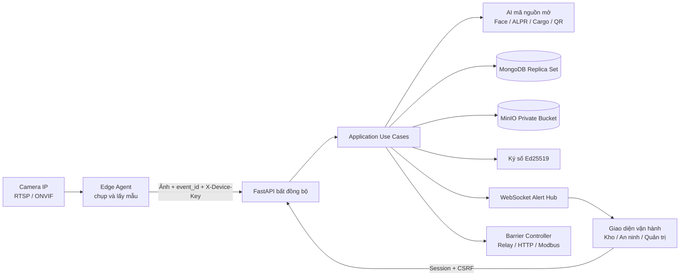
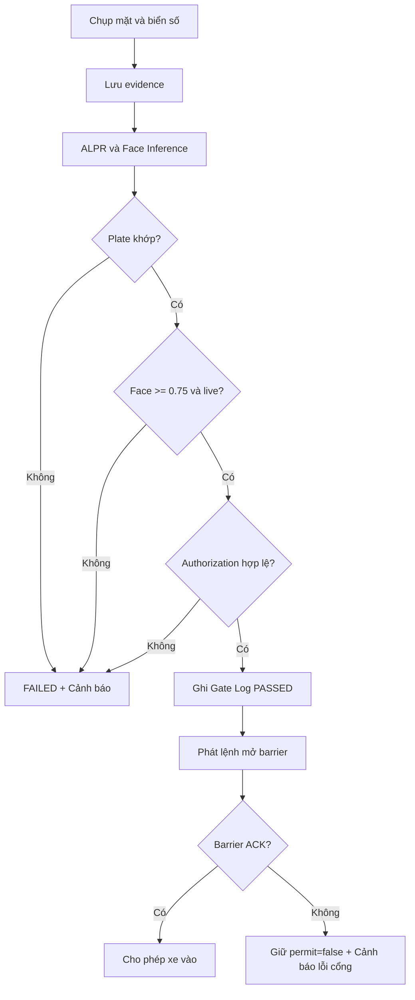

# EV Smart Gate — Hệ thống xác minh cổng và kho hàng bằng AI

> Nền tảng tự động hóa quy trình xe ra/vào và xuất hàng bằng **Face Recognition**, **ALPR**, giám sát hàng hóa, phiếu xuất kho QR ký số, FastAPI, MongoDB và WebSockets.

EV Smart Gate kết hợp camera AI tại cổng, camera tại kho và dữ liệu đăng ký nội bộ để xác minh đúng **tài xế — phương tiện — lệnh xuất kho** trước khi phát lệnh mở barrier. Hệ thống được thiết kế theo nguyên tắc **fail-closed**: nếu AI, lưu trữ, cơ sở dữ liệu, chữ ký số hoặc thiết bị barrier gặp lỗi, cổng vẫn đóng và nhân viên an ninh nhận cảnh báo thời gian thực.

## Mục lục

1. [Tổng quan hệ thống](#1-tổng-quan-hệ-thống)
2. [Dự toán và so sánh hạ tầng triển khai](#2-dự-toán-và-so-sánh-hạ-tầng-triển-khai)
3. [Luồng nghiệp vụ hệ thống](#3-luồng-nghiệp-vụ-hệ-thống)
4. [Kịch bản demo cho khách hàng](#4-kịch-bản-demo-cho-khách-hàng)
5. [Hướng dẫn cài đặt và chạy nhanh](#5-hướng-dẫn-cài-đặt-và-chạy-nhanh)
6. [Giao diện và API chính](#6-giao-diện-và-api-chính)
7. [Bảo mật và nguyên tắc an toàn](#7-bảo-mật-và-nguyên-tắc-an-toàn)
8. [Kiểm thử và tiêu chuẩn chất lượng](#8-kiểm-thử-và-tiêu-chuẩn-chất-lượng)
9. [Vận hành và xử lý sự cố](#9-vận-hành-và-xử-lý-sự-cố)

---

## 1. Tổng quan hệ thống

### 1.1. Mục tiêu

Hệ thống giải quyết ba bài toán vận hành chính:

- **Cổng vào:** nhận diện khuôn mặt tài xế, đọc biển số và kiểm tra quan hệ tài xế–xe đã được ủy quyền.
- **Kho hàng:** ghi nhận diễn biến xếp hàng, yêu cầu nhân viên kho xác nhận và phát hành phiếu xuất kho điện tử.
- **Cổng ra:** đối soát ba bên giữa khuôn mặt trực tiếp, biển số trực tiếp, QR ký số và lệnh xuất kho trong cơ sở dữ liệu.

### 1.2. Năng lực nổi bật

| Năng lực | Cách triển khai |
|---|---|
| Nhận diện tài xế | Trích xuất face embedding, chuẩn hóa L2 và so sánh bằng Cosine Similarity với ngưỡng mặc định `0.75` |
| Nhận diện phương tiện | FastALPR/PaddleOCR; ưu tiên exact match, fuzzy match được giới hạn chặt để tránh nhận nhầm |
| Chống giả mạo | Hỗ trợ liveness detection; ảnh không đạt chất lượng hoặc nghi spoof bị từ chối |
| Kiểm tra ủy quyền | Tài xế và phương tiện phải thuộc cùng quan hệ ủy quyền còn hiệu lực |
| Giám sát kho | YOLOX/OpenCV hoặc adapter YOLOv8 ghi nhận object, confidence và Bounding Box |
| Phiếu xuất kho | QR chứa JWS ký bằng Ed25519; có bản PNG, HTML và PDF để in |
| Cảnh báo thời gian thực | WebSocket có sequence, dedupe và REST resync khi client kết nối lại |
| Điều khiển barrier | Chỉ Application Use Case được phát lệnh; kết quả chỉ được cấp phép sau barrier ACK |
| Chống xử lý lặp | `event_id` và command idempotency ngăn retry mở cổng nhiều lần |
| Bảo vệ dữ liệu | Embedding và evidence được mã hóa AES-256-GCM; MinIO bucket ở chế độ private |

### 1.3. Kiến trúc tổng thể



Luồng phụ thuộc tuân theo Clean Architecture:

```text
Presentation -> Application -> Domain <- Infrastructure
```

- **Domain** chứa entity, enum, domain service và Protocol thuần Python.
- **Application** điều phối từng use case độc lập, không phụ thuộc FastAPI hoặc Beanie.
- **Infrastructure** hiện thực MongoDB, MinIO, AI, ký số, WebSocket và barrier adapter.
- **Presentation** chuyển HTTP/WebSocket thành DTO; router không chứa quyết định nghiệp vụ.
- **Bootstrap** là composition root duy nhất lựa chọn adapter và inject dependency.

### 1.4. Công nghệ sử dụng

| Lớp | Công nghệ |
|---|---|
| Backend | Python 3.11, FastAPI, Uvicorn, endpoint bất đồng bộ |
| Cơ sở dữ liệu | MongoDB replica set, Beanie ODM, PyMongo Async |
| Object Storage | MinIO private bucket |
| Face Recognition | YuNet + SFace; tùy chọn DeepFace |
| License Plate Recognition | FastALPR, PaddleOCR |
| Cargo Monitoring | YOLOX + OpenCV; tùy chọn YOLOv8 |
| QR/Barcode | PyZbar, OpenCV và QR JWS Ed25519 |
| Realtime | FastAPI WebSockets và REST resync |
| Bảo mật | Argon2, AES-256-GCM, HMAC-SHA256, Ed25519, CSRF |
| Đóng gói | Docker, Docker Compose |
| Giao diện | SPA JavaScript thuần, chạy cùng origin với FastAPI |

Toàn bộ workflow cốt lõi có thể chạy bằng model mã nguồn mở mà không cần API AI trả phí. Ở phương án cloud, doanh nghiệp có thể tự host các model này trên Cloud GPU; dịch vụ AI thương mại chỉ là lựa chọn thay thế.

### 1.5. Cấu trúc mã nguồn

```text
ev-smart-gate/
├── src/
│   ├── smart_gate/
│   │   ├── domain/              # Entity, enum, service và Protocol
│   │   ├── application/         # DTO và use case nghiệp vụ
│   │   ├── infrastructure/      # MongoDB, MinIO, AI, ký số, barrier, realtime
│   │   ├── presentation/        # FastAPI, schema, WebSocket và SPA
│   │   ├── bootstrap/           # Composition root và lifecycle
│   │   └── main.py              # Điểm khởi tạo ứng dụng
│   └── edge_agent/              # Chụp RTSP/HTTP và gửi yêu cầu xác minh
├── simulators/                  # Giả lập camera, barrier và toàn workflow
├── models/                      # Manifest, checksum, giấy phép và script tải model
├── tests/                       # Unit, contract, integration và end-to-end
├── docs/                        # HLD, ERD, RTM và hướng dẫn tích hợp
├── openspec/                    # Đặc tả hành vi và kịch bản nghiệp vụ
├── Dockerfile
└── docker-compose.yml
```

---

## 2. Dự toán và so sánh hạ tầng triển khai

### 2.1. Cơ sở lập dự toán

Các số liệu dưới đây là **ước tính định hướng ngân sách theo mặt bằng tham khảo tại Việt Nam tháng 08/2026**, không phải báo giá thương mại. Giá thực tế phụ thuộc hãng camera, điều kiện thi công, thời gian lưu dữ liệu, SLA và nhà cung cấp hạ tầng.

| Giả định | Giá trị tham chiếu |
|---|---|
| Quy mô | 01 cổng vào, 01 cổng ra, 01 khu vực xuất hàng |
| Camera | 06 camera IP: 02 camera mặt, 02 camera biển số, 02 camera dock |
| Lưu lượng | 250 lượt xe/ngày, hoạt động 30 ngày/tháng |
| Dữ liệu AI | Khoảng 7–11 ảnh/sự kiện xe, không tính lưu video liên tục |
| Thời gian lưu evidence | 30 ngày; thời gian dài hơn cần tính thêm storage |
| Đơn vị chi phí | Triệu VNĐ, chưa gồm VAT |
| Hạng mục chưa mặc định | Cơ khí barrier mới, nhà trạm, kéo điện xa và đường truyền chuyên dụng |

> Nếu cần lắp mới barrier cơ khí, ngân sách tham khảo thường cộng thêm khoảng **25–80 triệu VNĐ/làn**, tùy chiều dài cần, tốc độ đóng mở và cấp độ công nghiệp.

### 2.2. Phương án 1: AI On-Premise / Local Edge Server

**Khuyến nghị cho môi trường sản xuất cần bảo mật dữ liệu, độ trễ thấp và vẫn vận hành khi mất Internet.**

#### Cấu hình phần cứng khuyến nghị

| Hạng mục | Cấu hình tối thiểu | Cấu hình khuyến nghị |
|---|---|---|
| CPU | Intel Core i7 thế hệ 12 hoặc AMD Ryzen 7 tương đương | Intel Core i7-13700/14700, AMD Ryzen 7 7700 hoặc CPU workstation tương đương |
| GPU | NVIDIA RTX 3060 12 GB | NVIDIA RTX 4070 12 GB; tăng lên RTX 4080 khi có nhiều làn hoặc nhiều stream đồng thời |
| RAM | 32 GB | 64 GB ECC nếu dùng workstation/server hỗ trợ |
| Lưu trữ hệ thống | NVMe 1 TB | NVMe 1 TB cho hệ điều hành và model |
| Lưu trữ evidence | SSD/HDD 2 TB | 2 × 4 TB RAID 1 hoặc NAS nội bộ theo retention policy |
| Hệ điều hành | Ubuntu Server 22.04/24.04 LTS | Ubuntu Server LTS, Docker Engine và NVIDIA Container Toolkit |
| Camera cổng | IP camera RTSP/ONVIF, PoE, WDR, IR | Camera 4–8 MP, WDR tốt; camera LPR có shutter nhanh và ống kính phù hợp góc cổng |
| Mạng | PoE Switch Gigabit | PoE Switch quản lý được, VLAN tách camera, firewall và NTP nội bộ |
| Barrier I/O | Relay cách ly hoặc HTTP controller | Industrial I/O, Modbus TCP/RTU hoặc controller có ACK và trạng thái cảm biến |
| Nguồn dự phòng | UPS cơ bản | UPS online cho server, switch và controller barrier |

#### Chi phí đầu tư ban đầu dự kiến

| Hạng mục | Khoảng chi phí |
|---|---:|
| Edge Server/Workstation có RTX 3060/4070 | 42–78 triệu |
| 06 camera IP và phụ kiện lắp đặt | 24–60 triệu |
| Barrier controller, relay cách ly và cảm biến tích hợp | 8–20 triệu |
| PoE Switch, firewall/router, VLAN và cáp mạng | 12–30 triệu |
| UPS, ổ lưu trữ hoặc thiết bị backup tại chỗ | 8–22 triệu |
| Lắp đặt, căn chỉnh góc camera và hiệu chuẩn AI | 12–30 triệu |
| **Tổng CAPEX tham khảo** | **106–240 triệu** |

#### Chi phí vận hành hàng tháng dự kiến

| Hạng mục | Khoảng chi phí/tháng |
|---|---:|
| Điện cho server, camera, switch và UPS | 1,0–2,5 triệu |
| Bảo trì, vệ sinh camera và hiệu chuẩn định kỳ | 1,5–5,0 triệu |
| Backup ngoại vi, giám sát và kết nối Internet | 0,5–2,5 triệu |
| **Tổng OPEX tham khảo** | **3–10 triệu/tháng** |

#### Ưu điểm

- Độ trễ suy luận thấp, thường khoảng **80–350 ms** sau khi frame đã được chụp đúng chất lượng.
- Ảnh khuôn mặt, biển số và hàng hóa không bắt buộc rời khỏi mạng nội bộ.
- Gate In/Gate Out có thể tiếp tục hoạt động khi mất Internet nếu MongoDB, MinIO và barrier đều ở local.
- Chi phí dài hạn ổn định, không tăng tuyến tính theo số lượt gọi AI API.
- Chủ động khóa phiên bản model, checksum và lịch nâng cấp.

#### Hạn chế

- CAPEX ban đầu cao hơn và cần đội ngũ quản trị server/GPU.
- Cần thiết kế HA, backup và thiết bị dự phòng nếu yêu cầu SLA cao.
- Mở rộng nhiều site đòi hỏi quy trình quản lý cấu hình, model và giám sát tập trung.
- GPU có vòng đời phần cứng và cần dự toán thay thế sau khoảng 3–5 năm.

### 2.3. Phương án 2: AI Cloud API / Cloud GPU

**Phù hợp với MVP, thử nghiệm nhiều điểm hoặc mô hình Pay-as-you-go có lưu lượng ban đầu thấp.** Hệ thống vẫn ưu tiên chạy model mã nguồn mở trên Cloud GPU; dịch vụ AI thương mại là lựa chọn bổ sung và phải được đánh giá riêng về dữ liệu, giấy phép và tuân thủ.

#### Hạ tầng cần thiết

| Hạng mục | Cấu hình đề xuất |
|---|---|
| Local Gateway | Mini-PC Intel N100/Core i5, RAM 16 GB, SSD 512 GB, 2 cổng mạng nếu cần tách VLAN |
| Camera | Camera IP RTSP/ONVIF tương tự phương án On-Premise |
| Kết nối | Internet ổn định, nên có 02 đường truyền hoặc 4G/5G failover |
| Cloud Application | FastAPI container trên VM/Kubernetes/Container Service |
| Cloud Database | MongoDB managed hoặc MongoDB replica set tự quản trị |
| Object Storage | S3-compatible storage hoặc MinIO trên cloud |
| AI Inference | Serverless GPU, GPU VM theo lịch hoặc dịch vụ AI tính theo request |
| Barrier | Local relay/controller; lệnh cloud phải có timeout, ACK và cơ chế giữ cổng đóng khi mất mạng |

#### Chi phí đầu tư ban đầu dự kiến

| Hạng mục | Khoảng chi phí |
|---|---:|
| Mini-PC/Local Gateway | 8–18 triệu |
| 06 camera IP và phụ kiện lắp đặt | 24–60 triệu |
| Barrier controller, relay cách ly và cảm biến | 8–20 triệu |
| PoE Switch, router dual-WAN, UPS và cáp mạng | 10–25 triệu |
| Thiết lập cloud, VPN và hiệu chuẩn AI | 10–25 triệu |
| **Tổng CAPEX tham khảo** | **60–148 triệu** |

#### Ước tính lưu lượng và chi phí hàng tháng

Với 250 xe/ngày và 7–11 ảnh cần xử lý cho mỗi chu trình, tải tham chiếu là:

```text
250 xe × 30 ngày × 7–11 ảnh = 52.500–82.500 lượt suy luận/tháng
```

| Hạng mục | Khoảng chi phí/tháng |
|---|---:|
| Application Compute/API | 1,5–5 triệu |
| MongoDB, Object Storage và backup | 1,5–6 triệu |
| AI API hoặc Serverless GPU — phương án A | 3–18 triệu |
| Dedicated Cloud GPU — phương án B, thay cho phương án A | 8–25 triệu |
| Băng thông, VPN và egress | 0,5–4 triệu |
| Log, monitoring và cảnh báo | 0,5–3 triệu |
| Vận hành và hỗ trợ | 1–5 triệu |
| **Tổng OPEX tham khảo** | **8–48 triệu/tháng** |

Chi phí thực tế nên được tính lại theo công thức:

```text
OPEX = chi phí nền tảng
     + số lượt Face × đơn giá Face
     + số lượt ALPR × đơn giá ALPR
     + số giờ GPU × đơn giá GPU
     + dung lượng lưu trữ, backup và egress
```

#### Ưu điểm

- Khởi động nhanh, giảm đầu tư GPU tại từng site.
- Dễ scale-out theo số điểm triển khai và lưu lượng theo mùa.
- Dễ tích hợp giám sát, backup đa vùng và quản trị tập trung.
- Phù hợp PoC/MVP khi chưa chắc chắn về lưu lượng dài hạn.

#### Hạn chế

- Phụ thuộc chất lượng Internet; latency thường khoảng **350 ms–2 giây** hoặc cao hơn khi mạng không ổn định.
- OPEX tăng theo request, GPU hour, storage và egress.
- Dữ liệu sinh trắc học rời site, làm tăng yêu cầu mã hóa, kiểm soát truy cập và tuân thủ.
- Mất mạng có thể dừng quy trình nếu Local Gateway không có cache và chính sách offline phù hợp.
- Dịch vụ AI bên thứ ba có rủi ro thay đổi giá, quota hoặc API contract.

### 2.4. Bảng so sánh tổng hợp

| Tiêu chí | AI On-Premise / Local Edge | AI Cloud API / Cloud GPU |
|---|---|---|
| Phần cứng chính | Server có RTX 3060/4070 tại site | Mini-PC tại site và tài nguyên cloud |
| CAPEX tham khảo | 106–240 triệu | 60–148 triệu |
| OPEX tham khảo | 3–10 triệu/tháng | 8–48 triệu/tháng |
| Độ trễ | 80–350 ms | 350 ms–2 giây, phụ thuộc mạng |
| Hoạt động khi mất Internet | Có thể duy trì toàn bộ tại local | Bị hạn chế nếu không có offline fallback |
| Riêng tư dữ liệu | Cao; dữ liệu giữ trong site | Cần truyền dữ liệu ra cloud |
| Mở rộng nhiều site | Cần thêm edge server và quản trị fleet | Scale nhanh bằng tài nguyên cloud |
| Chi phí khi lưu lượng tăng | Tương đối ổn định đến giới hạn GPU | Tăng theo request/GPU/storage |
| Bảo trì | Do doanh nghiệp hoặc đối tác tại chỗ | Chia sẻ với cloud provider |
| Trường hợp phù hợp | Nhà máy, kho, cảng, dữ liệu nhạy cảm, vận hành 24/7 | MVP, PoC, nhiều site nhỏ, lưu lượng chưa ổn định |

### 2.5. Khuyến nghị kiến trúc

- **Giai đoạn PoC/MVP:** dùng simulator hoặc cloud để xác nhận quy trình, KPI và chất lượng camera.
- **Giai đoạn pilot tại một site:** dùng Local Edge Server cho AI và barrier; có thể đẩy metadata, dashboard và backup đã mã hóa lên cloud.
- **Giai đoạn production đa site:** chọn mô hình hybrid — suy luận và quyết định an toàn tại edge, quản trị cấu hình và báo cáo tập trung trên cloud.
- Thực hiện khảo sát hiện trường trước khi chốt cấu hình: tốc độ xe, khoảng cách camera, ánh sáng ngược, biển số bẩn, vị trí tài xế và thời gian lưu evidence ảnh hưởng trực tiếp đến chi phí.

---

## 3. Luồng nghiệp vụ hệ thống

### 3.1. Luồng Cổng Vào — Entry Check-in

1. Edge Agent chụp ảnh khuôn mặt và biển số từ camera Gate In, gắn `event_id` duy nhất.
2. API lưu ảnh evidence vào MinIO private; nếu lưu trữ lỗi, quy trình dừng và cổng giữ đóng.
3. ALPR chuẩn hóa ký tự biển số và tìm phương tiện đăng ký:
   - Ưu tiên exact match.
   - Fuzzy match chỉ hợp lệ khi cùng độ dài, hai số tỉnh đầu trùng, Levenshtein không quá 1, RapidFuzz tối thiểu 90 và không có candidate đồng hạng.
4. Face model kiểm tra chất lượng/liveness, trích xuất embedding đã chuẩn hóa L2.
5. Hệ thống so Cosine Similarity với embedding đăng ký; mặc định yêu cầu `similarity >= 0.75`.
6. Hệ thống xác nhận tài xế và phương tiện thuộc cùng authorization còn hiệu lực.
7. Nếu mọi điều kiện đạt, Gate Log được ghi `PASSED` và hệ thống phát gate command idempotent.
8. Chỉ khi barrier trả ACK, API mới trả `permit_granted=true`. Mọi mismatch hoặc lỗi thiết bị tạo Gate Log `FAILED`, giữ cổng đóng và phát WebSocket alert.



### 3.2. Luồng Tại Kho — Warehouse Inspection & Exit Slip

1. Nhân viên kho tạo Warehouse Exit Order và gán đúng `driver_id`, `vehicle_id`, cargo metadata và thời hạn.
2. Dock session chỉ được bắt đầu khi có Gate In log `PASSED` của đúng cặp tài xế–xe.
3. Camera dock gửi các capture; AI ghi nhận object, số lượng, confidence, Bounding Box và cargo state.
4. Timeline hàng hóa có thể gồm `EMPTY`, `LOADING`, `LOADED`, `ANOMALY` hoặc `UNKNOWN`.
5. AI chỉ cung cấp quan sát; nhân viên kho phải kiểm tra và finalize trạng thái `LOADED`.
6. Order chuyển theo chuỗi trạng thái:

```text
PENDING -> LOADING -> READY_FOR_EXIT -> SLIP_ISSUED -> COMPLETED
```

7. Khi order ở `READY_FOR_EXIT`, hệ thống phát hành Exit Slip gồm QR PNG, HTML và PDF.
8. QR chứa JWS Ed25519 với `order_id`, `vehicle_id`, `driver_id`, `slip_version`, `jti`, `iat`, `exp` và `kid`.
9. Thời hạn token là thời điểm sớm hơn giữa `order.valid_until` và 8 giờ. Reissue tăng `slip_version` và vô hiệu phiếu cũ.

### 3.3. Luồng Cổng Ra — Exit Check-out & 3-Way Matching

Điều kiện cho phép rời bãi:

```text
Dữ liệu QR đã ký
    = Tài xế và phương tiện trực tiếp tại Gate Out
    = Lệnh xuất kho nội bộ trong MongoDB
```

1. Gate Out chụp khuôn mặt, biển số và quét ảnh QR Exit Slip.
2. Hệ thống xác minh chữ ký Ed25519, `kid`, issuer/audience, thời hạn, `jti` và `slip_version`.
3. Order phải tồn tại và ở trạng thái `SLIP_ISSUED`.
4. Face trực tiếp phải khớp chính xác `assigned_driver_id`.
5. Plate trực tiếp phải resolve về chính xác `assigned_vehicle_id`.
6. Nếu một điều kiện sai, hệ thống ghi `FAILED`, giữ order nguyên trạng, giữ barrier đóng và phát cảnh báo `CRITICAL`.
7. Nếu ba chiều đều đúng, hệ thống ghi Gate Log `PASSED` và phát gate command.
8. Order chỉ chuyển sang `COMPLETED` sau barrier ACK. Timeout hoặc lỗi barrier không được phép hoàn tất order.

### 3.4. Trạng thái khi có lỗi

| Tình huống | Hành vi an toàn |
|---|---|
| AI model không tải hoặc inference lỗi | `FAILED`, barrier đóng, phát cảnh báo |
| Không lưu được evidence | Từ chối trước khi ra quyết định mở cổng |
| Face/plate không khớp | `FAILED`, giữ order, phát cảnh báo |
| QR giả, hỏng, hết hạn hoặc bị replay | `CRITICAL`, barrier đóng, order không đổi |
| Barrier không ACK | `permit_granted=false`; Gate Out không hoàn tất order |
| Camera gửi lại cùng `event_id` | Trả kết quả idempotent, không mở cổng lần hai |
| MongoDB không sẵn sàng | Readiness fail; hệ thống không fail-open |

---

## 4. Kịch bản demo cho khách hàng

Kịch bản sau được thiết kế để kỹ sư hoặc đội kinh doanh hoàn thành trong **5–10 phút** bằng giao diện tại `http://localhost:8000`.

### Chuẩn bị trước buổi demo

```bash
docker compose up -d --build
```

Đợi API sẵn sàng:

```bash
curl http://localhost:8000/health/ready
```

Đăng nhập bằng tài khoản local:

```text
Tên đăng nhập: admin
Mật khẩu: Local-SmartGate-Admin-2026
```

> Credential trên chỉ dành cho local/simulator. Không sử dụng trong pilot hoặc production.

### Bước 1 — Chuẩn bị dữ liệu mẫu

**Thời lượng:** khoảng 2 phút.

1. Mở màn hình **Tài xế**, chọn **Thêm tài xế** và dùng nút **Ảnh mẫu** để enrollment.
2. Mở màn hình **Phương tiện**, đăng ký biển số `30A12345`.
3. Mở màn hình **Ủy quyền**, liên kết tài xế vừa tạo với phương tiện và chọn thời gian hiệu lực hiện tại.
4. Nhấn mạnh với khách hàng rằng client không được gửi embedding trực tiếp; server tự trích xuất và lưu embedding đã mã hóa.

**Kết quả mong đợi:** hồ sơ tài xế, xe và authorization đều ở trạng thái `ACTIVE`.

### Bước 2 — Demo Cổng Vào

**Thời lượng:** khoảng 2 phút.

1. Vào màn hình **Gate In**, sử dụng cùng ảnh mặt mẫu và ảnh biển số mẫu.
2. Gửi xác minh thành công.
3. Chỉ ra các score Face/Plate, trạng thái `PASSED`, barrier `ACKNOWLEDGED` và `permit_granted=true`.
4. Thực hiện test vi phạm bằng ảnh khuôn mặt khác hoặc cặp tài xế–xe không được ủy quyền.

**Kết quả mong đợi:**

- Test hợp lệ: barrier simulator mở và Gate Log ghi `PASSED`.
- Test vi phạm: barrier giữ đóng, Gate Log ghi `FAILED` và cảnh báo đỏ xuất hiện tức thời trên màn hình an ninh.

### Bước 3 — Demo Nghiệp vụ Kho và sinh Exit Slip

**Thời lượng:** khoảng 2–3 phút.

1. Tạo **Lệnh xuất kho**, chọn đúng tài xế và phương tiện vừa qua Gate In.
2. Bắt đầu dock session, gửi một hoặc nhiều ảnh hàng hóa bằng **Ảnh mẫu**.
3. Trình bày timeline cargo state và dữ liệu detection của AI.
4. Nhân viên kho finalize `LOADED` để order chuyển sang `READY_FOR_EXIT`.
5. Chọn **Phát hành Exit Slip**, sau đó mở QR, HTML hoặc tải PDF.

**Kết quả mong đợi:** order chuyển sang `SLIP_ISSUED`; QR có chữ ký Ed25519 và thời hạn rõ ràng.

### Bước 4 — Demo Đối soát ba bên tại Cổng Ra

**Thời lượng:** khoảng 2 phút.

1. Vào màn hình **Gate Out**.
2. Chọn cùng ảnh khuôn mặt, cùng ảnh biển số và QR vừa phát hành.
3. Gửi xác minh và trình bày ba lớp đối chiếu: QR đã ký, dữ liệu live và order nội bộ.
4. Có thể thử QR của order khác hoặc QR đã bị sửa để minh họa cảnh báo `CRITICAL`.

**Kết quả mong đợi:** khi ba chiều cùng đúng và barrier ACK, `permit_granted=true` và order chuyển sang `COMPLETED`. Nếu bất kỳ yếu tố nào sai, barrier giữ đóng và order không thay đổi.

### Chạy demo tự động bằng dòng lệnh

Lệnh sau tạo/tái sử dụng dữ liệu mẫu và chạy toàn bộ Gate In → Dock → Exit Slip → Gate Out ở cấp API:

```bash
docker compose --profile workflow run --rm workflow-simulator
```

Kết quả thành công:

```text
Workflow hoàn tất: entry=PASSED, exit=PASSED, permit=true, order_status=COMPLETED
```

Để chạy cùng quy trình qua giao diện thật, tạo video Playwright 1440×900, thuyết minh OpenAI tiếng Việt, phụ đề và trace/report đã sanitize:

```bash
npm install
npx playwright install chromium
# Đặt OPENAI_API_KEY trong file .env cục bộ đã được Git ignore.
npm run demo:mvp
```

Deliverable cuối được ffprobe kiểm tra tại `dist/demo/MVP-Demo.mp4`. Xem [hướng dẫn MVP demo video](demo/README.md) để biết prerequisites, toàn bộ output và cách xử lý sự cố.

---

## 5. Hướng dẫn cài đặt và chạy nhanh

### 5.1. Yêu cầu môi trường

| Thành phần | Yêu cầu |
|---|---|
| Docker | Docker Desktop hoặc Docker Engine 24+ |
| Docker Compose | Compose V2 |
| Python khi chạy native | **Python 3.11**; dự án hiện không hỗ trợ Python 3.10 |
| Tài nguyên local tối thiểu | 4 CPU, RAM 8 GB, trống 10 GB |
| Tài nguyên khuyến nghị | 8 CPU, RAM 16 GB trở lên khi chạy model thật |
| Cổng mạng cần trống | `8000`, `9000`, `9001`, `18080`, `18081`, `27017` |
| ZBar khi chạy native | Bắt buộc để PyZbar đọc QR ổn định |

### 5.2. Chạy bằng Docker Compose — khuyến nghị

#### Bước 1: Lấy mã nguồn

```bash
git clone <repository-url>
cd ev-smart-gate
```

#### Bước 2: Khởi động toàn bộ dịch vụ

```bash
docker compose up -d --build
```

Docker Compose tự động thực hiện các bước khởi tạo:

- Khởi tạo MongoDB replica set `rs0`.
- Tạo MinIO private bucket `smart-gate-evidence`.
- Khởi động barrier simulator và camera simulator.
- Beanie đăng ký collections và indexes khi API khởi động.
- Bootstrap tài khoản quản trị và device credential mặc định nếu chưa tồn tại.

Vì vậy, dự án **không có migration SQL** và không cần chạy lệnh migration riêng.

#### Bước 3: Kiểm tra trạng thái

```bash
docker compose ps
curl http://localhost:8000/health/live
curl http://localhost:8000/health/ready
```

#### Bước 4: Mở hệ thống

| Dịch vụ | Địa chỉ |
|---|---|
| Giao diện vận hành | `http://localhost:8000` |
| Swagger/OpenAPI | `http://localhost:8000/docs` |
| ReDoc | `http://localhost:8000/redoc` |
| MinIO Console | `http://localhost:9001` |
| MongoDB | `mongodb://localhost:27017` |
| Barrier Simulator | `http://localhost:18080` |
| Camera Simulator | `http://localhost:18081` |

Tài khoản demo local:

```text
Tên đăng nhập: admin
Mật khẩu: Local-SmartGate-Admin-2026
```

#### Bước 5: Seed dữ liệu và chạy workflow mẫu

```bash
docker compose --profile workflow run --rm workflow-simulator
```

Workflow simulator có tính idempotent với dữ liệu nền: nếu tài xế, xe hoặc authorization mẫu hợp lệ đã tồn tại, script sẽ tái sử dụng thay vì tạo bản ghi trùng.

#### Bước 6: Chạy Edge Agent giả lập

```bash
docker compose --profile edge up -d --build
```

Edge Agent mặc định lấy ảnh từ camera simulator và gửi verification request theo chu kỳ bằng `X-Device-Key`.

### 5.3. Cấu hình biến môi trường

File [`.env.example`](.env.example) chứa cấu hình **chỉ dành cho local/simulator**. Docker Compose hiện dùng trực tiếp file này để giúp demo chạy ngay mà không cần secret bên ngoài.

Trong môi trường pilot/production:

1. Sao chép template thành file cấu hình riêng.
2. Sinh khóa mới.
3. Lưu secret trong Secret Manager/Vault hoặc Docker/Kubernetes Secret.
4. Cấu hình deployment manifest nạp file/secret của môi trường thay cho `.env.example`.

```bash
cp .env.example .env
python scripts/generate_secrets.py
```

Lệnh sinh secret cần môi trường Python đã cài dependency của dự án theo mục 5.4. Script chỉ in secret mới ra terminal; đội triển khai phải đưa các giá trị đó vào secret store an toàn, không commit vào Git.

| Biến quan trọng | Mục đích |
|---|---|
| `MONGODB_URI` | Chuỗi kết nối MongoDB replica set |
| `MINIO_ENDPOINT` | Địa chỉ Object Storage |
| `ADMIN_PASSWORD` | Mật khẩu quản trị bootstrap lần đầu |
| `SESSION_SECRET` | Băm session, CSRF và reference nhạy cảm |
| `DEVICE_API_KEY` | Xác thực Edge Agent/device |
| `EMBEDDING_ENCRYPTION_KEY` | Khóa AES-GCM cho face embedding |
| `EVIDENCE_ENCRYPTION_KEY` | Khóa AES-GCM cho ảnh evidence và Exit Slip |
| `QR_PRIVATE_KEY` / `QR_PUBLIC_KEY` | Cặp khóa Ed25519 ký và xác minh Exit Slip |
| `FACE_SIMILARITY_THRESHOLD` | Ngưỡng Face Cosine Similarity, mặc định `0.75` |
| `ALPR_PROVIDER` | `simulated`, `fastalpr` hoặc `paddleocr` |
| `FACE_PROVIDER` | `simulated`, `sface` hoặc `deepface` |
| `CARGO_PROVIDER` | `simulated`, `yolox` hoặc `yolov8` |
| `BARRIER_MODE` | `simulator` hoặc `http` |

> Không đổi `ADMIN_PASSWORD` rồi kỳ vọng mật khẩu của user đã tồn tại tự cập nhật. Bootstrap chỉ tạo tài khoản khi username chưa có; production phải dùng quy trình quản trị tài khoản có kiểm soát.

### 5.4. Chạy FastAPI native bằng Uvicorn

#### Bước 1: Khởi động hạ tầng phụ thuộc

```bash
docker compose up -d mongodb mongodb-init minio minio-init barrier-simulator camera-simulator
```

#### Bước 2: Tạo môi trường Python

```bash
python3.11 -m venv .venv
source .venv/bin/activate
python -m pip install --upgrade pip
python -m pip install --group dev .
cp .env.example .env
```

Trên macOS, cài ZBar:

```bash
brew install zbar
```

Trên Debian/Ubuntu, cài ZBar:

```bash
sudo apt-get update
sudo apt-get install libzbar0
```

#### Bước 3: Điều chỉnh endpoint trong `.env` cho tiến trình chạy trên host

```dotenv
MONGODB_URI=mongodb://localhost:27017/?replicaSet=rs0&directConnection=true
MINIO_ENDPOINT=localhost:9000
BARRIER_HTTP_URL=http://localhost:18080/commands
APP_PUBLIC_ORIGIN=http://localhost:8000
```

#### Bước 4: Chạy API

```bash
uvicorn smart_gate.main:app --host 0.0.0.0 --port 8000 --reload
```

### 5.5. Bật model AI thật

Chế độ mặc định dùng provider `simulated` để chạy workflow mà không tải model lớn. Để dùng adapter mã nguồn mở:

```bash
python -m pip install ".[vision]"
python models/download_models.py
```

Sau đó cấu hình:

```dotenv
ALPR_PROVIDER=fastalpr
FACE_PROVIDER=sface
CARGO_PROVIDER=yolox
```

Lưu ý khi triển khai model thật:

- Manifest khóa URL, version, giấy phép và SHA-256 của model ONNX.
- Production không tải model động khi đang phục vụ request; model phải được đóng gói thành artifact/image đã kiểm checksum.
- Nếu `REQUIRE_LIVENESS=true`, cần cung cấp `models/face/minifasnet.onnx` cùng checksum trong manifest triển khai.
- Chỉ được tắt liveness trong môi trường lab có kiểm soát; không tắt trong production.
- Adapter YOLOv8 dùng Ultralytics và cần được pháp chế đánh giá giấy phép trước khi phân phối proprietary.

### 5.6. Dừng hệ thống

```bash
docker compose down
```

Lệnh trên giữ nguyên MongoDB và MinIO volumes. Chỉ xóa volumes khi chắc chắn toàn bộ dữ liệu local có thể bị mất.

---

## 6. Giao diện và API chính

### 6.1. Màn hình vận hành

| Màn hình | Chức năng |
|---|---|
| Tổng quan | KPI Gate In/Gate Out, order và cảnh báo gần nhất |
| Gate In | Upload ảnh, camera trình duyệt, ảnh mẫu và kết quả xác minh |
| Gate Out | Face + Plate + QR, kết quả đối soát ba bên và barrier |
| Tài xế | Đăng ký bằng ảnh, xem và cập nhật trạng thái hồ sơ |
| Phương tiện | Quản lý biển số chuẩn hóa và metadata |
| Ủy quyền | Liên kết tài xế–xe theo khoảng thời gian hiệu lực |
| Kho hàng | Tạo order, dock capture, finalize và theo dõi cargo timeline |
| Exit Slip | Phát hành, cấp lại, xem QR/HTML và tải PDF |
| Nhật ký cổng | Tra cứu Gate Log, score, reason code và ảnh evidence |
| Cảnh báo | Nhận WebSocket alert, REST resync và cập nhật trạng thái xử lý |
| Hệ thống | Theo dõi liveness/readiness của API và dependency |

SPA được phục vụ cùng origin với FastAPI nên cookie HttpOnly, SameSite và CSRF hoạt động mà không cần Node.js hoặc frontend server riêng.

### 6.2. Endpoint chính

| Nhóm | Endpoint |
|---|---|
| Xác thực | `POST /api/v1/auth/login`, `POST /logout`, `GET /me` |
| Tài xế | CRUD `/api/v1/drivers` |
| Phương tiện | CRUD `/api/v1/vehicles` |
| Ủy quyền | `/api/v1/driver-vehicle-authorizations` |
| Lệnh xuất kho | CRUD `/api/v1/warehouse/orders` |
| Dock | Tạo session, capture, finalize và truy xuất evidence |
| Exit Slip | Phát hành, reissue, tải QR/HTML/PDF |
| Gate In | `POST /api/v1/gates/entry/verifications` |
| Gate Out | `POST /api/v1/gates/exit/verifications` |
| Gate Log | `GET /api/v1/gate-logs` và endpoint ảnh snapshot |
| Cảnh báo | `GET/PATCH /api/v1/security/alerts` |
| Realtime | `WS /ws/v1/security/alerts` |
| Health | `GET /health/live`, `GET /health/ready` |

### 6.3. Cơ chế xác thực

| Đối tượng | Cơ chế |
|---|---|
| Operator | Cookie session HttpOnly, SameSite Strict và `X-CSRF-Token` cho mutation |
| Edge device | `X-Device-Key` đã băm, giới hạn scope `gate:entry`, `gate:exit`, `dock:capture` |
| Vai trò | `ADMIN`, `WAREHOUSE`, `SECURITY` |

---

## 7. Bảo mật và nguyên tắc an toàn

- **Fail-closed:** không có nhánh lỗi nào được tự động chuyển thành `PASSED`.
- **Tách quyền điều khiển:** AI chỉ tạo observation; model không có quyền gọi barrier trực tiếp.
- **Barrier ACK:** xác minh đúng chưa đồng nghĩa được rời bãi; Gate Out chỉ hoàn tất order sau ACK.
- **Mã hóa sinh trắc học:** face embedding được mã hóa AES-256-GCM trước khi lưu MongoDB.
- **Mã hóa evidence:** ảnh khuôn mặt, biển số, hàng hóa và Exit Slip được mã hóa trước khi lưu MinIO.
- **Ký số phiếu:** JWS Ed25519 bảo vệ tính toàn vẹn, nguồn phát hành và thời hạn QR.
- **Password hashing:** mật khẩu được băm bằng Argon2; session/device key chỉ lưu dạng hash.
- **CSRF và cookie:** mutation của operator yêu cầu CSRF; cookie production bật `Secure` khi `APP_PUBLIC_ORIGIN` dùng HTTPS.
- **Idempotency:** `event_id`, `jti`, `slip_version` và gate command ID chống retry/replay.
- **Truy vết:** Gate Log lưu model version, threshold version, score, reason code và barrier status.
- **Tối thiểu hóa dữ liệu:** không commit ảnh sinh trắc học thật, private key, object dump hoặc model binary vào Git.
- **Phân đoạn mạng:** production nên tách VLAN camera, VLAN thiết bị barrier và mạng ứng dụng; chỉ mở đúng port cần thiết.

---

## 8. Kiểm thử và tiêu chuẩn chất lượng

### 8.1. Chạy bộ kiểm tra

```bash
ruff check .
ruff format --check .
mypy src
pytest --cov=smart_gate --cov-report=term-missing
python scripts/export_openapi.py
docker compose config --quiet
node --check src/smart_gate/presentation/static/assets/app.js
```

Node.js chỉ dùng cho kiểm tra cú pháp, Playwright và pipeline tạo video trong CI/phát triển; nó không phải dependency runtime production của SPA.

### 8.2. Phạm vi kiểm thử trọng yếu

- Cosine Similarity ngay dưới, bằng và trên ngưỡng `0.75`.
- Exact plate, fuzzy plate hợp lệ và tie rejection.
- Authorization đúng cặp và còn hiệu lực.
- State transition của order và dock session.
- JWS bị sửa, hết hạn, reissue và replay.
- Đối soát ba bên tại Gate Out.
- Idempotency khi camera reconnect hoặc client retry.
- Barrier timeout và nguyên tắc không hoàn tất order khi chưa ACK.
- MongoDB transaction, index, MinIO private evidence và WebSocket resync.

Real-model smoke test được tách khỏi test mặc định vì cần tải model và tài nguyên CPU/GPU lớn.

---

## 9. Vận hành và xử lý sự cố

### 9.1. Lệnh vận hành thường dùng

```bash
docker compose ps
docker compose logs -f api
docker compose logs -f mongodb
docker compose logs -f minio
docker compose restart api
```

Khi thay đổi file trong `src/smart_gate/presentation/static`, cần rebuild API vì thư mục source không được bind mount mặc định:

```bash
docker compose up -d --build api
```

### 9.2. Sự cố thường gặp

| Hiện tượng | Kiểm tra và hướng xử lý |
|---|---|
| Không mở được `localhost:8000` | Chạy `docker compose ps`, kiểm tra port 8000 và log service `api` |
| Readiness không đạt | Kiểm tra MongoDB replica set, MinIO bucket và secret runtime trong log API |
| Đăng nhập báo sai mật khẩu | Dùng credential đã tạo ở lần bootstrap đầu; đổi `ADMIN_PASSWORD` không cập nhật user đã tồn tại |
| UI vẫn hiển thị bản cũ | Hard refresh bằng `Cmd + Shift + R` hoặc `Ctrl + Shift + R` |
| QR không đọc được khi chạy native | Cài `libzbar0` hoặc `zbar`, sau đó khởi động lại tiến trình Python |
| `FACE_LOAD_FAILED` | Kiểm tra model YuNet/SFace, MiniFASNet và checksum trong manifest |
| `ALPR_LOAD_FAILED` | Kiểm tra extra `vision`, cache model FastALPR và quyền truy cập model |
| `permit_granted=false` dù xác minh đúng | Kiểm tra barrier simulator/controller có trả ACK trong thời gian timeout |
| WebSocket bị ngắt | UI tự kết nối lại và gọi REST resync; kiểm tra reverse proxy có hỗ trợ WebSocket upgrade |
| Camera thật không ổn định | Kiểm tra RTSP, NTP, shutter, WDR, góc camera, ánh sáng và packet loss |

### 9.3. Checklist trước production

- Thay toàn bộ secret local, khóa Ed25519 và device key.
- Bật HTTPS, cookie `Secure`, firewall và network segmentation.
- Dùng MongoDB replica set nhiều node hoặc dịch vụ managed có backup.
- Cấu hình MinIO/S3 versioning, lifecycle và retention policy.
- Đóng gói model đã kiểm checksum; không tải model động khi phục vụ request.
- Hiệu chuẩn ngưỡng Face/ALPR bằng dữ liệu đại diện tại hiện trường.
- Bật liveness, giám sát spoofing và quy trình xử lý thủ công.
- Kiểm thử barrier ACK, cảm biến an toàn, emergency stop và chế độ mất mạng.
- Cấu hình log tập trung, metric, cảnh báo dung lượng và audit trail.
- Xác định chính sách lưu/xóa dữ liệu sinh trắc học và phân quyền truy cập.

## Tài liệu liên quan

- [Thiết kế hệ thống mức cao](docs/smart-gate-system-design.md)
- [Mô hình dữ liệu MongoDB](docs/data-model-erd.md)
- [Hướng dẫn phát triển](docs/development.md)
- [Kiến trúc giao diện](docs/frontend-architecture.md)
- [Cấu trúc dự án](docs/project-structure.md)
- [Ma trận truy vết yêu cầu](docs/requirements-traceability.md)
- [Quản lý model AI](models/README.md)
- [Đặc tả OpenSpec](openspec/changes/automated-smart-gate-warehouse/)

---

**EV Smart Gate được thiết kế để AI hỗ trợ quyết định, còn quyền mở cổng luôn thuộc về use case nghiệp vụ có kiểm soát, có audit và có xác nhận từ thiết bị.**
