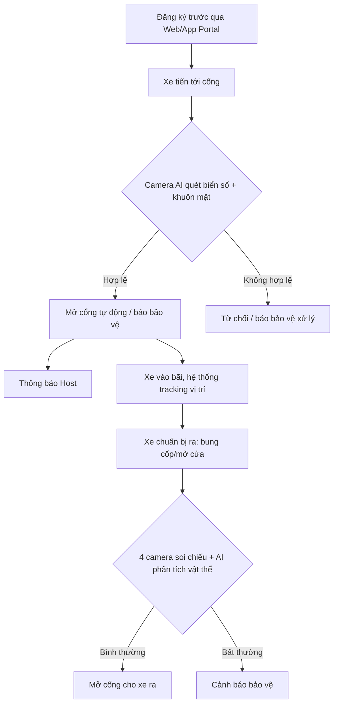

# Business Requirement Document (BRD)

## Document Control

| Trường | Nội dung |
|---|---|
| **Project Name** | AI-Powered Vehicle Gate Control and Inventory Management System |
| **Client** | Tổng Công ty Điện lực |
| **Document Version** | 0.2 |
| **Status** | `DRAFT / PROPOSED` — Đang chờ Requirement chính thức (bằng văn bản) từ khách hàng, xem `OQ-01` |
| **Prepared by** | Business Analyst Team |
| **Distribution** | Client Sponsor, BA/Dev Team nội bộ |
| **Related documents** | `requirements-traceability.md` (RTM), `smart-gate-system-design.md`, `diagrams.md`, `data-model-erd.md` |

### Revision History

| Version | Ngày | Tác giả | Mô tả thay đổi |
|---|---|---|---|
| 0.1 | — | BA Team | Bản nháp đầu tiên, tổng hợp từ nội dung cuộc họp khởi động (kickoff meeting) với khách hàng |
| 0.2 | 2026-08-17 | BA Team | Chuẩn hóa cấu trúc theo mẫu BRD chuyên nghiệp: bổ sung Document Control, Executive Summary, Non-Functional Requirements, Glossary, Approval; gắn ID (BR/FR/OQ/A) nhất quán với RTM; không thay đổi nội dung nghiệp vụ đã có ở bản 0.1 |

> **Lưu ý bắt buộc:** Số thứ tự các mục **1–12** trong tài liệu này được giữ nguyên như bản 0.1 vì `requirements-traceability.md` đang tham chiếu trực tiếp tới `BRD §4, §5, §6, §7, §9, §10, §11`. Mọi thay đổi số thứ tự các mục này trong tương lai **bắt buộc phải cập nhật đồng thời RTM**.

---

## Executive Summary

Tổng Công ty Điện lực đang tìm kiếm giải pháp tự động hóa quy trình kiểm soát xe ra/vào cổng bằng công nghệ Camera AI (nhận diện biển số, khuôn mặt) nhằm rút ngắn thời gian check-in và giảm rủi ro thất thoát tài sản/thiết bị điện lực trên phương tiện ra vào. Đây là sáng kiến cải tiến nội bộ; nếu triển khai thí điểm thành công, có kế hoạch nhân rộng ra các chi nhánh khác của Tổng công ty.

Dự án hiện ở giai đoạn **đề xuất giải pháp (Solution Proposal)**: team BA/Dev đang tự xây dựng bộ yêu cầu dựa trên mong muốn được trao đổi qua cuộc họp, **chưa có văn bản Requirement chính thức** từ phía khách hàng. Tài liệu này là cơ sở làm việc tạm thời cho đến khi được khách hàng xác nhận (xem `OQ-01`), và **chưa đủ điều kiện để làm căn cứ ký hợp đồng hoặc estimate cứng**.

Trong 6 module nghiệp vụ được đề xuất (§4), chỉ **2 module (BR-02, BR-03)** đã được khách hàng xác nhận trực tiếp trong cuộc họp; 4 module còn lại đang ở trạng thái đề xuất và cần được khách hàng phê duyệt bằng văn bản trước khi đưa vào scope chính thức.

---

## 1. Business Context

### 1.1 Background & Strategic Alignment

Tổng Công ty Điện lực mong muốn tự động hóa quy trình ra vào cổng bằng công nghệ Camera AI, nhằm giảm thiểu thời gian chờ đợi, đồng thời theo dõi và kiểm soát phương tiện, hàng hóa/tài sản trên xe để tránh thất thoát. Đây được xác định là một sáng kiến cải tiến (improvement initiative) của Tổng công ty; nếu triển khai thí điểm thành công, có định hướng nhân rộng ra các chi nhánh điện lực khác.

### 1.2 Business Objectives

| Mục tiêu | Mô tả | Ghi chú |
|---|---|---|
| Rút ngắn thời gian check-in tại cổng | Loại bỏ bước dừng xe, xuất trình giấy tờ, khai báo thủ công | Chỉ tiêu cụ thể (ví dụ: thời gian trung bình/xe) **chưa được khách hàng cung cấp** — cần làm rõ khi có Requirement chính thức |
| Giảm rủi ro thất thoát tài sản/thiết bị điện lực | Kiểm soát hàng hóa mang ra bằng AI thay vì kiểm tra thủ công bằng mắt | Là động lực nghiệp vụ chính, ưu tiên cao theo trao đổi trong cuộc họp |
| Chuẩn hóa quy trình để nhân rộng | Xây dựng giải pháp có khả năng triển khai lại (replicate) cho các chi nhánh khác | Thuộc Future/Potential Scope, xem §9 |

### 1.3 Current State (As-Is)

Việc kiểm soát ra vào hiện đang được thực hiện **hoàn toàn thủ công** bởi nhân viên bảo vệ tại cổng.

### 1.4 Problem Statement / Pain Points

| Pain Point | Mô tả | Tác động nghiệp vụ |
|---|---|---|
| Tốn thời gian check-in | Khách/nhà cung cấp đến phải dừng lại, xuất trình căn cước, khai báo người cần gặp | Ùn ứ giao thông tại cổng, trải nghiệm khách hàng/đối tác kém |
| Rủi ro an ninh & thất thoát tài sản | Nhân viên hoặc nhà cung cấp có thể "tuồn" hàng hóa, thiết bị của công ty ra ngoài; bảo vệ kiểm tra bằng mắt thường/bằng tay không đảm bảo độ chính xác | Rủi ro tài chính trực tiếp do mất mát tài sản/thiết bị điện lực có giá trị |

---

## 2. Stakeholders & Roles

| Vai trò | Mô tả | Tương tác chính với hệ thống |
|---|---|---|
| **Client Sponsor** | Cán bộ/Trưởng phòng Thông tin trực thuộc Tổng Công ty Điện lực | Phê duyệt yêu cầu, chốt scope, nghiệm thu |
| **Nhân viên Bảo vệ (Guard)** | Trực ca tại cổng | Nhận cảnh báo từ hệ thống, giám sát màn hình camera, hỗ trợ mở cổng nếu hệ thống không mở tự động |
| **Khách hàng / Nhà cung cấp (Guest/Supplier)** | Người từ bên ngoài vào công ty | Sử dụng App/Web Portal để đăng ký thông tin trước khi đến |
| **Nhân viên nội bộ (Employee)** | Di chuyển bằng xe máy/ô tô/xe bán tải ra vào công ty | Được hệ thống nhận diện; hàng hóa mang ra được kiểm soát |
| **Người được gặp (Host)** | Nhân viên bên trong công ty có lịch hẹn với khách | Nhận thông báo khi khách đã tới cổng |

---

## 3. Business Problems

| Vấn đề | Mô tả | Liên quan Pain Point |
|---|---|---|
| Quy trình kiểm soát ra vào thủ công tốn thời gian | Tạo luồng giao thông ùn ứ tại cổng | §1.4 |
| Khó kiểm soát tài sản có giá trị trên phương tiện | Linh kiện, thiết bị điện lực di chuyển ra ngoài qua xe bán tải, xe tải khó giám sát | §1.4 |
| Giới hạn của kiểm tra thủ công | Bảo vệ không thể kiểm soát 100% bằng mắt thường xem đồ vật mang ra có hợp lệ hay không | §1.4 |

---

## 4. Business Requirements

| ID | Module | Mô tả | Status | Phase |
|---|---|---|---|---|
| **BR-01** | Đăng ký (Web/App Portal) | Khách/Nhà cung cấp phải có nền tảng để đăng ký thông tin ra vào (hình ảnh, biển số xe, thông tin người gặp) trước khi đến công ty | `PROPOSED` | Phase 1 |
| **BR-02** | Nhận diện (AI & Camera IoT) | Quét và nhận diện biển số xe, khuôn mặt của người lái xe và hành khách theo thời gian thực (Real-time) | `CONFIRMED` | Phase 1 |
| **BR-03** | Điều khiển Cổng | Tự động mở cổng cho xe đã đăng ký hoặc gửi thông báo hiển thị cho bảo vệ bấm nút mở cổng | `CONFIRMED` | Phase 1 |
| **BR-04** | Kiểm soát Tài sản & An ninh | Sử dụng hệ thống 4 camera (trước, sau, 2 bên hông/cốp) để soi và nhận diện vật thể/hàng hóa bên trong xe khi cốp mở, nhằm cảnh báo nếu có hàng hóa mang ra không hợp lệ | `PROPOSED` | Phase 1 |
| **BR-05** | Tracking Phương tiện | Theo dõi hành trình của xe (khách, nhà cung cấp) sau khi vào bãi (đậu ở đâu, hành vi như thế nào) | `PROPOSED` | Chưa xác định |
| **BR-06** | Đối chiếu Xuất kho | Liên kết với phần mềm quản lý kho để đối chiếu hình ảnh/vật thể trên xe với "Phiếu xuất kho" | `PROPOSED` | Phase 2 |

> **Chỉ BR-02 và BR-03 đã được khách hàng xác nhận trực tiếp.** 4/6 module còn lại là đề xuất của team BA/Dev dựa trên nhu cầu trao đổi qua cuộc họp — cần khách hàng phê duyệt bằng văn bản trước khi đưa vào cam kết hợp đồng. Chi tiết mức độ rủi ro scope xem `requirements-traceability.md §2`.

---

## 5. Functional Requirements

| ID | Tên chức năng | Actor | Mô tả | Business Rule | Input / Output | Priority |
|---|---|---|---|---|---|---|
| **FR01** | Đăng ký khách ra vào | Guest, Supplier | Đăng ký trước thông tin phương tiện, người lái và người cần gặp qua Portal | Cần chụp/tải lên hình ảnh khuôn mặt, biển số xe hợp lệ | **In:** Tên, CCCD, Biển số xe, Ảnh, Người cần gặp. **Out:** Lịch hẹn thành công | High |
| **FR02** | Nhận diện tự động tại cổng | System, Camera | Camera quét biển số xe, nhận diện khuôn mặt người ngồi trong xe để đối chiếu với dữ liệu đã đăng ký | Xử lý real-time qua AI model | **In:** Video stream. **Out:** Dữ liệu biển số, khuôn mặt đã bóc tách | High |
| **FR03** | Xử lý mở cổng | System, Guard | Hệ thống tự động kích hoạt mở cổng hoặc báo lên màn hình bảo vệ nếu xe đã đăng ký | Trạng thái "Đã đăng ký" & "Đúng giờ" → Auto-open hoặc Cảnh báo bảo vệ | **In:** Kết quả từ FR02. **Out:** Lệnh mở cổng/Notification | High |
| **FR04** | Thông báo cho Host | System | Tự động thông báo qua app cho nhân viên bên trong khi khách đến cổng | Khách đã được nhận diện và qua cổng thành công | **Out:** Push Notification | Medium |
| **FR05** | Nhận diện & Cảnh báo hàng hóa | System | Quét 4 góc xe (khi mở cốp/cửa) để xác định có vật thể/hàng hóa mang ra ngoài hay không | Nếu phát hiện vật thể khả nghi, đánh cờ và gửi cảnh báo | **In:** Video stream từ 4 góc xe. **Out:** Cảnh báo bất thường | High |
| **FR06** | Tích hợp Phiếu xuất kho (Phase 2) | System | Quét thùng thiết bị/hàng hóa và đối chiếu với dữ liệu phiếu xuất kho | Vật thể nhận diện được phải khớp với số lượng/loại trong phiếu xuất kho đã được duyệt | **In:** Mã phiếu xuất kho, Dữ liệu AI. **Out:** Trạng thái Khớp/Không khớp | Low |

> **Gap đã ghi nhận:** BR-05 (Tracking Phương tiện) hiện **chưa có Functional Requirement tương ứng**. Đây là thiếu sót cần khách hàng làm rõ — xem `OQ-05` trong `requirements-traceability.md §3.1`.

---

## 6. Business Process

### 6.1 AS-IS

Khách/nhân viên đến cổng → Chờ đợi → Xuất trình giấy tờ tùy thân thủ công → Bảo vệ hỏi thông tin → Cho vào. Khi ra: Bảo vệ xét xe, bắt mở cửa/cốp xem thủ công bằng mắt để chống trộm.

### 6.2 TO-BE (Đề xuất)

1. Người dùng truy cập Web/App Portal đăng ký trước thông tin (khuôn mặt, biển số, người gặp, thời gian).
2. Phương tiện tiến tới cổng công ty.
3. Hệ thống Camera AI tự động quét biển số và đối chiếu khuôn mặt trong xe.
4. Hệ thống kiểm tra: nếu hợp lệ → gửi lệnh mở cổng tự động (hoặc báo bảo vệ) + gửi thông báo (push notification) cho Host bên trong biết khách đã tới.
5. Xe di chuyển vào trong bãi, hệ thống tiếp tục tracking vị trí dừng đỗ.
6. Khi xe đi ra: yêu cầu bung cốp/mở cửa, 4 camera soi chiếu và AI model phân tích vật thể mang theo (ở Phase 2, quét và đối chiếu với Phiếu xuất kho).
7. Cổng mở cho xe ra nếu không có cảnh báo bất thường.

> Sơ đồ tuần tự (sequence diagram), state machine chi tiết cho từng bước xem `diagrams.md`.

---

## 7. Data Requirements

### 7.1 Entities chính

| Entity | Mô tả | Thuộc tính chính |
|---|---|---|
| **Users** | Khách, Nhà cung cấp, Nhân viên | Tên, Hình ảnh khuôn mặt, Căn cước |
| **Vehicles** | Xe tải, Xe bán tải, Ô tô con | Biển số xe, Loại xe |
| **Appointments** | Lịch ra vào | Thời gian dự kiến, Mục đích, Trạng thái, Người Host |
| **Assets/Equipments** | Tài sản/thiết bị theo dõi trên xe | Hình dáng, Nhãn mác (thùng điện, vật tư) |
| **ExportVoucher** (Phase 2) | Phiếu xuất kho | Mã phiếu, Danh sách vật tư, Trọng lượng |

### 7.2 Quan hệ dữ liệu

- 1 **User** có thể đăng ký nhiều **Vehicle**.
- 1 **Appointment** liên kết với 1 **User**, 1 **Vehicle** và 1 **Host**.
- 1 **Vehicle** khi rời khỏi công ty có thể liên kết với 1 **ExportVoucher** (nếu có chở hàng).

> Cardinality 1-N giữa User–Vehicle cần xác nhận lại với thực tế nghiệp vụ (ví dụ xe tải nhà cung cấp có thể đổi tài xế) — xem `OQ-08` trong RTM. Physical schema chi tiết (kiểu dữ liệu, PK/FK, index, PII) xem `data-model-erd.md`.

---

## 8. Reports / Notifications / Integrations

### 8.1 Notifications

| Đối tượng nhận | Điều kiện kích hoạt |
|---|---|
| Bảo vệ | Cảnh báo khi có phương tiện chưa đăng ký, hoặc phát hiện nghi vấn mang hàng hóa ("tuồn hàng") ra ngoài |
| Người được gặp (Host) | Báo ngay khi khách vừa check-in qua cổng |

### 8.2 Integrations

| Hệ thống | Mục đích |
|---|---|
| Hệ thống Camera IP / Thiết bị IoT | Đóng/mở cổng |
| Hệ thống Quản lý kho của Điện lực | Lấy dữ liệu Phiếu xuất kho (Phase 2) |
| Hệ thống Nhân sự (HR) của công ty | *(Future)* |

---

## 9. Scope

### 9.1 In Scope

- Web/App Portal phục vụ đăng ký ra vào cho khách/nhà cung cấp.
- Hệ thống AI Model (Local hoặc Third-party) xử lý video thời gian thực từ camera.
- Nhận diện biển số, khuôn mặt, tính năng tự động mở cổng.
- Nhận diện cơ bản hàng hóa/thiết bị trong xe để cảnh báo chống trộm.

### 9.2 Out of Scope

- Phần cứng Camera, Server, Thiết bị IoT (Khách hàng Tổng công ty Điện lực dự kiến sẽ cung cấp/đầu tư).

### 9.3 Future / Potential Scope

- Tích hợp sâu đối chiếu với Phiếu xuất kho.
- Đóng gói thành sản phẩm SaaS (hoặc bán License) để triển khai cho hàng chục chi nhánh điện lực khác hoặc bán cho công ty ngoài.

---

## 10. Open Questions

Cần làm rõ với khách hàng trước khi chốt Scope chính thức.

| ID | Câu hỏi | Trạng thái | Ảnh hưởng nếu không trả lời |
|---|---|---|---|
| **OQ-01** | Yêu cầu chính thức (Official Requirement): hiện team đang tự lên "Solution" dựa trên mong muốn ban đầu. Cần xin bản Requirement chính thức (văn bản) từ phòng Thông tin Điện lực để chốt Scope | `NEEDS CONFIRMATION` | Blocking toàn bộ dự án |
| **OQ-02** | Hạ tầng AI: khách hàng muốn tự xây dựng AI model chạy Local (bảo mật dữ liệu) hay sử dụng AI API của bên thứ 3 (chi phí duy trì cao)? | `NEEDS CONFIRMATION` | Ảnh hưởng quyết định kiến trúc và chi phí hạ tầng |
| **OQ-03** | Phần cứng: thông số kỹ thuật của các camera hiện tại (góc quét, độ phân giải) để đảm bảo chất lượng đầu vào cho bài toán nhận diện đồ vật ở 4 góc xe? | `NEEDS CONFIRMATION` | Không thể cam kết độ chính xác của FR05 |
| **OQ-04** | Dữ liệu huấn luyện (Training Data): khách hàng có hỗ trợ cung cấp hình ảnh/video mẫu (dataset) để train model nhận diện hàng hóa/thùng thiết bị điện không? | `NEEDS CONFIRMATION` | FR05/FR06 không khả thi đúng hạn nếu thiếu dataset |

> Danh sách Open Question mở rộng (phát sinh trong quá trình phân tích thiết kế: `OQ-05`–`OQ-08`) được theo dõi tại `requirements-traceability.md §6`.

---

## 11. Assumptions & Risks

### 11.1 Assumptions

| ID | Giả định | Nếu sai thì sao |
|---|---|---|
| **A-01** | Toàn bộ chi phí trang bị phần cứng (Camera, IoT, Server) sẽ do ngân sách của Điện lực chi trả | Dự án đội chi phí nghiêm trọng, phải đàm phán lại hợp đồng |
| **A-02** | Có thể thực hiện việc test giải pháp ban đầu tại cổng/bãi đỗ xe của trường | Không có môi trường thử nghiệm phù hợp, phải test trực tiếp tại site khách |

### 11.2 Risks

| ID | Rủi ro | Loại | Mô tả |
|---|---|---|---|
| **R-01** | Độ chính xác nhận diện vật thể bị che khuất | Kỹ thuật | Nhận diện khuôn mặt và biển số đã khá phổ biến, nhưng thuật toán soi và phân tích vật thể bị giấu trong xe (ví dụ: nhìn cốp xe, nhìn qua kính) rất phức tạp và phụ thuộc nhiều vào chất lượng hình ảnh, ánh sáng môi trường. Độ chính xác có thể không như mong đợi |
| **R-03** | Thủ tục hành chính/thanh toán dự án Nhà nước | Hành chính / Dòng tiền | Đây là dự án của Nhà nước, thủ tục ký kết hợp đồng, duyệt giải pháp, nghiệm thu và giải ngân thường mất nhiều thời gian (khoảng 2–3 tháng đợi duyệt). Team cần có giải pháp quản trị rủi ro dòng tiền (đảm bảo "có tiền mới làm") |

> ID được đặt khớp với `requirements-traceability.md §7, §8` để dễ tra cứu. Danh sách rủi ro đầy đủ (bao gồm `R-02, R-04`–`R-08` phát sinh trong quá trình thiết kế) và biện pháp giảm thiểu chi tiết xem tại RTM.

---

## 12. Requirement Summary & Next Steps

### 12.1 Summary

Dự án nhằm xây dựng một hệ thống kiểm soát xe ra vào thông minh ứng dụng AI Camera cho Tổng công ty Điện lực. Hệ thống thay thế quy trình check-in bằng sức người hiện tại sang một quy trình đăng ký số hóa (Web/App), kết hợp thị giác máy tính (Computer Vision) để đọc biển số, nhận diện khuôn mặt và đặc biệt là phân tích hình ảnh xe để ngăn chặn nhân viên/nhà cung cấp tuồn tài sản công ty ra ngoài.

Hiện tại, dự án đang ở giai đoạn đề xuất giải pháp (Solution Proposal) và chờ thống nhất danh sách yêu cầu chính thức từ khách hàng trước khi tiến hành ký hợp đồng.

### 12.2 Next Steps

1. Xin văn bản Official Requirement từ Phòng Thông tin Điện lực (`OQ-01`) — điều kiện tiên quyết để freeze scope.
2. Làm rõ quyết định hạ tầng AI (Local vs Third-party API) (`OQ-02`).
3. Thu thập thông số kỹ thuật camera hiện có tại site (`OQ-03`).
4. Xác nhận khả năng cung cấp dataset huấn luyện cho FR05/FR06 (`OQ-04`).
5. Trình khách hàng phê duyệt các hạng mục `PROPOSED` (BR-01, BR-04, BR-05, BR-06) bằng văn bản.

---

## 13. Non-Functional Requirements (NFR)

> **`DESIGN-ADDED`** — Bản BRD gốc từ cuộc họp chưa đề cập yêu cầu phi chức năng. Các mục dưới đây do team BA/Dev đề xuất bổ sung dựa trên đặc thù hệ thống (real-time AI, dữ liệu sinh trắc học, an ninh cổng vật lý) và **cần khách hàng xác nhận** trước khi đưa vào cam kết hợp đồng.

| ID | Hạng mục | Yêu cầu đề xuất | Lý do |
|---|---|---|---|
| NFR-01 | Hiệu năng nhận diện | Xử lý real-time, độ trễ từ lúc xe vào vùng quét đến khi có kết quả cần đủ ngắn để không gây ùn ứ cổng (giá trị cụ thể — TBD, phụ thuộc `OQ-03`) | FR02, FR03 yêu cầu real-time nhưng chưa có ngưỡng SLA cụ thể |
| NFR-02 | Bảo mật dữ liệu sinh trắc học | Mã hóa dữ liệu khuôn mặt/CCCD khi lưu trữ và truyền tải; chính sách retention rõ ràng | Dữ liệu cá nhân/sinh trắc học thuộc phạm vi tuân thủ pháp luật về bảo vệ dữ liệu cá nhân |
| NFR-03 | Fail-safe khi mất kết nối | Cổng phải về trạng thái an toàn (không tự mở tự do) khi hệ thống/mạng gặp sự cố | Rủi ro an ninh nếu hệ thống "fail-open" |
| NFR-04 | Khả năng mở rộng (Scalability) | Kiến trúc không phụ thuộc cứng vào 1 model camera/1 giao thức IoT cụ thể, hỗ trợ nhân rộng nhiều chi nhánh | Phù hợp định hướng Future Scope §9.3 |
| NFR-05 | Audit & truy vết | Ghi log toàn bộ quyết định mở/từ chối cổng và các can thiệp thủ công của bảo vệ | Dự án Nhà nước, cần truy trách nhiệm khi có sự cố mất tài sản |

> Chi tiết kỹ thuật và ADR liên quan xem `smart-gate-system-design.md`.

---

## 14. Glossary

| Thuật ngữ | Giải thích |
|---|---|
| **LPR** | License Plate Recognition — nhận diện biển số xe bằng thị giác máy tính |
| **Host** | Nhân viên nội bộ có lịch hẹn với khách, là người được khách đến gặp |
| **Guest/Supplier** | Khách hàng hoặc nhà cung cấp bên ngoài đến làm việc tại công ty |
| **Portal** | Nền tảng Web/App dùng để đăng ký thông tin ra vào trước khi đến |
| **AS-IS / TO-BE** | Mô tả quy trình hiện tại (trước khi cải tiến) / quy trình đề xuất (sau khi triển khai hệ thống) |
| **BR / FR** | Business Requirement / Functional Requirement — ID định danh dùng xuyên suốt bộ tài liệu (BRD, RTM) |
| **RTM** | Requirements Traceability Matrix — tài liệu `requirements-traceability.md`, cầu nối giữa BRD và thiết kế kỹ thuật |

---

## 15. Approval / Sign-off

> Tài liệu này **chưa được ký duyệt chính thức**. Bảng dưới đây sẽ được hoàn tất khi có văn bản Official Requirement từ khách hàng (`OQ-01`).

| Vai trò | Họ tên | Chữ ký | Ngày duyệt |
|---|---|---|---|
| Client Sponsor | *(TBD)* | | |
| BA Lead | *(TBD)* | | |
| Tech Lead | *(TBD)* | | |
