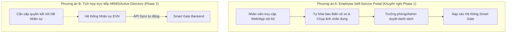
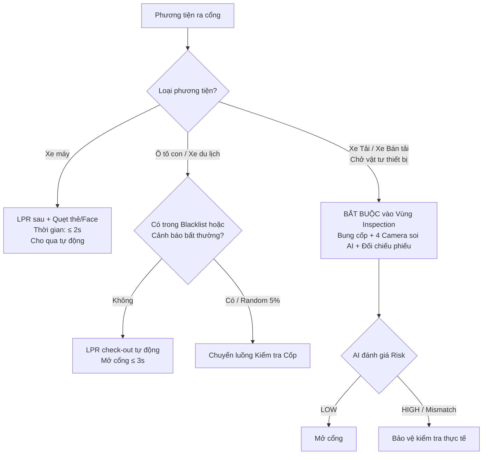

# Tài liệu Họp Khách hàng & Phương án Giải pháp — Smart Gate EVN

> **Dự án:** Hệ thống Kiểm soát Cổng & Nhận diện Phương tiện Thông minh (Smart Gate)  
> **Khách hàng:** Tổng Công ty Điện lực  
> **Phiên bản:** v1.0 — Chuẩn bị cho buổi làm việc chính thức  
> **Mục tiêu:** Chốt các câu hỏi nghiệp vụ trọng yếu (Blocking Questions), thống nhất phạm vi thực tế (Scope Boundary), và trình bày phương án tuân thủ pháp lý theo Luật Dữ liệu cá nhân mới.

---

## 📋 Chương trình làm việc đề xuất (Meeting Agenda)

| STT | Nội dung trao đổi | Thời lượng dự kiến | Mục tiêu đầu ra |
|:---:|---|:---:|---|
| **1** | Báo cáo tiến độ thiết kế giải pháp & Kiến trúc tổng thể | 15 phút | Thống nhất mô hình Edge AI + Human-in-the-loop |
| **2** | **Vấn đề 1:** Quy trình đăng ký & nhận diện Nhân viên nội bộ (`OQ-09`) | 20 phút | Chốt phương án Portal tự đăng ký vs Tích hợp HRMS |
| **3** | **Vấn đề 2:** Quy hoạch & Cơ chế kiểm soát Xe máy (`OQ-10`) | 20 phút | Chốt phân làn, vị trí camera & phạm vi AI cho xe máy |
| **4** | **Vấn đề 3:** Thông lượng giờ cao điểm & Quy trình cổng ra (`OQ-11`) | 20 phút | Chốt chính sách kiểm tra (100% vs Sampling) để chống ùn tắc |
| **5** | **Vấn đề 4:** Tuân thủ Luật Dữ liệu cá nhân & Dữ liệu Sinh trắc học (`OQ-07`) | 15 phút | Thống nhất điều khoản Bảo vệ dữ liệu (Luật 91/2025/QH15) |
| **6** | Thống nhất lộ trình, bàn giao Hardware Spec & Ký biên bản | 15 phút | Ký biên bản làm việc, làm cơ sở ban hành Official Requirement |

---

## 🎯 Chi tiết 4 Vấn đề Trọng tâm & Phương án Trình bày

---

### VẤN ĐỀ 1: Đăng ký & Nhận diện Nhân viên Nội bộ (`OQ-09`)

#### 1. Thực trạng & Rủi ro
* **Thực trạng:** Module `FR01` hiện tại chỉ mới định nghĩa cổng đăng ký cho Khách (Guest) và Nhà cung cấp (Supplier). Nhưng trong thực tế vận hành tại Điện lực, **nhân viên nội bộ chiếm 80% – 90% lưu lượng qua cổng mỗi ngày**.
* **Rủi ro:** 2 module đã chốt (`FR02` - Nhận diện AI và `FR03` - Điều khiển cổng) sẽ **không thể hoạt động** nếu không có sẵn cơ sở dữ liệu khuôn mặt và biển số xe của nhân viên.
* **Mối đe dọa an ninh:** Mục tiêu của dự án là chống thất thoát tài sản, trong đó đối tượng cần kiểm soát bao gồm cả nội bộ.

#### 2. Các phương án đề xuất cho Điện lực



* **Phương án A — Employee Self-Service Portal (Đề xuất chọn cho Giai đoạn Thí điểm):**
  * *Cách thực hiện:* Mở rộng Portal `FR01` cho nhân viên đăng nhập bằng Email công vụ / Mã nhân viên, tự khai báo biển số xe và tải ảnh khuôn mặt theo tiêu chuẩn. Cán bộ quản lý/Hành chính duyệt theo đợt.
  * *Ưu điểm:* Triển khai được ngay, không phụ thuộc vào hạ tầng kỹ thuật hay bảo mật của phần mềm Nhân sự bên ngoài.
* **Phương án B — Tích hợp hệ thống HRMS nội bộ:**
  * *Cách thực hiện:* Xây dựng API kết nối đồng bộ hồ sơ nhân viên từ HRMS của EVN.
  * *Hạn chế:* Thủ tục cấp quyền bảo mật nội bộ phức tạp, thường kéo dài 2–3 tháng. Đề xuất chuyển sang Giai đoạn 2.

> **👉 Câu hỏi cần khách hàng chốt:**
> *Điện lực chọn Phương án A (Nhân viên tự đăng ký qua Portal được duyệt) cho đợt thí điểm đầu tiên, hay bắt buộc phải kết nối phần mềm HR ngay từ Phase 1?*

---

### VẤN ĐỀ 2: Giải pháp Kiểm soát Xe máy (`OQ-10`)

#### 1. Thách thức Vật lý đối với Xe máy tại Việt Nam
1. **Vị trí biển số:** Xe máy chỉ có biển số ở **phía sau**. Camera LPR hướng chính diện (đang thiết kế cho ô tô) hoàn toàn không đọc được.
2. **Khuôn mặt bị che khuất:** Đa số người đi xe máy đội mũ bảo hiểm (nửa đầu/cả đầu), đeo khẩu trang, kính râm. Nhận diện khuôn mặt từ xa khi đang chạy xe là bất khả thi về mặt quang học.
3. **Không có cốp lộ thiên:** Không thể áp dụng hệ thống "4 camera soi thùng/cốp" như xe bán tải/ô tô.

#### 2. Đề xuất Quy hoạch Phân làn & Giải pháp Công nghệ

```text
               ┌────────────────────────────────────────────────────────┐
               │                    CỔNG VÀO / RA                       │
               └────────────────────────────────────────────────────────┘
                                    │
            ┌───────────────────────┴───────────────────────┐
            ▼                                               ▼
   [ LÀN Ô TÔ / XE TẢI ]                           [ LÀN XE MÁY RIÊNG ]
   - Camera LPR Trước                               - Camera LPR chụp BIỂN SỐ SAU
   - Camera Face chính diện                         - Kiosk xác thực tại vạch dừng:
   - Barrier tự động (cần 3-4m)                       + Màn hình hướng dẫn dừng xe
   - Inspection Zone 4 camera (chiều ra)              + Camera Face tầm gần HOẶC
                                                      + Đầu đọc Thẻ nhân viên RFID
                                                    - Mini Barrier (cần ngắn 1.5-2m)
```

#### 3. Bảng so sánh giải pháp Làn Xe máy

| Hạng mục | Nhận diện Camera AI thuần túy | Kết hợp Camera AI + Thẻ RFID/QR dự phòng (Khuyến nghị) |
|---|---|---|
| **Cách vận hành** | Dừng xe, bỏ khẩu trang/kính để camera soi mặt + LPR sau | Quẹt thẻ nhân viên (0.5s) + LPR sau đối chiếu ngầm |
| **Tốc độ xử lý** | 4 – 7 giây/xe (dễ ùn ứ nếu trời mưa/tối) | **1 – 2 giây/xe** (cực nhanh, chống ùn tắc) |
| **Xử lý thời tiết** | Kém khi mưa to, ngược sáng, mũ trùm kín | Ổn định 99.9% trong mọi điều kiện thời tiết |
| **Kiểm soát tài sản** | Không soi cốp xe máy tự động; bảo vệ quan sát thủ công | Kiểm tra thủ công ngẫu nhiên (chỉ khi có nghi vấn) |

> **👉 Câu hỏi cần khách hàng chốt:**
> 1. *Tại cổng thí điểm có quy hoạch tách riêng **Làn Ô tô** và **Làn Xe máy** không?*
> 2. *Điện lực có đồng ý bổ sung phương án **Thẻ RFID nhân viên + Camera LPR sau** cho làn xe máy để đảm bảo tốc độ giải tỏa cao điểm không?*

---

### VẤN ĐỀ 3: Thông lượng Cao điểm & Quy trình Kiểm soát Chiều Ra (`OQ-11`)

#### 1. Nguy cơ Ùn tắc nghiêm trọng lúc 17h00 (Tan ca)
* Nếu áp dụng quy trình kiểm soát chiều ra theo BRD: **Mọi xe dừng lại → Bung cốp → 4 Camera chụp → AI phân tích → Có thể yêu cầu Rescan → Mở cổng**.
* **Hệ quả:** Mỗi xe mất từ 25 – 45 giây. Với 100 xe tan ca cùng lúc, đoàn xe sẽ nối đuôi kéo dài cả km ra đường chính. **Hậu quả thực tế:** Bảo vệ sẽ bấm mở cổng bằng tay liên tục để giải tỏa hoặc tắt luôn hệ thống AI.

#### 2. Đề xuất Chính sách Phân luồng & Kiểm tra Chọn lọc (Selective Inspection Policy)



#### 3. Bảng chỉ tiêu Thông lượng cần thống nhất (NFR Input)

| Chỉ tiêu | Giá trị đề xuất | Số liệu thực tế từ EVN (Cần điền) |
|---|:---:|:---:|
| Lưu lượng cao điểm sáng (7h15 – 8h00) | 150 – 250 xe/giờ | `[ .............. xe/giờ ]` |
| Lưu lượng cao điểm chiều (16h45 – 17h30) | 180 – 300 xe/giờ | `[ .............. xe/giờ ]` |
| Thời gian giải tỏa mục tiêu cho 1 xe máy | **≤ 2 giây** | `[ ....................... ]` |
| Thời gian giải tỏa mục tiêu cho 1 ô tô con | **≤ 4 giây** | `[ ....................... ]` |
| Thời gian kiểm tra chuyên sâu xe tải/bán tải | **≤ 20 giây** | `[ ....................... ]` |

> **👉 Câu hỏi cần khách hàng chốt:**
> *Điện lực có đồng ý áp dụng cơ chế **Kiểm tra 100% đối với Xe tải/Bán tải** và **Kiểm tra ngẫu nhiên/theo cảnh báo đối với Ô tô con/Xe máy** để tối ưu lưu lượng cổng ra không?*

---

### VẤN ĐỀ 4: Tuân thủ Luật Bảo vệ Dữ liệu Cá nhân & Dữ liệu Sinh trắc học (`OQ-07`)

#### 1. Khung Pháp lý Mới (Hiệu lực từ 01/01/2026)
* **Luật Bảo vệ Dữ liệu Cá nhân 2025 (Luật số 91/2025/QH15)** và **Nghị định số 356/2025/NĐ-CP** đã chính thức có hiệu lực từ ngày 01/01/2026.
* **Điều 31 (Luật 91/2025/QH15):** Xếp dữ liệu sinh trắc học (khuôn mặt, vân tay) vào nhóm **Dữ liệu cá nhân nhạy cảm**, áp dụng chế tài xử phạt hành chính rất nặng và trách nhiệm bồi thường thiệt hại nếu để lộ lọt hoặc thu thập trái quy định.
* **Phân định trách nhiệm pháp lý:**
  * **Tổng Công ty Điện lực (EVN):** Đóng vai trò là **Bên Kiểm soát Dữ liệu (Data Controller)** — chịu trách nhiệm pháp lý cao nhất trước chủ thể dữ liệu và cơ quan quản lý Nhà nước.
  * **Đơn vị Cung cấp Giải pháp (Team dự án):** Đóng vai trò là **Bên Xử lý Dữ liệu (Data Processor)** — thực hiện xử lý kỹ thuật theo hợp đồng và quy định an toàn thông tin.

#### 2. Phương án Tuân thủ Thiết kế sẵn trong Hệ thống (Compliance-by-Design)

Team dự án đã chủ động thiết kế kiến trúc đáp ứng đầy đủ các tiêu chuẩn pháp lý mới nhất:

```text
┌─────────────────────────────────────────────────────────────────────────────┐
│               HỆ THỐNG SMART GATE — COMPLIANCE ARCHITECTURE                │
├─────────────────────────────────────────────────────────────────────────────┤
│ 1. LƯU VẾT ĐỒNG Ý MINH BẠCH (Bảng CONSENT_RECORD):                         │
│    - Ghi nhận đầy đủ: Phiên bản điều khoản, Nội dung hiển thị, Thời điểm,   │
│      Địa chỉ IP, Kênh đồng ý (Portal/App).                                   │
│                                                                             │
│ 2. ĐÁP ỨNG QUYỀN RÚT ĐỒNG Ý & QUYỀN ĐƯỢC XÓA (DATA_DELETION_REQUEST):       │
│    - Khi người dùng rút đồng ý: Hệ thống xóa cứng Vector Embedding & Ảnh gốc│
│      trên Storage, sinh mã băm bằng chứng đã xóa (Deletion Proof Hash).     │
│    - Bảng AUDIT_LOG được tách biệt: Vẫn lưu vết lịch sử ra vào hợp pháp mà  │
│      không lưu giữ dữ liệu sinh trắc học nhạy cảm.                         │
│                                                                             │
│ 3. AN TOÀN DỮ LIỆU TẠI CỔNG (EDGE SECURITY):                                │
│    - Mã hóa dữ liệu truyền nhận (TLS 1.3) và mã hóa lưu trữ (AES-256).      │
│    - Thiết bị Edge tại cổng không lưu trữ database tập trung.               │
└─────────────────────────────────────────────────────────────────────────────┘
```

#### 3. Đề xuất Hành động cho Buổi họp

1. Đưa điều khoản **"Xử lý và Bảo vệ Dữ liệu Cá nhân"** thành một phụ lục riêng trong Hợp đồng kinh tế giữa EVN và Nhà thầu.
2. Team kỹ thuật sẵn sàng hỗ trợ EVN lập **Hồ sơ Đánh giá Tác động Xử lý Dữ liệu Cá nhân (DPIA)** phục vụ công tác thanh tra/kiểm tra sau này.

> **👉 Điểm nhấn bán hàng (Sales Advantage):**  
> *Rất ít đơn vị trên thị trường hiện nay thiết kế hệ thống kiểm soát ra vào chuẩn hóa theo Luật 91/2025/QH15. Đây là giải pháp an toàn pháp lý tuyệt đối cho Ban Lãnh đạo Tổng Công ty.*

---

## 📝 Phiếu Ghi nhận Quyết định tại Cuộc họp (Sign-off Sheet)

*(Dành cho đại diện EVN và Team Dự án ký xác nhận sau buổi họp)*

| Mã mục | Nội dung cần chốt | Lựa chọn của Khách hàng | Ký xác nhận / Ghi chú |
|---|---|---|---|
| **OQ-09** | Đăng ký nhân viên nội bộ | ☐ Phương án A (Portal tự đăng ký)<br/>☐ Phương án B (Tích hợp HRMS) | |
| **OQ-10** | Phạm vi & Phân làn Xe máy | ☐ Tách làn riêng (LPR sau + Thẻ/Face)<br/>☐ Chung làn với Ô tô<br/>☐ Không áp dụng Smart Gate cho xe máy | |
| **OQ-11** | Chính sách kiểm tra chiều ra | ☐ 100% Xe tải/Bán tải + Sampling Ô tô<br/>☐ Kiểm tra 100% toàn bộ phương tiện | |
| **OQ-12** | Cảm biến an toàn Barrier | ☐ Khách hàng trang bị Loop Detector/Sensor<br/>☐ Giao nhà thầu cung cấp đồng bộ | |
| **OQ-07** | Phương án Tuân thủ Dữ liệu | ☐ Đồng ý phương án Compliance-by-Design<br/>☐ Cần bổ sung quy định nội bộ EVN | |
| **OQ-01** | Kế hoạch ban hành Official Req | ☐ Dự kiến ban hành ngày: `..../..../2026` | |

---

## 🚀 Kế hoạch Hành động Ngay sau Buổi họp

```text
[ BUỔI HỌP NGÀY MAI ]
        │
        ▼ (Chốt thông số & phạm vi)
[ 48H SAU HỌP: BÀN GIAO WAVE 3 ]
        ├── 1. Bàn giao Bản Đặc tả Phần cứng (Hardware Specification)
        ├── 2. Bàn giao Bộ Tiêu chí Nghiệm thu Kỹ thuật (Acceptance Criteria M0–M6)
        └── 3. Bàn giao Kế hoạch Thu thập Dữ liệu & Huấn luyện AI (MLOps Plan)
        │
        ▼
[ HOÀN THIỆN HỢP ĐỒNG & KHỞI ĐỘNG MILESTONE M0 ]
```
