# Mô hình Dữ liệu MongoDB, ERD Logic & Phân loại Bảo mật — EV Smart Gate

| Thuộc tính | Giá trị |
| --- | --- |
| **Mã tài liệu** | `EVSG-ERD-AI-2026-V2` |
| **Phiên bản** | `2.0` — Bao phủ cả **13 Collections Baseline v1** và **Các Collections Kiến trúc Mục tiêu v2** kèm Ma trận Phân loại Dữ liệu (`Public / Internal / Confidential / Restricted`) |
| **Ngày cập nhật** | `21/10/2026` (`Asia/Bangkok`) |
| **Tài liệu liên kết** | [BRD chuẩn AI](BRD.md) · [Thiết kế hệ thống](smart-gate-system-design.md) · [Hợp đồng M0](contracts/migration-v1.md) · [RTM](requirements-traceability.md) |

---

## 1. Sơ đồ Quan hệ Thực thể Logic (Logical ERD — Tổng thể v1 & v2)

> [!IMPORTANT]
> **Nguyên tắc tách biệt danh tính trong Domain**:
> - `DRIVER` / `EMPLOYEE_REGISTRY` là **danh tính vật lý ra/vào cổng** (gắn với sinh trắc khuôn mặt, thẻ RFID, quyền đi bộ và ủy quyền lái xe).
> - `USER` là **tài khoản đăng nhập vận hành hệ thống** (gắn với `ROLE`, `PERMISSION`, phiên đăng nhập và nhật ký kiểm toán quản trị).
> - Hai nhóm danh tính này hoàn toàn độc lập: nhân viên đi qua cổng không mặc nhiên có tài khoản `USER`, và quyền RBAC của `USER` không tự suy ra quyền mở cổng vật lý.

```mermaid
erDiagram
    %% Nhóm 1: Danh tính Vật lý, Thẻ RFID, Phương tiện & Quyền Ra/Vào Cổng
    DRIVER ||--o{ EMPLOYEE_CARD : owns_lifecycle
    DRIVER ||--o| EMPLOYEE_REGISTRY : maps_enrollment
    DRIVER ||--o{ DRIVER_VEHICLE_AUTHORIZATION : authorizes
    VEHICLE ||--o{ DRIVER_VEHICLE_AUTHORIZATION : authorizes
    EMPLOYEE_REGISTRY ||--o{ PEDESTRIAN_ACCESS_GRANT : granted_access
    ACCESS_POINT ||--o{ PEDESTRIAN_ACCESS_GRANT : scopes_lane

    %% Nhóm 2: Thu nhận Camera, Nhật ký Cổng, Lệnh Barrier & Cảnh báo
    ACCESS_POINT ||--o{ CAPTURE_BUNDLE : ingests
    CAPTURE_BUNDLE ||--o| GATE_LOG : verifies_vehicle
    CAPTURE_BUNDLE ||--o| PERSON_ACCESS_LOG : verifies_pedestrian
    DRIVER ||--o{ GATE_LOG : resolved_driver
    VEHICLE ||--o{ GATE_LOG : resolved_vehicle
    EMPLOYEE_REGISTRY ||--o{ PERSON_ACCESS_LOG : resolved_employee
    GATE_LOG ||--o{ EVIDENCE : stores_snapshot
    PERSON_ACCESS_LOG ||--o{ EVIDENCE : stores_snapshot
    GATE_LOG ||--o| GATE_COMMAND : issues_command
    PERSON_ACCESS_LOG ||--o| GATE_COMMAND : issues_command
    GATE_LOG ||--o{ SECURITY_ALERT : triggers

    %% Nhóm 3: Tài khoản Vận hành, Auth JWT v2, RBAC & Kiểm toán
    ROLE ||--o{ USER : assigned_single_role
    ROLE }o--o{ PERMISSION : grants_catalog
    USER ||--o{ AUTH_SESSION : owns_v1_or_v2
    USER ||--o{ AUTH_TOKEN_FAMILY : rotates_refresh
    USER ||--o{ ADMIN_AUDIT_LOG : actor_or_target

    %% Nhóm 4: Thống kê, Trợ lý AI Báo cáo & Cấu hình Thiết bị
    USER ||--o{ REPORT_JOB : owns_report
    ANALYTICS_SNAPSHOT ||--o{ REPORT_JOB : grounds_numbers
    REPORT_JOB ||--o{ REPORT_EVENT : streams_sse
    DEVICE_CONFIG ||--o{ DEVICE_CONFIG_OPERATION : applies_async
    DEVICE_CONFIG ||--o{ DEVICE_CONFIG_AUDIT : records_diff

    %% Nhóm 5: Module Kho Mở rộng (Extension)
    DRIVER ||--o{ WAREHOUSE_EXIT_ORDER : assigned
    VEHICLE ||--o{ WAREHOUSE_EXIT_ORDER : assigned
    GATE_LOG ||--o| DOCK_INSPECTION : starts_from_entry
    WAREHOUSE_EXIT_ORDER ||--o| DOCK_INSPECTION : contains
    WAREHOUSE_EXIT_ORDER ||--o{ EVIDENCE : stores_slip
```

---

## 2. Danh mục Collections Đang Chạy (`Baseline v1` — Đã hiện thực trong `src/smart_gate/`)

| STT | Collection | Trường dữ liệu cốt lõi | Indexes chính | Cấp độ Dữ liệu & Cơ chế Bảo vệ |
| :---: | :--- | :--- | :--- | :--- |
| 1 | `drivers` | `employee_code`, `full_name`, `phone`, `status`, `embedding_ciphertext`, `embedding_iv`, `embedding_dimension`, `model_version` | `employee_code` unique sparse; `(status, created_at)` | **Confidential** (PII) + **Restricted** (`embedding_ciphertext` mã hóa `AES-256-GCM` với `AAD = driver_id`; không bao giờ trả embedding ra API). |
| 2 | `vehicles` | `plate_raw`, `plate_normalized`, `vehicle_type`, `status`, `description` | `plate_normalized` unique; `(status, created_at)` | **Confidential**: Chuẩn hóa biển số; ở v2 ánh xạ `sedan -> car` và chặn tự động mở cổng nếu `vehicle_type = unknown`. |
| 3 | `driver_vehicle_authorizations` | `driver_id`, `vehicle_id`, `status`, `valid_from`, `valid_until`, `revoked_at`, `revoked_reason` | `(driver_id, vehicle_id, valid_from)` unique; kiểm tra chống chồng lấn khoảng `ACTIVE` | **Confidential**: Bắt buộc còn hiệu lực tại thời điểm phương tiện qua cổng. |
| 4 | `employee_cards` | `card_id`, `driver_id`, `card_uid_hash`, `card_uid_masked`, `status` (`ACTIVE`/`BLOCKED`/`LOST`/`REPLACED`), `issued_at`, `reason`, `replaced_by_card_id` | `card_uid_hash` unique; tối đa 1 thẻ `ACTIVE` mỗi `driver_id` | **Restricted** (`card_uid` thô chỉ băm `HMAC-SHA256`, xóa khỏi RAM sau khi cấp) + **Confidential** (`card_uid_masked`). |
| 5 | `gate_logs` | `event_id`, `direction` (`ENTRY`/`EXIT`), `driver_id`, `vehicle_id`, `face_similarity`, `liveness_passed`, `plate_detected`, `match_type`, `status` (`PASSED`/`FAILED`), `reason_codes`, `permit_granted`, `barrier_status`, `evidence_keys`, `threshold_version`, `model_version`, `occurred_at` | `event_id` unique; `(direction, occurred_at)` | **Confidential**: Lưu tách biệt `observation`, `decision` và `barrier_status`; idempotent theo `event_id`. |
| 6 | `evidence` | `object_key`, `bucket`, `content_type`, `sha256_plaintext`, `iv`, `aad_context`, `correlation_id`, `created_at` | `object_key` unique; `(correlation_id, created_at)` | **Restricted**: Đối tượng nhị phân trong MinIO private bucket được mã hóa `AES-256-GCM` ở tầng ứng dụng. |
| 7 | `gate_commands` | `command_id` (`open:{gate_id}:{event_id}`), `gate_id`, `event_id`, `status` (`ACKED`/`FAILED`/`TIMEOUT`), `executed_at`, `error_detail` | `command_id` unique | **Internal / Confidential**: Đảm bảo lệnh mở barrier là idempotent, ngăn mở cổng lặp khi mạng retry. |
| 8 | `security_alerts` | `alert_id`, `sequence`, `event_id`, `gate_log_id`, `event_type`, `severity`, `status` (`OPEN`/`ACKNOWLEDGED`/`RESOLVED`), `data`, `occurred_at` | `sequence` unique; `(status, severity, occurred_at)` | **Confidential**: `data` phải nằm trong allowlist đã redact, không chứa sinh trắc học thô hay secret. |
| 9 | `users` | `username`, `display_name`, `password_hash`, `role` (v1 enum) / `role_id` (v2), `status`, `must_change_password`, `session_version`, `authz_version`, `version` | `username` unique | **Restricted** (`password_hash` dùng `Argon2`) + **Confidential** (thông tin tài khoản). |
| 10 | `auth_sessions` | `session_id`, `user_id`, `token_hash`, `csrf_hash`, `expires_at`, `idle_expires_at`, `revoked_at` | `token_hash` unique; TTL index trên `expires_at` | **Restricted**: Chỉ lưu băm `HMAC-SHA256` của session token và CSRF token. |
| 11 | `device_credentials` | `device_id`, `name`, `key_hash`, `scopes`, `access_point_id`, `status` | `name` unique; `key_hash` unique | **Restricted**: Lưu băm `HMAC-SHA256`, cấp quyền tối thiểu theo từng thiết bị/làn. |
| 12 | `sequence_counters` | `_id` (tên chuỗi, ví dụ `security_alerts`), `seq` | `_id` unique mặc định | **Internal**: Cấp phát số thứ tự `sequence` tăng nguyên tử bằng `findOneAndUpdate`. |
| 13 | `warehouse_exit_orders` & `dock_inspections` | `order_id`, `driver_id`, `vehicle_id`, `status`, `slip_version`, `jti_hash`, `token_hash`, `valid_until`, `exit_event_id`; `captures[]`, `cargo_timeline[]`, `operator_note` | `order_id` unique; `(status, valid_until)`; `exit_event_id` sparse unique | **Confidential** + **Restricted** (`jti_hash`, `token_hash` của phiếu JWS Ed25519). Thuộc **Module Kho Mở rộng**. |

---

## 3. Danh mục Collections Mở rộng trong Kiến trúc Mục tiêu (`Target v2` — `BE-01..BE-07`)

Các collections dưới đây được đặc tả trong [`migration-v1.md`](file:///e:/ev-smart-gate/docs/contracts/migration-v1.md) và [`frontend-api-gaps.md`](file:///e:/ev-smart-gate/docs/contracts/frontend-api-gaps.md) để Team Backend hoàn thiện các gói `BE-01..BE-07`:

| Gói bàn giao | Collection mục tiêu | Trách nhiệm nghiệp vụ & Ràng buộc bất biến (Invariants) | Indexes & Chính sách Lưu trữ (`Retention`) |
| :--- | :--- | :--- | :--- |
| **`BE-01`** *(Auth JWT v2)* | `auth_token_families` `ws_tickets` | - Lưu gia đình refresh token (`family_id`, `user_id`, `current_token_hash`, `consumed_tokens[]` kèm thời điểm consume để xử lý grace `5s`, `absolute_expires_at`, `revoked_at`, `revoke_reason`). - Lưu vé kết nối WebSocket dùng một lần (`ticket_hash`, `user_id`, `session_id`, `channel`, `authz_version`, `expires_at` `30s`, `consumed_at`). | - `family_id` unique, `current_token_hash` unique, TTL `absolute_expires_at` (`7 ngày`). - `ticket_hash` unique, TTL `expires_at` (`30 giây`). |
| **`BE-02`** *(Dynamic RBAC & Audit)* | `roles` `permissions` `admin_audit_logs` | - `roles`: `role_id`, `code` (bất biến sau khi tạo; gồm 3 system roles `ADMIN`, `WAREHOUSE`, `SECURITY` và custom roles), `permission_codes[]`, `is_system`, `status`, `version`. - `admin_audit_logs`: Nhật ký kiểm toán bất biến (append-only) ghi trong cùng transaction với thao tác thay đổi (`actor_id`, `target_type`, `target_id`, `action`, `reason`, `redacted_diff`, `request_id`, `occurred_at`). | - `roles.code` unique. - `admin_audit_logs`: `(target_type, target_id, occurred_at DESC)`, `(actor_id, occurred_at DESC)`; **cấm mọi API sửa/xóa**. |
| **`BE-03`** *(Employee & Pedestrian)* | `employee_registries` `access_points` `pedestrian_access_grants` `person_access_logs` | - `employee_registries`: Liên kết `employee_id` với `driver_id` (`person_id`) đã enrollment, `employee_code` unique, `status`, `version` (không nhân bản `face_embedding`). - `pedestrian_access_grants`: Cấp quyền đi bộ theo `(employee_id, access_point_id, direction, valid_from, valid_until)`. - `person_access_logs`: Nhật ký ra/vào của người đi bộ tách biệt hoàn toàn với `gate_logs` của phương tiện. | - `employee_code` unique, `driver_id` unique. - `(employee_id, access_point_id, direction, valid_from)` unique. - `person_access_logs`: `event_id` unique, `(occurred_at DESC, _id DESC)`. |
| **`BE-04`** *(Trusted Capture & Events)* | `capture_bundles` `access_events` | - `capture_bundles`: Lưu manifest gói thu nhận từ thiết bị (`capture_bundle_id`, `device_id`, `access_point_id`, `access_mode`, `direction`, `card_uid_hash`, `face_evidence_key`, `plate_evidence_key`, `captured_at`, `received_at`, `calibration_version`, `bundle_fingerprint`). - `access_events`: Lưu trạng thái đối soát sự kiện theo `(namespace, event_id)` để tra cứu khi timeout (`GET /api/v2/access-events/{event_id}`). | - `capture_bundle_id` unique. - `(namespace, event_id)` unique; giữ dedupe tối thiểu `24 giờ` (TTL cấu hình tại `G6`). |
| **`BE-05`** *(Analytics)* | `analytics_snapshots` | - Lưu snapshot bất biến phục vụ đối chiếu Dashboard và làm nguồn chuẩn (`ground truth`) cho AI Assistant: `snapshot_id`, `owner_scope_hash`, `authz_version`, `period_from`, `period_to`, `timezone`, `metric_definition_version`, `data_as_of`, `coverage`, `source_watermarks`, `metrics_payload`. | - `snapshot_id` unique; TTL gắn theo vòng đời báo cáo tham chiếu. |
| **`BE-06`** *(Self-Hosted AI Assistant)* | `report_jobs` `report_events` | - `report_jobs`: Quản lý vòng đời báo cáo (`report_id`, `owner_id`, `authz_version`, `idempotency_key`, `snapshot_id`, `status` [`QUEUED`, `RUNNING`, `VALIDATING`, `COMPLETED`, `FAILED`, `CANCEL_REQUESTED`, `CANCELED`], `worker_lease_owner`, `lease_expires_at`, `result_payload`, `risk_flags`, `expires_at`, `purged_at`). - `report_events`: Lưu các khung sự kiện tiến trình SSE có `sequence` tăng dần để hỗ trợ nối lại (`Last-Event-ID`). | - `report_id` unique; `(owner_id, idempotency_key)` unique; `(status, lease_expires_at)` cho worker recovery. - `(report_id, sequence)` unique; purge nội dung khi qua `expires_at` (`G6`). |
| **`FE-G08`** *(Device & Vision Settings)* | `device_configs` `device_config_operations` `device_config_audits` | - `device_configs`: Lưu cấu hình theo 5 nhóm (`cameras`, `models`, `barriers`, `readers`, `access-points`), tách biệt `desired_version`, `applied_version`, `apply_status`, `restart_required`; secrets kết nối được mã hóa `AES-256-GCM` và che hoàn toàn khi trả Read DTO. - `device_config_operations`: Theo dõi tiến trình apply bất đồng bộ (`operation_id`). | - `(group, code)` unique. - `operation_id` unique. - `device_config_audits` append-only. |

---

## 4. Quy tắc Giao dịch & Toàn vẹn Thời gian (`Transactions & Timezone Rules`)

1. **Chuẩn Thời gian (`UTC & Timezone-Aware`)**:
   - Mọi trường thời gian trong MongoDB đều lưu ở dạng `UTC` với `tz_aware = True` (tuyệt đối không trộn lẫn `naive datetime` và `aware datetime`).
   - Các truy vấn thống kê và báo cáo dùng khoảng nửa mở `[from, to)` với múi giờ hiển thị/nhóm mặc định là `Asia/Bangkok` (`UTC+07:00`).
2. **Giao dịch Đa tài liệu (`MongoUnitOfWork` trên Replica Set)**:
   - Bắt buộc dùng transaction cho các thao tác:
     - Thay đổi trạng thái/quyền của `User`/`Role` (kiểm tra bất biến `last-admin` + cập nhật `authz_version` + ghi `admin_audit_logs`).
     - Phát hành thay thế thẻ nhân viên (`REPLACED` thẻ cũ + `ACTIVE` thẻ mới).
     - Khởi tạo `DockInspection`, `finalize LOADED` và `claim Gate Out + tạo GateLog` (trong module kho).
     - Ghi cảnh báo `SecurityAlert` kèm cấp phát `sequence` và bản ghi delta outbox.
