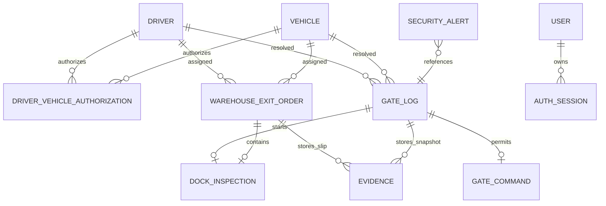

# Mô hình dữ liệu MongoDB và ERD logic

## Collection chính

| Collection | Dữ liệu quan trọng | Index |
|---|---|---|
| `drivers` | embedding ciphertext, dimension, model/version | employee_code unique sparse; status+created_at |
| `vehicles` | plate gốc/normalized, metadata | plate_normalized unique |
| `driver_vehicle_authorizations` | validity, status | driver_id+vehicle_id+valid_from unique; từ chối khoảng hiệu lực ACTIVE chồng lấn |
| `gate_logs` | event, direction, scores, reasons, evidence, barrier | event_id unique; direction+occurred_at |
| `warehouse_exit_orders` | assignment, state, slip hashes/version/ref | order_id unique; status+valid_until; exit_event_id sparse |
| `dock_inspections` | Gate In ref, captures, cargo timeline, operator note | order_id unique |
| `evidence` | object key, SHA-256, content metadata | object_key unique; correlation+created_at |
| `security_alerts` | sequence, severity, status, data | sequence unique; status+severity+time |
| `gate_commands` | command id, ACK/error | command_id unique |
| `users` | Argon2 password hash, role | username unique |
| `auth_sessions` | session/CSRF hash, expiry | token_hash unique; TTL expires_at |
| `device_credentials` | API key hash và scopes | name/key_hash unique |
| `sequence_counters` | sequence nguyên tử | `_id` unique mặc định |

MongoDB lưu datetime theo UTC. Client bật `tz_aware=True` để không trộn datetime naive và aware. Start dock, finalize dock và claim Gate Out + Gate Log dùng `MongoUnitOfWork` trên replica set.
