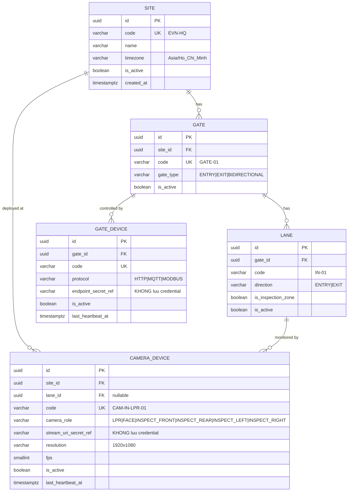
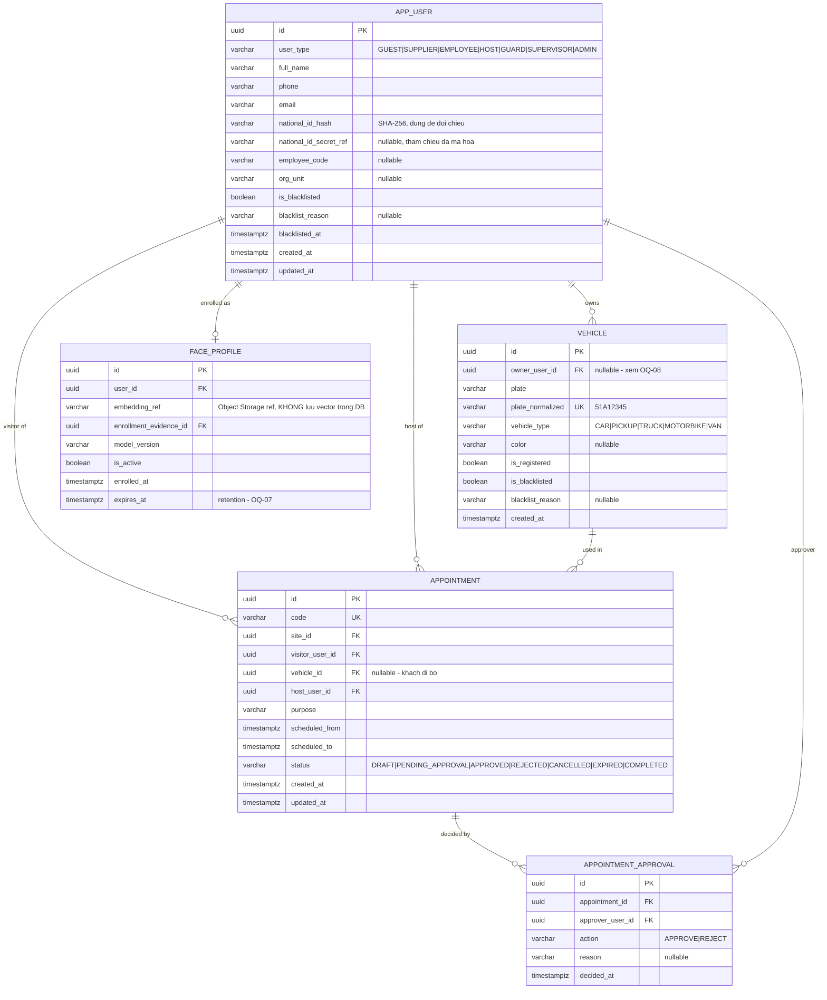
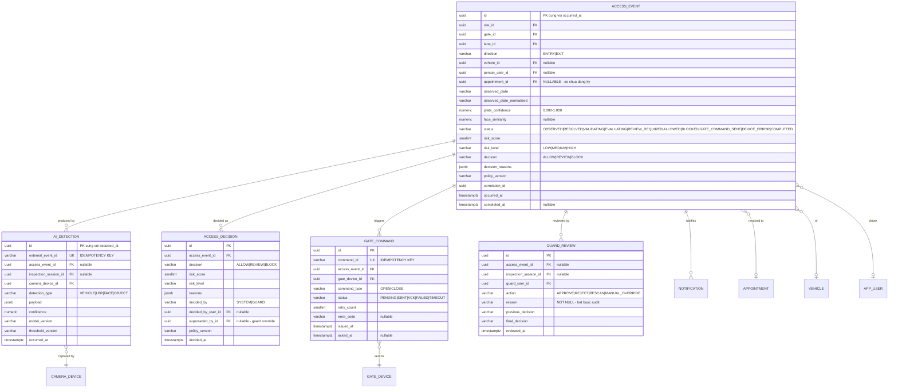
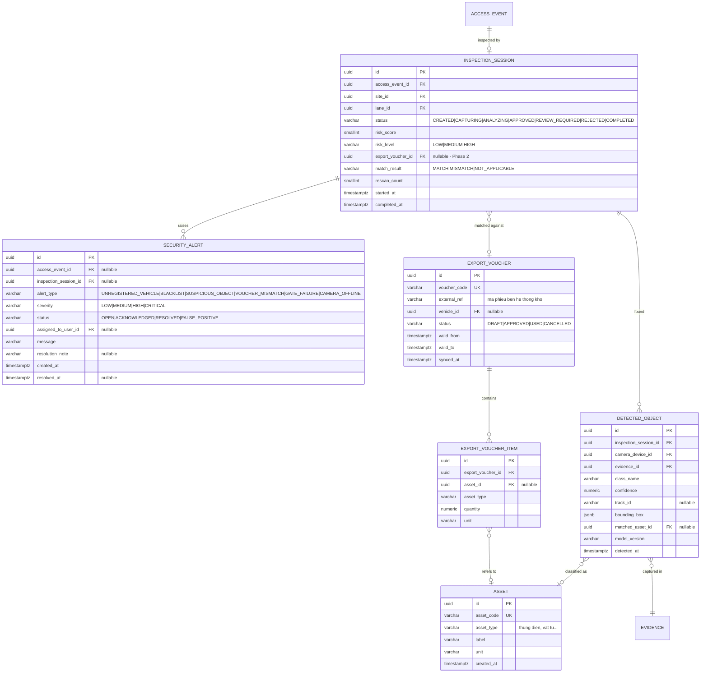
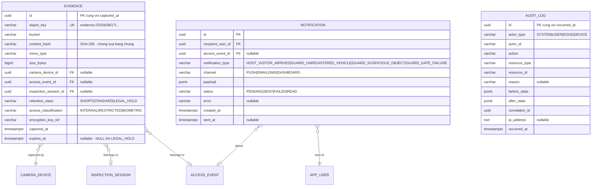
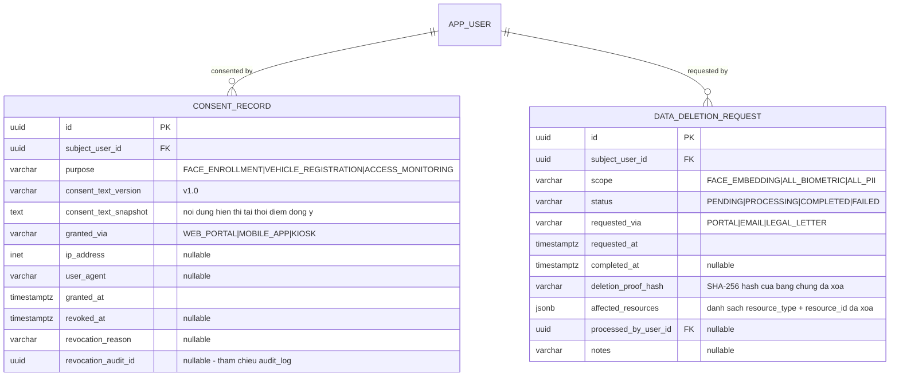

# Data Model — Entity Relationship Diagram

> **Project:** AI-Powered Vehicle Gate Control and Inventory Management System
> **Target DBMS:** PostgreSQL 16+
> **Nguồn yêu cầu:** BRD §7 Data Requirements
> **Trạng thái:** `PROPOSED` — chờ `OQ-01`, `OQ-07`, `OQ-08`

Tài liệu này là **physical data model**. Nó khác với Class Diagram (`diagrams.md §15`):

| | Class Diagram | ERD (tài liệu này) |
|---|---|---|
| Mục đích | Domain model — entity + behavior | Persistence model — bảng + ràng buộc |
| Có method? | Có (`approve()`, `reject()`) | Không |
| Có kiểu dữ liệu, index, nullable? | Không | Có |
| Ai dùng | Backend Dev (Domain layer) | Backend Dev (Infrastructure), DBA |

> ⚠️ Domain entity **không** ánh xạ 1-1 với bảng. Xem `project-structure.md` —
> ORM model chỉ tồn tại trong `infrastructure/database/models/`.

---

## 1. Nguyên tắc thiết kế

| # | Nguyên tắc | Xuất phát từ |
|---|---|---|
| 1 | `access_event.appointment_id` **NULLABLE** | BRD §8 — phải cảnh báo được phương tiện **chưa đăng ký** |
| 2 | **Không lưu raw** CCCD / face embedding trong bảng nghiệp vụ — chỉ lưu hash + reference đã mã hóa | BRD §11, `OQ-07`, `R-07` |
| 3 | Evidence binary nằm ở Object Storage; DB chỉ lưu metadata | System Design §15 |
| 4 | Mọi bảng sinh ra từ sự kiện ngoài đều có **idempotency key UNIQUE** | System Design §17, camera reconnect không được mở cổng 2 lần |
| 5 | Bảng cấu hình thiết bị **không lưu credential** — chỉ lưu secret reference | `development.md` Hardware Safety Rules |
| 6 | Bảng Phase 2 (voucher) tạo schema sẵn nhưng **không migrate** cho tới khi có Inventory API contract | RTM §6 `OQ-04` |
| 7 | Bảng tăng trưởng nhanh (`access_event`, `ai_detection`, `audit_log`, `evidence`) thiết kế sẵn để **partition theo tháng** | NFR Scalability |
| 8 | Soft delete **không** dùng cho dữ liệu sinh trắc học — phải xóa cứng để tuân thủ quyền xóa | `R-07` |

### Quy ước chung

- PK: `uuid` (UUIDv7 để giữ tính tuần tự theo thời gian, tốt cho index).
- Thời gian: `timestamptz`, luôn lưu UTC.
- Enum: dùng `varchar` + `CHECK` constraint thay vì native `ENUM` type (dễ thêm giá trị mới, không cần lock bảng).
- Mọi bảng có `created_at`; bảng có thể sửa có thêm `updated_at`.

---

## 2. ERD — Subject Area 1: Site & Device Configuration

Phục vụ yêu cầu nhân rộng ra các chi nhánh (BRD §9 Future Scope) và ràng buộc
phần cứng Out of Scope (`ADR-006`).



> `camera_role` chứa 4 giá trị `INSPECT_*` tương ứng **4 camera (trước, sau, 2 bên/cốp)**
> mà BRD §4 BR-04 yêu cầu.

---

## 3. ERD — Subject Area 2: Identity & Appointment

Phủ `FR01` (Đăng ký khách ra vào) và `DA-01` (Host Approval).



### 3.1 Tách `FACE_PROFILE` khỏi `APP_USER` — lý do

Dữ liệu sinh trắc học có vòng đời và quyền truy cập **khác** hồ sơ hành chính:

- Có thể phải xóa face embedding theo yêu cầu chủ thể dữ liệu mà **vẫn giữ** lịch sử ra vào để audit.
- Retention của face khác retention của user record (`OQ-07`).
- Phân quyền đọc face embedding hẹp hơn nhiều so với đọc tên/số điện thoại.

Nếu nhét embedding vào `app_user`, cả ba yêu cầu trên đều không thực hiện được sạch sẽ.

### 3.2 ⚠️ Vấn đề phát sinh — quan hệ User ↔ Vehicle

BRD §7 ghi *"1 User có thể đăng ký nhiều Vehicle"* → quan hệ **1-N**, và ERD này làm đúng theo BRD
(`vehicle.owner_user_id`).

Nhưng thực tế nghiệp vụ nhiều khả năng là **N-N**: một xe tải của nhà cung cấp thường
**đổi tài xế** giữa các lần giao hàng. Với mô hình 1-N hiện tại, mỗi lần đổi tài xế phải
sửa `owner_user_id`, làm mất lịch sử ai từng lái xe đó.

→ Đã ghi nhận thành **`OQ-08`**. Nếu khách xác nhận N-N, bổ sung bảng liên kết:

```sql
CREATE TABLE user_vehicle (
    user_id     uuid NOT NULL REFERENCES app_user(id),
    vehicle_id  uuid NOT NULL REFERENCES vehicle(id),
    relation    varchar(20) NOT NULL,  -- OWNER | AUTHORIZED_DRIVER
    valid_from  timestamptz NOT NULL,
    valid_to    timestamptz,
    PRIMARY KEY (user_id, vehicle_id, valid_from)
);
```

**Không implement trước khi có câu trả lời** — đây là thay đổi schema tốn kém nếu làm sai hướng.

---

## 4. ERD — Subject Area 3: Access Control (Core)

`ACCESS_EVENT` là core aggregate (`ADR-003`). Phủ `FR02`, `FR03`, `FR04`.



### 4.1 Vì sao tách `ACCESS_DECISION` khỏi `ACCESS_EVENT`

`access_event` giữ **quyết định hiện hành** (để query nhanh). `access_decision` giữ **lịch sử quyết định**.

Một lượt ra vào có thể có 2 quyết định: hệ thống ra `REVIEW`, sau đó Guard override thành `ALLOW`.
Nếu chỉ có 1 cột `decision` trên `access_event`, quyết định gốc của hệ thống bị ghi đè và
**không thể trả lời câu hỏi "hệ thống đã đề xuất gì trước khi người can thiệp"** — đây chính là
câu hỏi quan trọng nhất khi điều tra một vụ thất thoát tài sản.

Cột `superseded_by_id` tạo chuỗi quyết định có thứ tự.

### 4.2 Ràng buộc bắt buộc

```sql
-- Guard override PHAI co ly do (DA-02, DA-07)
ALTER TABLE guard_review
  ADD CONSTRAINT ck_guard_review_reason_not_blank
  CHECK (length(trim(reason)) > 0);

-- Idempotency: camera reconnect khong duoc mo cong 2 lan
ALTER TABLE ai_detection  ADD CONSTRAINT uq_ai_detection_event  UNIQUE (external_event_id);
ALTER TABLE gate_command  ADD CONSTRAINT uq_gate_command_id     UNIQUE (command_id);

-- Confidence luon trong [0,1]
ALTER TABLE access_event
  ADD CONSTRAINT ck_plate_confidence CHECK (plate_confidence BETWEEN 0 AND 1),
  ADD CONSTRAINT ck_face_similarity  CHECK (face_similarity IS NULL OR face_similarity BETWEEN 0 AND 1);

-- Da ALLOW thi bat buoc phai co ly do quyet dinh
ALTER TABLE access_event
  ADD CONSTRAINT ck_decision_has_reasons
  CHECK (decision IS NULL OR (decision_reasons IS NOT NULL AND jsonb_array_length(decision_reasons) > 0));
```

---

## 5. ERD — Subject Area 4: Exit Inspection & Inventory

Phủ `FR05` (Stage 1B) và `FR06` (Phase 2).



> **`SECURITY_ALERT.status` có giá trị `FALSE_POSITIVE`** — bắt buộc phải có.
> Rủi ro `R-01` nói độ chính xác nhận diện vật thể che khuất là không chắc chắn;
> nếu không đo được tỷ lệ báo động giả thì không hiệu chỉnh được ngưỡng risk (`DA-04`),
> và bảo vệ sẽ mất niềm tin vào hệ thống. Đây cũng là dữ liệu đầu vào cho `OQ-06`.

> **Bảng `ASSET`, `EXPORT_VOUCHER`, `EXPORT_VOUCHER_ITEM` thuộc Phase 2.**
> Tạo migration nhưng **không apply** cho tới khi có Inventory API contract từ khách hàng.

---

## 6. ERD — Subject Area 5: Evidence, Notification & Audit

Nền tảng cho `DA-02` (Audit) và `DA-03` (Evidence).



> `AUDIT_LOG` **cố ý không có Foreign Key** tới các bảng nghiệp vụ.
> Audit phải sống sót cả khi bản ghi gốc bị xóa (ví dụ xóa dữ liệu sinh trắc học theo `OQ-07`),
> nên chỉ lưu `resource_type` + `resource_id` dạng text. Bảng này **append-only** —
> không cấp quyền `UPDATE` / `DELETE` cho application role.

---

## 6.1. ERD — Subject Area 6: Consent & Data Subject Rights

> **Bắt buộc theo Luật Bảo vệ dữ liệu cá nhân 2025 (Luật 91/2025/QH15) và NĐ 356/2025/NĐ-CP.**
> Điều 31 đưa ra quy định chuyên biệt cho dữ liệu sinh trắc học.
> Hệ thống thu thập CCCD + ảnh khuôn mặt qua Portal → **bắt buộc** có cơ chế lưu bằng chứng đồng ý
> và luồng rút lại đồng ý. "Có nút tick" không đủ — cần lưu nội dung đã hiển thị, phiên bản, thời điểm, IP.



### 6.1.1 Vì sao cần `CONSENT_RECORD` tách riêng

- `APP_USER` chỉ lưu hồ sơ hành chính. Consent có **vòng đời riêng**: có thể rút lại, có nhiều mục đích,
  và cần snapshot nội dung tại thời điểm đồng ý (vì nội dung consent text có thể thay đổi giữa các phiên bản).
- Khi bị kiểm tra, cần chứng minh: chủ thể đã đồng ý **cụ thể cái gì**, **lúc nào**, **qua kênh nào**.

### 6.1.2 Luồng xóa dữ liệu khi chủ thể rút đồng ý

```text
1. Chủ thể gửi yêu cầu rút đồng ý → tạo DATA_DELETION_REQUEST (status=PENDING)
2. System xóa: face_profile.embedding_ref → xóa file trên Object Storage
3. System xóa: evidence có access_classification=BIOMETRIC liên quan
4. System KHÔNG xóa: audit_log (đã thiết kế không FK — ADR-003)
5. System ghi deletion_proof_hash + affected_resources
6. Nếu ADR-015 chọn phương án B/C: lan truyền lệnh xóa tới mọi Edge
7. Status → COMPLETED
```

> Bảng `AUDIT_LOG` không có FK → vẫn giữ được trace khi bản ghi gốc bị xóa.
> Đây là quyết định thiết kế đã có sẵn, và nó phục vụ đúng mục đích này.

---

## 7. Index Strategy

```sql
-- ACCESS_EVENT: truy van chinh cua Guard Dashboard
CREATE INDEX ix_access_event_site_gate_time
    ON access_event (site_id, gate_id, occurred_at DESC);

CREATE INDEX ix_access_event_plate
    ON access_event (observed_plate_normalized, occurred_at DESC);

-- Hang doi cho Guard: chi index cac ban ghi CHUA xu ly xong
CREATE INDEX ix_access_event_pending
    ON access_event (occurred_at DESC)
    WHERE status IN ('REVIEW_REQUIRED', 'GATE_COMMAND_SENT', 'DEVICE_ERROR');

CREATE INDEX ix_access_event_correlation ON access_event (correlation_id);
CREATE INDEX ix_access_event_appointment ON access_event (appointment_id)
    WHERE appointment_id IS NOT NULL;

-- APPOINTMENT: resolve lich hen khi xe toi cong (duong dan nong nhat)
CREATE INDEX ix_appointment_lookup
    ON appointment (vehicle_id, status, scheduled_from, scheduled_to)
    WHERE status = 'APPROVED';

CREATE INDEX ix_appointment_host ON appointment (host_user_id, status);

-- VEHICLE / USER: blacklist check
CREATE UNIQUE INDEX uq_vehicle_plate ON vehicle (plate_normalized);
CREATE INDEX ix_vehicle_blacklist ON vehicle (id) WHERE is_blacklisted;
CREATE INDEX ix_user_blacklist     ON app_user (id) WHERE is_blacklisted;
CREATE INDEX ix_user_national_id   ON app_user (national_id_hash);

-- ALERT: hang doi cua Guard
CREATE INDEX ix_alert_open
    ON security_alert (severity DESC, created_at DESC)
    WHERE status IN ('OPEN', 'ACKNOWLEDGED');

-- EVIDENCE: job don dep theo retention
CREATE INDEX ix_evidence_expiry ON evidence (expires_at)
    WHERE expires_at IS NOT NULL;

-- AUDIT: truy vet
CREATE INDEX ix_audit_resource    ON audit_log (resource_type, resource_id, occurred_at DESC);
CREATE INDEX ix_audit_correlation ON audit_log (correlation_id);
```

### Partitioning

| Bảng | Ước lượng tăng trưởng | Chiến lược |
|---|---|---|
| `access_event` | ~vài nghìn dòng/ngày/site | `RANGE` theo `occurred_at`, partition tháng |
| `ai_detection` | Cao nhất — nhiều detection cho 1 lượt | `RANGE` theo `occurred_at`, partition tháng |
| `evidence` | Metadata theo số ảnh chụp | `RANGE` theo `captured_at`, partition tháng |
| `audit_log` | Cao | `RANGE` theo `occurred_at`, partition tháng |

> Chưa triển khai partition ở PoC. Nhưng **đặt cột thời gian vào PK ngay từ đầu**
> (composite PK: `(id, occurred_at)` hoặc `(id, captured_at)`) để PostgreSQL cho phép
> partition key nằm trong PK/unique constraint.
> Sửa sau khi có 10 triệu dòng thì tốn kém hơn rất nhiều.

---

## 8. PII & Retention Classification

Bảng này là đầu vào trực tiếp để trả lời `OQ-07` và giảm thiểu `R-07`.

| Bảng.Cột | Phân loại | Lưu dạng | Retention đề xuất | Ai được đọc |
|---|---|---|---|---|
| `app_user.full_name`, `phone`, `email` | PII | Plain | Theo vòng đời quan hệ + N năm | Admin, Guard (hạn chế) |
| `app_user.national_id_hash` | PII — định danh | SHA-256 | Như trên | Chỉ để đối chiếu, không hiển thị |
| `app_user.national_id_secret_ref` | **PII nhạy cảm** | Reference tới vault | Ngắn nhất có thể | Admin + audit log bắt buộc |
| `face_profile.embedding_ref` | **Sinh trắc học** | Object Storage, mã hóa | **TBD — `OQ-07`** | Chỉ Vision service |
| `evidence` (ảnh khuôn mặt) | **Sinh trắc học** | Object Storage, mã hóa | `SHORT` mặc định | Guard + Supervisor, có audit |
| `evidence` (ảnh cốp xe / vật thể) | Nội bộ | Object Storage | `STANDARD` | Guard, Supervisor |
| `evidence` (`LEGAL_HOLD`) | Bằng chứng vụ việc | Object Storage | Không tự xóa | Supervisor + Legal |
| `vehicle.plate*` | PII gián tiếp | Plain | Theo access_event | Guard, Admin |
| `access_event.*` | Nghiệp vụ | Plain | Dài (audit) | Guard, Admin, Auditor |
| `audit_log.*` | Nghiệp vụ | Append-only | Dài nhất | Chỉ Auditor |

> ⚠️ **Ba con số retention vẫn đang bỏ trống** (face embedding, ảnh khuôn mặt, hồ sơ user).
> Không thể tự quyết — phải chờ khách hàng và bộ phận pháp chế trả lời `OQ-07`.
> Trước khi có câu trả lời, **không đưa hệ thống vào vận hành thật với dữ liệu người thật.**

---

## 9. Migration Order

Thứ tự tạo bảng theo phụ thuộc FK:

```text
1.  site → gate → lane → camera_device → gate_device
2.  app_user → face_profile
3.  vehicle
4.  appointment → appointment_approval
5.  access_event
6.  evidence                    (FK 2 chieu voi access_event -> tao FK sau)
7.  ai_detection
8.  access_decision
9.  gate_command
10. inspection_session
11. detected_object
12. guard_review
13. security_alert
14. notification
15. audit_log
─────────────── Phase 2, KHONG apply o Phase 1 ───────────────
16. asset
17. export_voucher → export_voucher_item
18. ALTER inspection_session ADD export_voucher_id
```

Bước 6 có phụ thuộc vòng (`evidence.access_event_id` ↔ `access_event` cần evidence).
Xử lý bằng cách tạo bảng trước, thêm FK constraint ở migration riêng sau.

---

## 10. Traceability

| Entity trong BRD §7 | Bảng trong ERD | Ghi chú |
|---|---|---|
| Users | `app_user` + `face_profile` | Tách sinh trắc học — xem §3.1 |
| Vehicles | `vehicle` | Cardinality theo BRD — xem cảnh báo `OQ-08` §3.2 |
| Appointments | `appointment` + `appointment_approval` | Approval là `DA-01` |
| Assets / Equipments | `asset` | Phase 2 |
| ExportVoucher | `export_voucher` + `export_voucher_item` | Phase 2 |
| — | `access_event` và các bảng liên quan | `DA-02`, `DA-03` — không có trong BRD |
| — | `site` / `gate` / `lane` / `*_device` | `DA-06` — không có trong BRD |

**Không có bảng nào cho `FR07` (Vehicle Tracking).** Chờ `OQ-05` xác định phạm vi
(chỉ vị trí đỗ cuối → 1 bảng đơn giản; toàn hành trình + Re-ID → cần time-series store riêng,
khác hoàn toàn về chi phí và công nghệ).
