# Smart Gate & Vehicle Security — Diagrams

Tập hợp Mermaid và PlantUML diagrams dùng chung cho BA, Backend, AI, IoT và DevOps.

> Mọi Use Case trong tài liệu này đều truy vết được về `FR01`–`FR07` của BRD.
> Xem `requirements-traceability.md` để biết hạng mục nào đã `CONFIRMED`,
> hạng mục nào còn `PROPOSED` hoặc `DESIGN-ADDED`.

## Cách xem sơ đồ

| Loại | Xem bằng gì |
|---|---|
| **Mermaid** | Cài extension **Markdown Preview Mermaid Support** (`bierner.markdown-mermaid`) → `Ctrl+Shift+V` |
| **PlantUML** | Cài extension **PlantUML** (`jebbs.plantuml`) → mở file → `Alt+D`. Cần Java + Graphviz, hoặc trỏ về server `https://www.plantuml.com/plantuml` trong settings |

```bash
code --install-extension bierner.markdown-mermaid
code --install-extension jebbs.plantuml
```

> Các sơ đồ UML thuần (Use Case, Class Diagram) có **cả 2 bản**: bản Mermaid để xem nhanh
> không cần cài gì thêm ngoài extension mermaid, và bản PlantUML chuẩn UML để đưa vào tài liệu bàn giao.

---

## 1. System Context

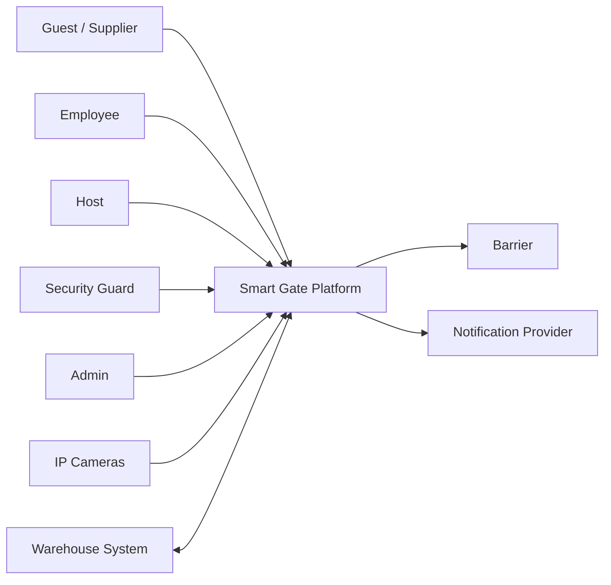

---

## 2. Use Case Diagram

Sơ đồ Use Case chuẩn UML (PlantUML), áp dụng nguyên tắc scoping của Cockburn:

- Actor người dùng đồng bộ với **System Context** (mục 1) và **BRD §2**: Guest/Supplier, Employee, Host, Security Guard, Admin.
- `Edge AI` và `Warehouse System` là **actor hệ thống phụ (system actor)**, chỉ tham gia các use case ở mức sub-function.
- Các use case mức sub-function (Recognize Plate, Verify Face, Detect Objects, Match Voucher, Evaluate Access Risk) là quan hệ **`<<include>>`** bên trong use case mức user-goal — đúng "coffee-break test": actor chỉ nghỉ giải lao sau khi *Enter Site* / *Inspect Vehicle at Exit* hoàn tất.
- `Open Gate` không phải use case riêng — là postcondition trong Normal Course của `Enter Site` (xem mục 5 và 7).
- `Review Access` và `Review Alert` là quan hệ **`<<extend>>`**: chỉ xảy ra khi có ngoại lệ (risk flagged / mismatch detected).

### 2.1 Bản Mermaid — xem nhanh

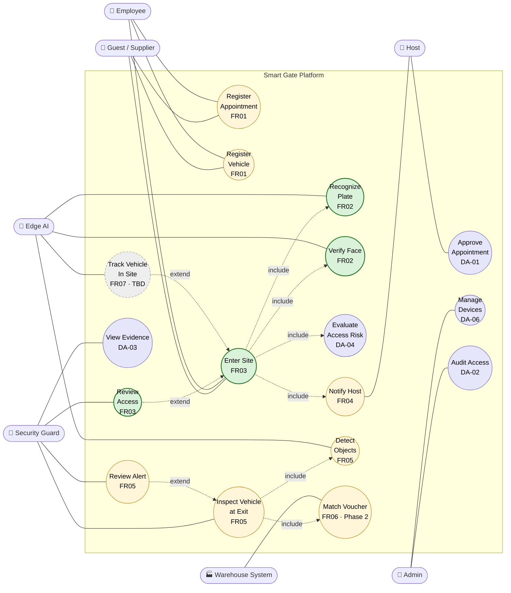

| Màu | Ý nghĩa |
|---|---|
| 🟩 Xanh lá | `CONFIRMED` — khách đã xác nhận |
| 🟨 Vàng | `PROPOSED` — team đề xuất, chờ chốt |
| 🟪 Tím | `DESIGN-ADDED` — team tự thêm, không có trong BRD |
| ⬜ Xám nét đứt | `NEEDS CONFIRMATION` — **không estimate** (`OQ-05`) |

> Mermaid không có sơ đồ Use Case chuẩn UML. Bản trên dùng flowchart để mô phỏng
> (hình tròn = use case, đường liền = association, đường đứt = `include` / `extend`).
> Bản chuẩn UML nằm ở §2.2.

### 2.2 Bản PlantUML — chuẩn UML để bàn giao

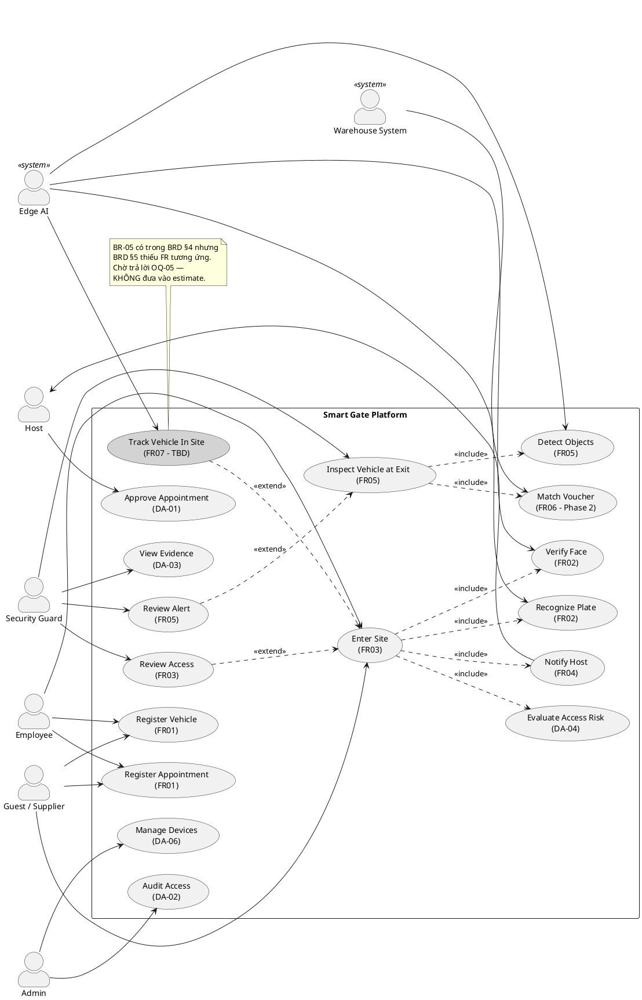

### 2.3 Use Case → Requirement Traceability

| Use Case | FR / ID | Actor chính | Phase | Status |
|---|---|---|---|---|
| Register Appointment | FR01 | Guest / Supplier / Employee | 1 | `PROPOSED` |
| Register Vehicle | FR01 | Guest / Supplier / Employee | 1 | `PROPOSED` |
| Approve Appointment | `DA-01` | Host | 1 | `DESIGN-ADDED` |
| Enter Site | FR03 | Guest / Employee | 1 | **`CONFIRMED`** |
| ├─ Recognize Plate | FR02 | Edge AI | 1 | **`CONFIRMED`** |
| ├─ Verify Face | FR02 | Edge AI | 1 | **`CONFIRMED`** |
| ├─ Evaluate Access Risk | `DA-04` | — | 1 | `DESIGN-ADDED` |
| └─ Notify Host | FR04 | — → Host | 1 | `PROPOSED` |
| Review Access | FR03 | Guard | 1 | **`CONFIRMED`** |
| Track Vehicle In Site | FR07 | Edge AI | **TBD** | ⚠️ `NEEDS CONFIRMATION` |
| Inspect Vehicle at Exit | FR05 | Guard | 1 | `PROPOSED` |
| ├─ Detect Objects | FR05 | Edge AI | 1 | `PROPOSED` |
| └─ Match Voucher | FR06 | Warehouse System | 2 | `PROPOSED` |
| Review Alert | FR05 | Guard | 1 | `PROPOSED` |
| View Evidence | `DA-03` | Guard | 1 | `DESIGN-ADDED` |
| Manage Devices | `DA-06` | Admin | 1 | `DESIGN-ADDED` |
| Audit Access | `DA-02` | Admin | 1 | `DESIGN-ADDED` |

---

## 3. Business Process — AS-IS vs TO-BE

Nguồn: BRD §6.

### 3.1 AS-IS — quy trình thủ công hiện tại

```mermaid
flowchart LR
    A["Khách / NV<br/>đến cổng"] --> B["Dừng xe<br/>chờ đợi"]
    B --> C["Xuất trình CCCD<br/>khai báo thủ công"]
    C --> D["Bảo vệ ghi sổ<br/>liên hệ người bên trong"]
    D --> E["Bảo vệ mở cổng<br/>thủ công"]
    E --> F["Xe vào bãi<br/>KHÔNG theo dõi"]
    F --> G["Xe ra cổng"]
    G --> H["Bảo vệ yêu cầu<br/>mở cốp / cửa"]
    H --> I["Kiểm tra<br/>bằng MẮT THƯỜNG"]
    I --> J["Mở cổng cho ra"]
```

### 3.2 TO-BE — quy trình đề xuất

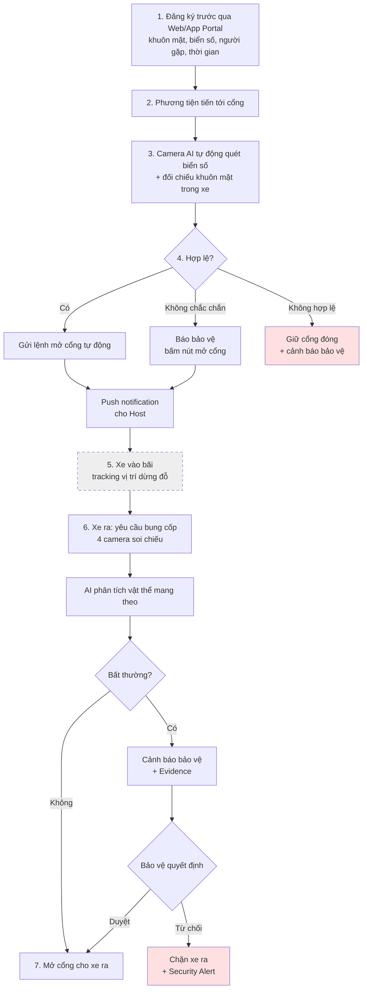

| Bước TO-BE | FR | Status |
|---|---|---|
| 1. Đăng ký trước qua Portal | FR01 | `PROPOSED` |
| 2–3. Camera AI quét biển số + khuôn mặt | FR02 | **`CONFIRMED`** |
| 4. Kiểm tra hợp lệ → mở cổng / báo bảo vệ | FR03 | **`CONFIRMED`** |
| 4b. Push notification cho Host | FR04 | `PROPOSED` |
| 5. Tracking vị trí dừng đỗ trong bãi | FR07 | ⚠️ `NEEDS CONFIRMATION` (`OQ-05`) |
| 6. Bung cốp, 4 camera soi chiếu, AI phân tích | FR05 | `PROPOSED` — rủi ro `R-01` |
| 6b. Đối chiếu Phiếu xuất kho | FR06 | `PROPOSED` — Phase 2 |
| 7. Mở cổng cho ra nếu không bất thường | FR05 | `PROPOSED` |

> Bước 5 được vẽ **nét đứt** vì BRD nêu trong TO-BE nhưng không có FR tương ứng.
> Không triển khai cho tới khi `OQ-05` được trả lời.

---

## 4. Component Architecture

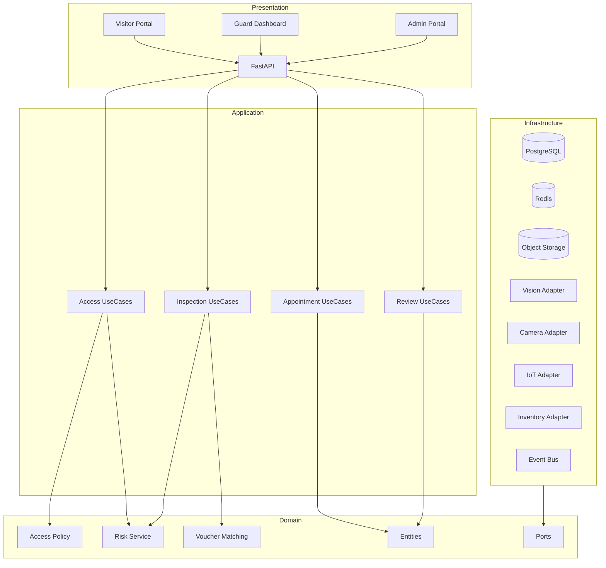

---

## 5. Vehicle Entry Flow

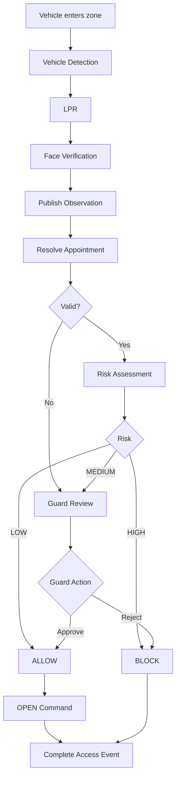

---

## 6. Exit Inspection Flow

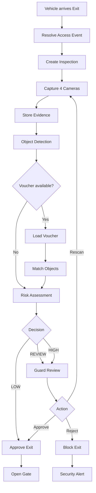

---

## 7. Access State Machine

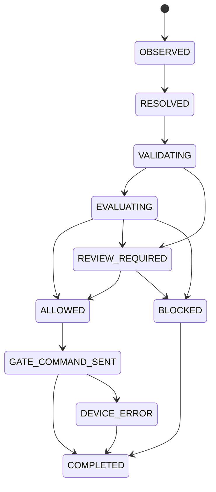

---

## 8. Inspection State Machine

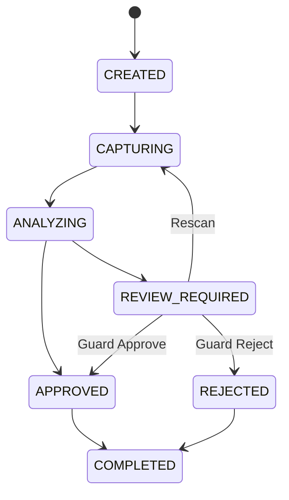

---

## 9. Edge AI Pipeline

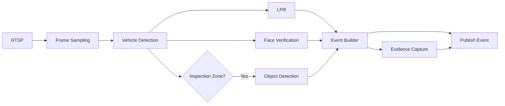

---

## 10. Risk Engine

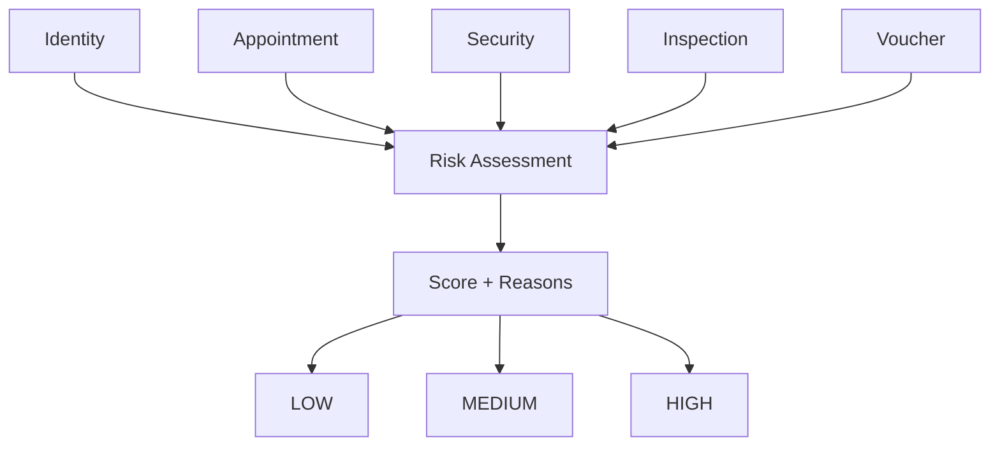

---

## 11. Multi-site Deployment

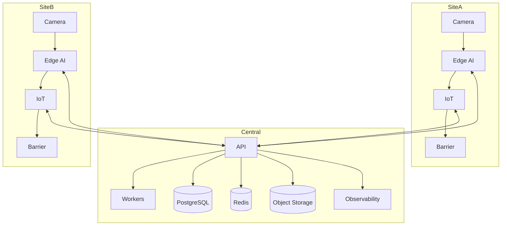

---

## 12. Entry Sequence

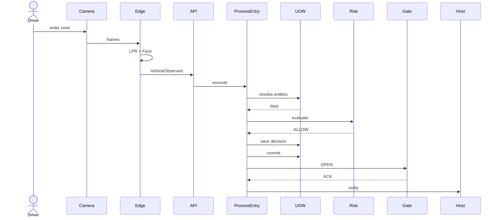

---

## 13. Manual Review Sequence

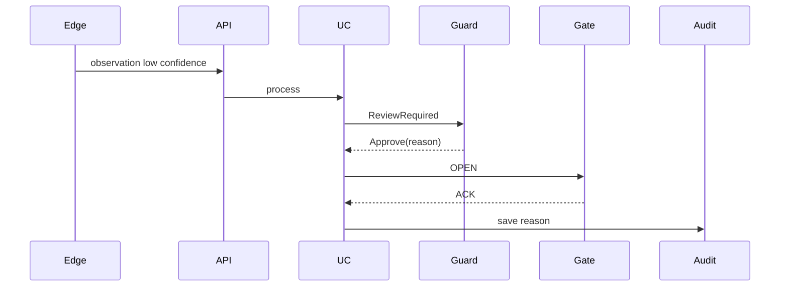

---

## 14. Exit Voucher Mismatch

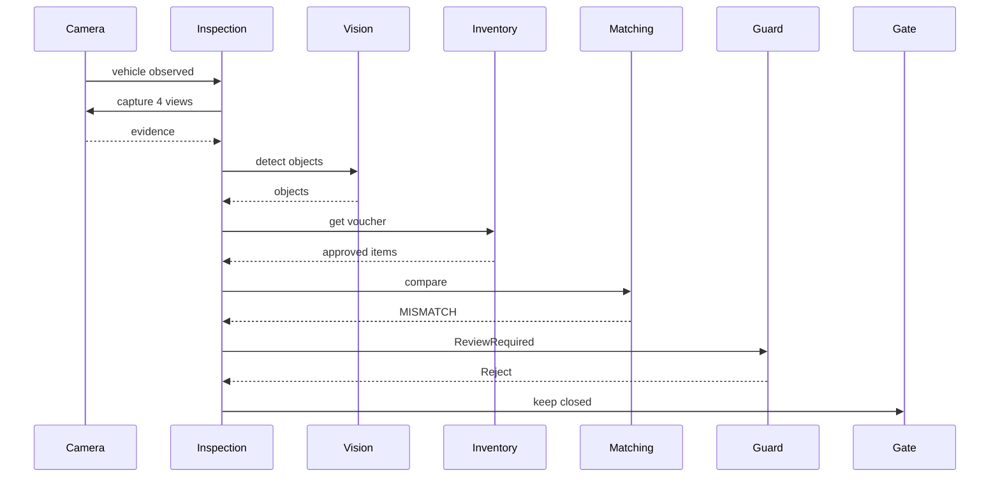

---

# PlantUML

## 15. Core Domain Class Diagram

Bao phủ toàn bộ entity trong **BRD §7 Data Requirements**, giữ đúng cardinality mà BRD mô tả
(*"1 User có thể đăng ký nhiều Vehicle"*, *"1 Vehicle khi rời công ty có thể liên kết 1 ExportVoucher"*).

> Đây là **domain model** (có behavior). Mô hình bảng vật lý — kiểu dữ liệu, PK/FK, index,
> constraint — nằm ở tài liệu riêng: **`data-model-erd.md`**.

### 15.1 Bản Mermaid — xem nhanh

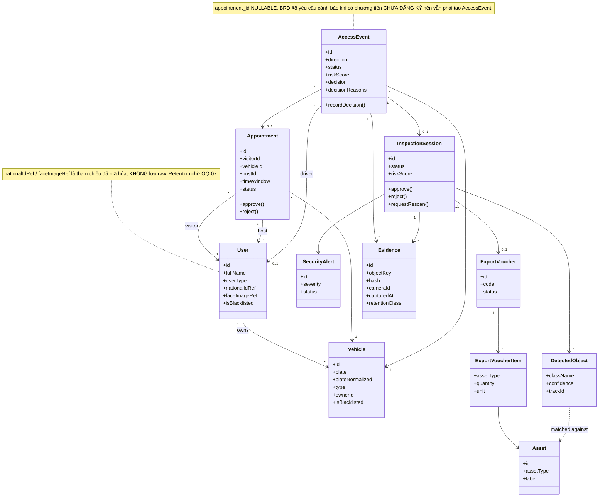

### 15.2 Bản PlantUML — chuẩn UML để bàn giao

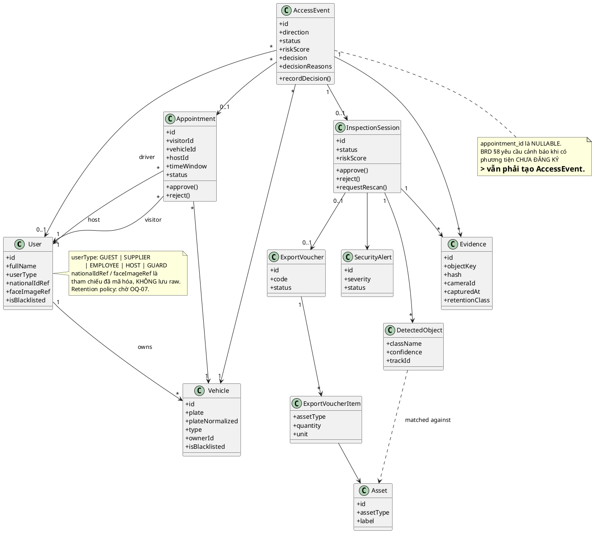

> `ExportVoucher` / `ExportVoucherItem` / `Asset` thuộc **Phase 2** (`FR06`).
> Thiết kế sẵn quan hệ nhưng chưa triển khai cho tới khi có Inventory API contract.

---

## 16. Clean Architecture Dependency Diagram

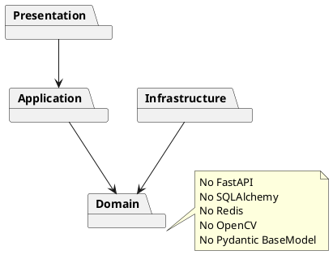
