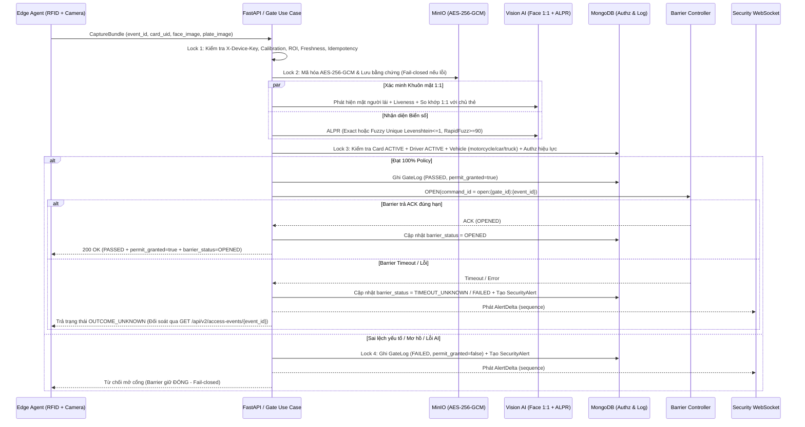
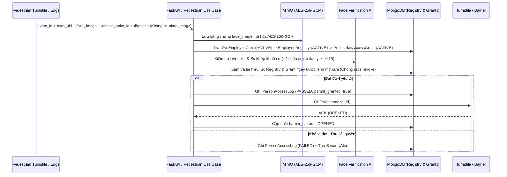
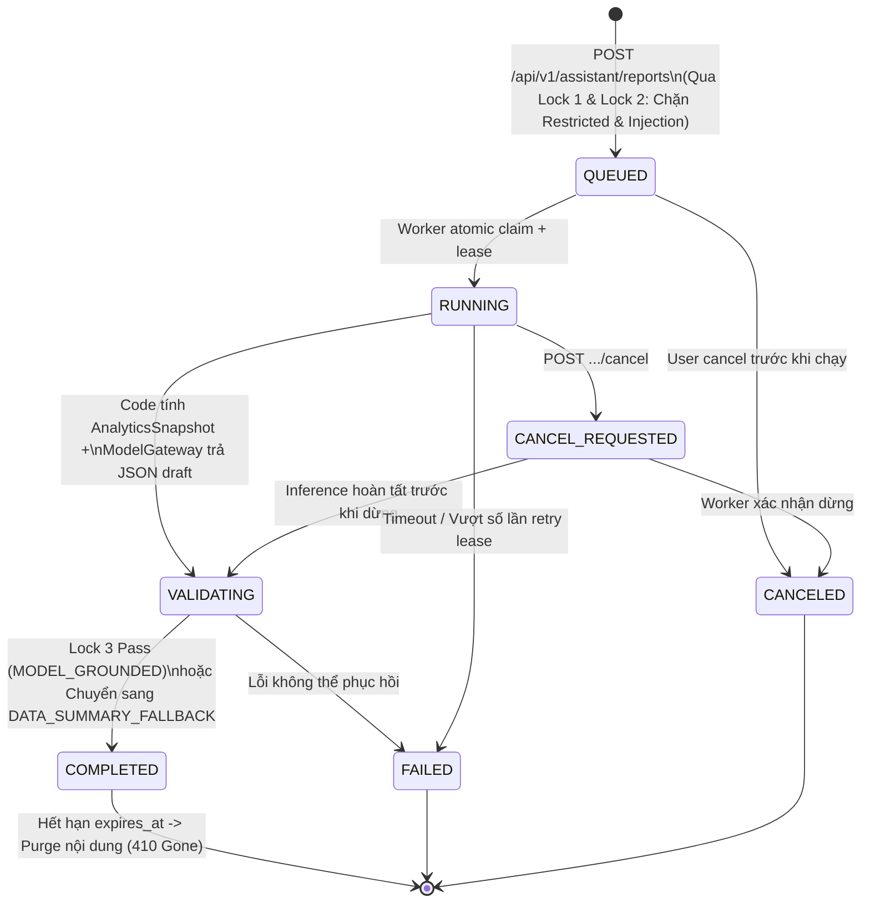
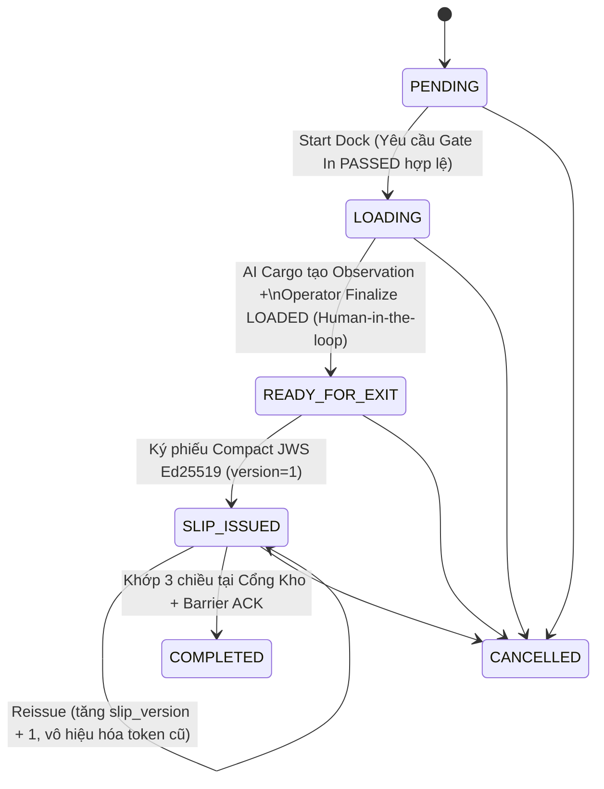

# Sơ đồ Kiến trúc & Luồng Nghiệp vụ — EV Smart Gate

> Các sơ đồ tương tác chất lượng cao (HTML standalone, hỗ trợ zoom, trace flow, inspector) được tạo bằng **Archify**:
> - 🏛️ **Kiến trúc Tổng thể Hệ thống & React Migration**: [ev-smart-gate-architecture.html](file:///e:/ev-smart-gate/docs/diagrams/ev-smart-gate-architecture.html) (Specification: [ev-smart-gate-architecture.json](file:///e:/ev-smart-gate/docs/diagrams/ev-smart-gate-architecture.json))
> - 🔄 **Trình tự Xác minh 3 Yếu tố & Vòng đời Auth**: [ev-smart-gate-verification-auth.html](file:///e:/ev-smart-gate/docs/diagrams/ev-smart-gate-verification-auth.html) (Specification: [ev-smart-gate-verification-auth.json](file:///e:/ev-smart-gate/docs/diagrams/ev-smart-gate-verification-auth.json))

---

## 1. Luồng Cổng Phương tiện Đa yếu tố (`Vehicle Gate In / Gate Out` — 3 Nhóm xe)

---

## 2. Luồng Cổng Nhân viên Đi bộ (`Pedestrian Access` — 4 Yếu tố, Độc lập với Xe)

---

## 3. Máy Trạng thái Công việc Báo cáo AI Nội bộ (`ReportJob Lifecycle` — `UC-AI-03`)

---

## 4. Máy Trạng thái Lệnh Xuất Kho (`Warehouse Exit Order` — Module Mở rộng)

