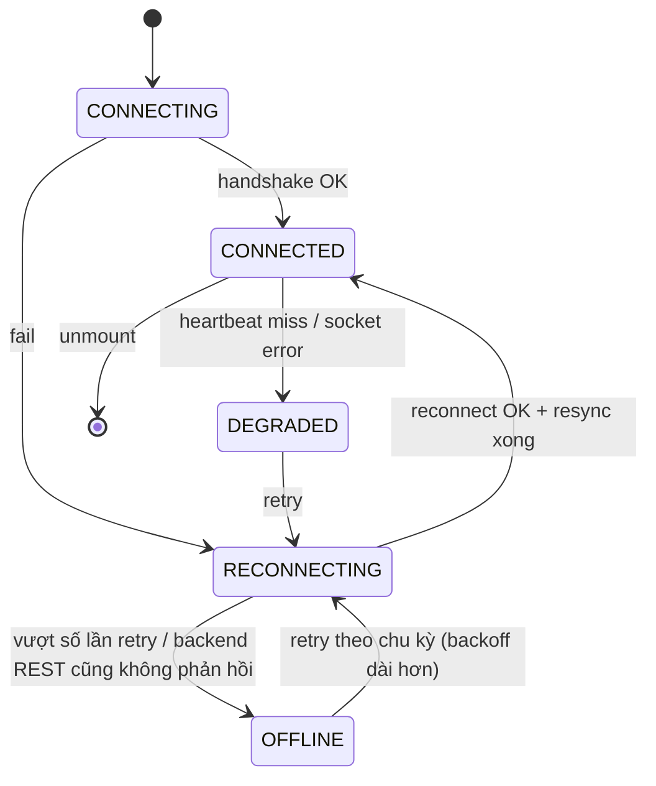

# Smart Gate & Vehicle Security Platform — Frontend Architecture

> **Project:** AI-Powered Vehicle Gate Control and Inventory Management System
> **Client:** Tổng Công ty Điện lực
> **Status:** DRAFT / PROPOSED — chờ Official Requirement bằng văn bản (`OQ-01`)
> **Phạm vi:** Web/App Portal (FR01), Guard Dashboard (FR02/FR03/FR05), Admin Portal, Host Notification (FR04)

> ⚠️ **Đọc `requirements-traceability.md` và `smart-gate-system-design.md` trước tài liệu này.**
> Tài liệu này chỉ mô tả *giải pháp kỹ thuật phía Frontend*. Trạng thái xác nhận của từng
> module nghiệp vụ (`CONFIRMED` / `PROPOSED` / `DESIGN-ADDED`) được quản lý tập trung tại RTM —
> **chỉ ưu tiên implement UI cho các use case `CONFIRMED`** (`process_entry_observation`,
> `review_access_decision` — xem `project-structure.md` §Implementation Priority).

---

## Document Control

| | |
|---|---|
| Tài liệu | `frontend-architecture.md` |
| Phiên bản | v0.1 |
| Trạng thái | DRAFT / PROPOSED |
| Đối tượng đọc | Frontend Dev, Tech Lead, BA, Architect |
| Tài liệu nguồn | `requirements-traceability.md`, `smart-gate-system-design.md`, `project-structure.md` |

### Revision History

| Version | Ngày | Thay đổi |
|---|---|---|
| v0.1 | 2026-08-17 | Bản đầu tiên — chốt qua interview kiến trúc (grill-me), gồm 16 quyết định nền tảng + phần đào sâu WebSocket reliability / Auth+RBAC / Critical Command Workflow |

---

# PART A — OVERVIEW

## 1. Purpose & Scope

Tài liệu này định nghĩa kiến trúc kỹ thuật cho **3 ứng dụng frontend riêng biệt**, tương ứng
3 client đã có trong `smart-gate-system-design.md §6`:

| Ứng dụng | Actor | FR liên quan | Auth model |
|---|---|---|---|
| **Portal** (Visitor/Host) | Guest, Supplier, Host | FR01 (đăng ký), FR04 (thông báo Host) | Magic Link (Guest/Supplier, không tài khoản) + JWT (Host) |
| **Guard Dashboard** | Guard | FR02, FR03, FR05 | JWT + RBAC |
| **Admin Portal** | System Admin, Security Supervisor | Cấu hình policy/user/site (`DA-06`, `DA-08`) | JWT + RBAC |

Không thiết kế 1 ứng dụng dùng chung cho cả 3 nhóm actor — lý do: mô hình quyền, tần suất
thao tác, yêu cầu real-time và rủi ro bảo mật khác nhau hoàn toàn giữa Guest (không tài khoản,
thao tác 1 lần) và Guard (tài khoản nội bộ, thao tác liên tục theo ca, cần real-time).

## 2. Guiding Principles

1. **Server là nguồn quyết định duy nhất** (kế thừa `ADR-002` của HLD: *AI Result != Access
   Decision*). Frontend không tự suy luận trạng thái an ninh — chỉ hiển thị và gửi lệnh; mọi
   quyết định (approve/reject/risk score) đến từ backend.
2. **Fail-safe, not fail-open** (Guardrail #14) áp dụng cả ở tầng UI: khi mất kết nối, UI phải
   khoá thao tác ảnh hưởng cổng, không được để Guard thao tác "mù" trên dữ liệu cũ mà không cảnh báo.
3. **Composition Pattern bắt buộc** (yêu cầu tường minh của dự án): không viết component
   gộp nhiều trách nhiệm. Tách theo 4 mối quan tâm độc lập — xem §8.
4. **Không tối ưu sớm cho việc chưa xảy ra** (YAGNI) — các phần chưa cần thiết (i18n framework,
   Redux, micro-frontend...) được ghi nhận là *contingency option*, không đưa vào stack ban đầu.

---

# PART B — ARCHITECTURE DECISIONS

## 3. Monorepo & Tooling

**Quyết định:** pnpm workspaces, **không dùng Nx/Turborepo build-cache nâng cao** ở giai đoạn
hiện tại — quy mô 3 apps + ~8 packages chưa đủ lớn để công sức cấu hình caching mang lại ROI
rõ ràng. Turborepo được dùng ở mức tối thiểu (chạy script song song `dev`/`build`/`test` qua
`turbo.json`), không dùng remote caching.

```text
ev-smart-gate-frontend/
├── apps/
│   ├── portal/
│   ├── guard-dashboard/
│   └── admin-portal/
├── packages/
│   ├── api-client/       # OpenAPI-generated client + typed hooks
│   ├── auth/              # token/session/permission logic dùng chung
│   ├── config/            # runtime config schema + loader
│   ├── domain/             # business logic thuần (không phụ thuộc React)
│   ├── observability/      # Sentry init, logger
│   ├── test-utils/         # test fixtures, mock server handlers
│   ├── eslint-config/
│   └── tsconfig/
├── turbo.json
├── pnpm-workspace.yaml
└── package.json
```

> **Không tạo `packages/ui`** dùng chung UI component cho cả 3 app. Lý do: Guard Dashboard +
> Admin Portal dùng Ant Design, Portal dùng Tailwind + shadcn/ui (§6) — 2 design language khác
> nhau, ép dùng chung sẽ ra abstraction giả tạo, khó maintain hơn là không chia sẻ. Chỉ chia sẻ
> logic (domain, auth, api-client), không chia sẻ presentation.

**ADR-007 — Monorepo pnpm workspaces, 3 app riêng biệt, không remote build-cache**
Context: cần chia sẻ type/domain logic giữa 3 app deploy độc lập nhưng không muốn overhead
cấu hình Nx/Turborepo caching khi số lượng package còn nhỏ.
Decision: pnpm workspaces + Turborepo mức cơ bản (song song hoá script), review lại nếu số
package/app tăng đáng kể (M5/M6 — multi-site, thêm app).
Alternative: Nx (bị bác — learning curve không tương xứng quy mô hiện tại).

## 4. Tech Stack Matrix

| Layer | Portal | Guard Dashboard | Admin Portal |
|---|---|---|---|
| Framework | React + TypeScript + Vite (SPA) | React + TypeScript + Vite (SPA) | React + TypeScript + Vite (SPA) |
| UI Library | Tailwind CSS + shadcn/ui | Ant Design | Ant Design |
| Server state | TanStack Query | TanStack Query | TanStack Query |
| Real-time | — (không cần WS) | WebSocket (native, qua `packages/domain`) | — |
| Forms | (P1 — xem §17 Open Items) | (P1) | (P1) |
| Routing | React Router | React Router | React Router |
| Auth | Magic Link (Guest/Supplier) + JWT (Host) | JWT + RBAC | JWT + RBAC |

Không dùng SSR — cả 3 app build ra static bundle, phục vụ qua Nginx trong Docker (§13).

## 5. Folder Structure (Layer-based + Domain Namespace)

**Quyết định gốc (câu 15 interview):** Layer-based (chia theo loại file), theo lựa chọn tường
minh của chủ dự án — không phải Feature-based dù đó là khuyến nghị ban đầu của tôi.

**Tinh chỉnh sau review:** để tránh 1 thư mục layer chứa hàng trăm file phẳng khi app lớn lên,
mỗi layer có thêm **1 cấp namespace theo domain nghiệp vụ** bên trong nó.

```text
apps/guard-dashboard/src/
├── components/
│   ├── access-event/       # AccessEventCard, AccessEventList...
│   ├── inspection/
│   ├── alert/
│   └── gate-control/
├── hooks/
│   ├── access-event/        # useAccessEventStream, useApproveAccess...
│   ├── inspection/
│   └── ws-connection/       # useWebSocketConnection (state machine, §9)
├── domain/                  # business logic THUẦN — không import React/hook
│   ├── access-event/         # ví dụ: gom nhóm event theo site, tính badge count
│   └── manual-override/      # invariant "reason required" (§11)
├── validators/               # schema validation (Zod) — tách khỏi domain & hook
│   ├── manual-override.schema.ts
│   └── appointment-form.schema.ts
├── services/                 # I/O thuần: gọi api-client, WS client wrapper
├── pages/
└── config/
```

Hai layer mới so với đề xuất ban đầu: **`domain/`** (business logic thuần, framework-agnostic,
dễ unit test không cần render React) và **`validators/`** (schema validation tách riêng khỏi
hook, dùng chung được giữa form UX-validation và domain invariant).

## 6. Composition Pattern

Yêu cầu tường minh của dự án: *"tách component ra, không viết gom thành 1 cục khó maintain"*.
Nguyên tắc áp dụng — tách theo **4 mối quan tâm độc lập**, không dồn hết vào 1 chỗ (kể cả hook):

| Mối quan tâm | Nơi đặt | Ví dụ |
|---|---|---|
| Trình bày (rendering) | `components/` | `AccessEventCard` chỉ nhận props, không gọi API |
| Điều phối phụ thuộc React (state, effect, subscribe) | `hooks/` | `useAccessEventStream` gọi WS + Query, trả data cho component |
| Business logic thuần | `domain/` | `groupEventsBySite()`, `computeOverrideAuditPayload()` — hàm thuần, test không cần React |
| I/O | `services/` | gọi `api-client`, wrap WebSocket client |
| Xác thực dữ liệu | `validators/` | schema Zod cho form và cho domain invariant |

**Compound Component**: chỉ dùng khi các phần thực sự chia sẻ ngữ cảnh semantic (ví dụ
`InspectionPanel.Header` / `.EvidenceGrid` / `.Actions` cùng thuộc 1 phiên kiểm tra). Không ép
mọi component phức tạp thành compound — composition qua props/children thường là đủ.

**Ngưỡng kích thước**: 150-200 dòng là **cảnh báo**, không phải giới hạn cứng. Tín hiệu thật sự
cần tách nhỏ: số `useEffect` > 2, số state field > 5, trộn lẫn side-effect API và WS trong cùng
component, hoặc component vừa render UI vừa chứa business rule.

## 7. State Management Strategy

| Loại state | Công cụ | Lý do |
|---|---|---|
| Server state (REST) | TanStack Query | Cache, dedupe, retry, stale-while-revalidate có sẵn |
| Real-time state (WS) | TanStack Query (`setQueryData`/`invalidateQueries`) | Coi WS event như một nguồn cập nhật cache, không tạo store riêng song song — tránh 2 nguồn sự thật |
| UI state thuần (modal, tab, filter panel) | `useState`/`useReducer` | Không cần cache, không cần chia sẻ ngoài component |
| State toàn cục thật sự cross-cutting (nếu phát sinh) | **Zustand hoặc Redux Toolkit — contingency, chưa dùng ngay** | Chỉ thêm khi có nhu cầu cụ thể, không thêm trước |

Redux Toolkit + RTK Query bị loại ở vòng chốt vì phần lớn business logic của hệ thống nằm ở
server (đúng tinh thần `ADR-002`), và TanStack Query đã phủ hết nhu cầu server-state + real-time
cache — thêm Redux sẽ trùng chức năng, tăng boilerplate mà không giải quyết vấn đề mới. Giữ lại
làm phương án dự phòng nếu sau này phát sinh state client-side phức tạp thật sự (ví dụ: một quy
trình multi-step wizard nhiều màn hình cần state máy phức tạp không map tốt vào server cache).

## 8. API Integration — OpenAPI Codegen

**Quyết định:** sinh client TypeScript type-safe từ OpenAPI schema của backend FastAPI (công cụ
kiểu `orval`/`openapi-typescript`), thay vì viết tay từng API call.

**Drift-control pipeline** (bắt buộc, tránh lệch schema âm thầm giữa BE/FE):

1. `openapi.json` được commit vào `packages/api-client/` như 1 snapshot có version.
2. CI có bước diff schema mới lấy từ backend `/openapi.json` với snapshot đã commit — fail
   build nếu lệch mà chưa cập nhật snapshot + regenerate client.
3. Contract test tối thiểu cho các endpoint P0 (`process_entry_observation` output shape,
   `review_access_decision` request/response) — tương tự tinh thần `tests/contract/` đã có ở
   backend (`project-structure.md`).
4. Pin version cụ thể của công cụ generator trong `package.json` (không dùng `latest`) để
   tránh output thay đổi ngoài ý muốn giữa các lần chạy CI.

## 9. Real-time Architecture (WebSocket)

Đây là phần được đào sâu nhất theo yêu cầu review — trạng thái ban đầu chỉ mới quyết định
*dùng WebSocket* (câu 5), chưa có protocol reconnect/resync.

### 9.1 Connection State Machine



| Trạng thái | UI behaviour |
|---|---|
| `CONNECTED` | Bình thường — nhận alert/access event real-time |
| `DEGRADED` | Banner cảnh báo "mất real-time updates, đang thử kết nối lại" — **REST vẫn hoạt động**, Guard vẫn thao tác được (mỗi hành động là 1 lệnh confirm-based qua REST, không phụ thuộc WS — xem §11) |
| `RECONNECTING` | Giống `DEGRADED` về UX, backoff mũ + jitter giữa các lần thử |
| `OFFLINE` | Cả WS và REST đều không phản hồi → banner đỏ "Hệ thống trung tâm không phản hồi — chuyển sang xử lý thủ công theo quy trình vật lý (ngoài phần mềm)", **khoá các nút Approve/Reject/Override/Open Gate trong UI** vì không có backend để gửi lệnh tới (đúng Guardrail #14 — không fail-open, và về bản chất kỹ thuật cũng không có nơi để gửi lệnh) |

Điểm mấu chốt: **`DEGRADED` (chỉ mất WS) và `OFFLINE` (mất cả REST) là 2 trạng thái khác nhau**,
không gộp chung — vì mất kênh real-time không có nghĩa backend đã chết; ép Guard chuyển hẳn
sang quy trình thủ công chỉ khi thực sự không còn kết nối tới backend.

### 9.2 Resync sau reconnect

Khi WS chuyển `RECONNECTING → CONNECTED`, **không** tin ngay các event tới tiếp theo là đầy đủ.
Bắt buộc gọi 1 REST endpoint resync (ví dụ `GET /access-events?since=<last_known_event_id>`)
để lấy lại các event có thể đã miss trong lúc mất kết nối, trước khi coi luồng WS là đáng tin
lại. Đây là lý do TanStack Query phù hợp: resync = 1 lần `invalidateQueries` + refetch, không
cần logic merge state thủ công.

### 9.3 Event ordering & Idempotency

Frontend xử lý mọi WS event **idempotent theo `event_id`** (dedupe nếu nhận trùng — có thể xảy
ra khi vừa resync REST vừa nhận lại event cũ qua WS). Nếu event tới sai thứ tự, sắp xếp lại theo
timestamp trước khi áp dụng vào cache.

> **DA-10 (DESIGN-ADDED, cần backend bổ sung):** `smart-gate-system-design.md §8.3` (AI Event
> Contract) hiện có `event_id` nhưng **chưa có `sequence`/`version` tường minh** để frontend
> phát hiện chắc chắn việc mất/trùng event khi mất kết nối dài. Đề xuất bổ sung field
> `sequence` (tăng dần theo site/gate) vào các event push qua WS (`AccessEvent`, `SecurityAlert`).
> Cần trao đổi với backend team trước khi coi phần idempotency ở FE là hoàn chỉnh.

## 10. Authentication & Authorization

### 10.1 Token Storage & Session

**Quyết định:** dùng **httpOnly Secure cookie** do backend set khi login, **không lưu access
token trong `localStorage`** — giảm rủi ro đánh cắp token qua XSS, phù hợp với mức nhạy cảm của
dữ liệu (sinh trắc học, evidence an ninh).

| Cơ chế | Thiết kế |
|---|---|
| Access token | Sống ngắn (ví dụ 15 phút), gửi kèm tự động qua cookie |
| Refresh | Silent refresh qua endpoint riêng khi access token gần hết hạn hoặc khi API trả 401 |
| 401 handling | Interceptor: thử refresh 1 lần → thành công thì retry request gốc, thất bại thì logout + redirect `/login` kèm `returnUrl` |
| Multi-tab | Đồng bộ logout giữa các tab qua `BroadcastChannel` (tab khác nhận signal logout ngay, không phải đợi API 401 riêng lẻ) |
| Logout / Revocation | Backend xoá session phía server (không chỉ xoá cookie phía client) — hỗ trợ "đăng xuất từ xa" khi cần thu hồi quyền Guard/Admin |

> **DA-09 (DESIGN-ADDED, cần backend + khách duyệt):** cách này đổi mô hình auth từ
> "Bearer token qua header" thuần sang cookie-based, yêu cầu backend cấu hình `Set-Cookie`,
> CORS `credentials: include`, và endpoint refresh riêng. Cần thống nhất với backend team
> trước khi implement — không phải quyết định FE có thể tự chốt một mình.

### 10.2 Magic Link (Guest/Supplier)

**Quyết định (đã chốt):** **Single-use, hết hạn theo cửa sổ hẹp** — hết hạn sau khi Guest đã
qua cổng, hoặc sau thời điểm hẹn + buffer (ví dụ +2 giờ) nếu Guest không tới.

| Rule | Chi tiết |
|---|---|
| Single-use | Link chỉ dùng được 1 lần; nếu Guest cần sửa thông tin lịch hẹn sau khi đã dùng link, hệ thống cấp lại link mới (gửi lại qua kênh đã đăng ký) |
| TTL | Hết hạn sau khi qua cổng **hoặc** sau giờ hẹn + buffer, tuỳ điều kiện nào đến trước |
| Binding | Token gắn chặt với `appointment_id`, không dùng chung cho nhiều lịch hẹn |
| Chống replay | Token là chuỗi ngẫu nhiên entropy cao, lưu **hash** phía backend (không lưu plaintext) — tương tự pattern password-reset token |
| Redirect whitelist | Sau khi xác thực magic link, chỉ redirect trong danh sách route được whitelist trong `packages/config` — chặn open-redirect |

**Lý do chọn single-use thay vì multi-use:** ưu tiên giảm cửa sổ tấn công (link bị lộ/share
nhầm thì hại giảm tối đa) hơn là tiện lợi cho Guest sửa nhiều lần — chi phí kỹ thuật của việc
"cấp lại link" là rẻ vì Portal đã hỗ trợ đăng ký lại dễ dàng.

### 10.3 RBAC — Permission Model

**Quyết định (đào sâu theo review):** không dừng ở "role" đơn thuần — mở rộng thành
`permission = action + resource + scope`, để hỗ trợ mô hình multi-site (`DA-06`) trong tương lai
(Guard ở Site A không được thao tác dữ liệu Site B dù cùng role "Guard").

```text
permission := { action: "approve" | "reject" | "override" | "view" | ...,
                 resource: "access_event" | "inspection" | "user" | "policy" | ...,
                 scope: site_id | "*" }
```

Frontend dùng 1 hook trung tâm `usePermission(action, resource, scope)` (trong `packages/auth`)
đọc từ claims trả về lúc login/`/me`, dùng để **ẩn/disable UI** — nhưng đây chỉ là UX, **backend
luôn là nơi enforce thật sự** (frontend permission check không phải là security boundary).

## 11. Critical Command Workflow (Manual Override / Approve / Reject / Open Gate)

Đây là luồng nhạy cảm nhất của Guard Dashboard, gắn trực tiếp **Business Rule 7** ("Manual
Override bắt buộc có operator + reason + audit") và **Guardrail #14** (fail-safe, not fail-open).

**Quyết định:** **không dùng optimistic update** cho bất kỳ hành động nào trong nhóm này.

```text
Guard bấm hành động
    → Modal xác nhận (bắt buộc với Override: nhập "reason")
    → Validate qua validators/manual-override.schema.ts (client-side, chỉ để UX)
    → Gọi API, giữ UI ở trạng thái "pending" (nút disable + spinner)
    → Chờ response server:
        - Success → cập nhật UI theo state server trả về (không tự suy đoán trước)
        - Fail → hiện lỗi rõ ràng, giữ nguyên trạng thái cũ, KHÔNG rollback UI ảo
```

Lý do cấm optimistic update: khác với 1 thao tác UI thông thường (ví dụ đổi tên), hành động
này điều khiển vật lý (mở cổng) và có audit pháp lý — hiển thị sai trạng thái dù chỉ trong
khoảnh khắc chờ response là rủi ro không chấp nhận được.

**"Reason required" là domain invariant, không chỉ là validation form:** đặt trong
`validators/manual-override.schema.ts`, dùng chung logic giữa (a) validate UX trước khi submit
và (b) tài liệu hoá rõ ràng đây là business rule bắt buộc — nhưng **enforce thật vẫn nằm ở
backend** (use case `manual_gate_override.py` — `DA-07`), frontend validate chỉ chặn sớm cho
trải nghiệm, không phải nguồn sự thật.

## 12. Evidence & Media Handling

Ảnh/clip evidence (từ `evidence_storage_gateway` — HLD §15) hiển thị qua **Signed URL ngắn hạn**,
frontend không proxy binary qua backend.

| Guardrail | Chi tiết |
|---|---|
| Bucket | Private — không public-read |
| Authorization | Backend kiểm tra quyền (permission theo §10.3) **trước khi** phát signed URL, không phát URL vô điều kiện |
| TTL | Ngắn (vài phút), đủ dùng cho 1 lần xem, không cache lâu |
| Logging | Không log full signed URL (chứa signature) ra log/APM/Sentry |
| CSP | `img-src`/`media-src` giới hạn đúng domain object storage, không wildcard |
| Caching | Tránh để proxy/CDN cache evidence nhạy cảm |

## 13. Configuration & Deployment

**Quyết định (câu 16):** Runtime config injection — **không bake `VITE_*` env var lúc build** —
để hỗ trợ "build 1 lần, deploy N site" (multi-site theo `DA-06`).

Cơ chế: Nginx entrypoint script sinh file `config.js` (chứa `window.APP_CONFIG = {...}`) tại lúc
container **start**, dựa trên biến môi trường của container đó. `index.html` load `config.js`
trước bundle chính.

**Guardrail bổ sung sau review:**

- `config.js` **chỉ chứa giá trị public**: `apiBaseUrl`, `wsBaseUrl`, `sentryDsn` (DSN không
  phải secret), `siteCode`, `environment`. **Không bao giờ** đặt bất kỳ secret/API key bí mật
  nào vào đây — file này chạy ở trình duyệt, ai cũng xem được qua View Source.
- Validate `window.APP_CONFIG` bằng schema (Zod) ngay lúc bootstrap app (`packages/config`).
  Thiếu field bắt buộc → **fail-fast**: hiện màn hình lỗi cấu hình rõ ràng, không cho app chạy
  nửa vời với config thiếu (tránh lỗi khó debug xuất hiện muộn ở giữa luồng nghiệp vụ).

Đóng gói: Docker (Nginx serving static build), theo đúng pattern `docker-compose.yml` đã có ở
backend — deploy sau này lên server/VPS của khách.

**ADR-010 — Runtime Config Injection thay vì build-time env baking**
Context: multi-site rollout (`DA-06`, M6) cần build 1 image dùng chung nhiều site, mỗi site chỉ
khác `apiBaseUrl`/`siteCode`.
Decision: Nginx entrypoint sinh `config.js` lúc container start; validate bằng schema, fail-fast
nếu thiếu field.
Alternative: build-time `VITE_*` (bị bác — phải build lại riêng cho từng site, không scale khi
số site tăng).

## 14. Observability (Sentry)

**Quyết định:** self-hosted Sentry, cùng cluster Docker với backend.

**Chi phí vận hành thật sự cần lường trước** (không phải "chạy 1 container là xong"):

| Hạng mục | Ghi chú |
|---|---|
| Storage/DB | Sentry cần Postgres/ClickHouse riêng, tăng theo volume event |
| Retention & backup | Cần chính sách retention rõ ràng, nằm trong kế hoạch backup chung |
| Upgrade | Self-hosted Sentry cần theo dõi & nâng cấp version định kỳ |
| Source maps & release mapping | Phải setup upload source map đúng theo từng release build để error log đọc được |
| **PII scrubbing** | **Bắt buộc** cấu hình filter trước khi gửi lên Sentry — tránh để lọt biển số/khuôn mặt/thông tin khách vào error context (ví dụ: state object của 1 component evidence bị dump nguyên vào breadcrumb) |
| Alert policy | Cần định nghĩa ngưỡng alert (ví dụ error rate spike) và người nhận, không chỉ log thụ động |

> **R-09 (Risk mới):** Vận hành self-hosted Sentry không đúng mức (thiếu PII scrubbing, thiếu
> retention policy) có thể biến chính công cụ giám sát lỗi thành nơi rò rỉ dữ liệu nhạy cảm.
> Mức độ: Trung bình. Giảm thiểu: checklist PII scrubbing là điều kiện bắt buộc trước khi bật
> Sentry ở môi trường có dữ liệu thật (không chỉ ở PoC).

## 15. Testing Strategy

**Quyết định (câu 12, điều chỉnh sau review):**

| Loại test | Công cụ | Thời điểm |
|---|---|---|
| Unit/Component | Vitest + React Testing Library | Từ ngày đầu (M1) |
| Contract | Kiểm tra response shape từ `api-client` khớp `openapi.json` snapshot | Từ M1, gắn với pipeline §8 |
| E2E — critical path (5-10 kịch bản) | Playwright | **Kéo sớm về M2/M3** cho Guard Dashboard (không đợi M4) — vì đây là luồng an ninh, rủi ro cao nhất nếu regress |
| E2E — diện rộng | Playwright | M4+ |

Kịch bản E2E ưu tiên sớm: (1) Alert tới → evidence hiện → review → approve/reject; (2) WS
disconnect → `DEGRADED` → reconnect → resync đúng dữ liệu (§9); (3) Manual Override thiếu
reason bị chặn submit (§11).

## 16. Internationalization / Copy Management

**Quyết định (câu 9, điều chỉnh sau review):** vẫn **hardcode tiếng Việt**, chưa setup
`react-i18next` — chưa có nhu cầu đa ngôn ngữ thực tế (YAGNI). Nhưng **centralize các câu chữ
nghiệp vụ quan trọng** (tên trạng thái, thông báo lỗi nghiệp vụ, nhãn hành động Approve/Reject/
Override...) vào 1 module `copy.ts` mỗi app, thay vì rải JSX string literal khắp component.

Lý do compromise: chi phí gần như bằng 0 lúc này, nhưng giảm đáng kể chi phí refactor nếu sau
này thực sự cần i18n (chỉ cần thay nguồn của `copy.ts`, không phải tìm-sửa string rải rác hàng
trăm file).

## 17. Package Layout (chi tiết `packages/`)

| Package | Nội dung |
|---|---|
| `api-client` | Client sinh từ OpenAPI + `openapi.json` snapshot + contract test helpers |
| `auth` | Token/session handling, `usePermission`, Magic Link verify flow |
| `config` | Schema (Zod) + loader cho `window.APP_CONFIG` runtime config |
| `domain` | Business logic thuần dùng chung được giữa các app (nếu có) — ví dụ tính toán liên quan risk display, không chứa logic riêng của 1 app |
| `observability` | Khởi tạo Sentry, logger, PII scrubbing rule dùng chung |
| `test-utils` | Mock server handlers (MSW), fixture data dùng cho Vitest/Playwright |
| `eslint-config`, `tsconfig` | Cấu hình dùng chung, đảm bảo 3 app không lệch chuẩn code |

---

# PART C — GOVERNANCE

## 18. Architecture Decision Records

### ADR-007 — Monorepo pnpm workspaces, không remote build-cache
Xem §3.

### ADR-008 — TanStack Query là unified server-state + real-time cache
Context: cần 1 nguồn sự thật cho dữ liệu vừa đến từ REST vừa đến từ WS, tránh 2 store song song
lệch nhau.
Decision: mọi WS event cập nhật thẳng vào TanStack Query cache (`setQueryData`/
`invalidateQueries`), không tạo store real-time riêng (Zustand/Redux) song song.
Alternative: Redux Toolkit + RTK Query — giữ làm contingency (§7), không dùng ngay.

### ADR-009 — Layer-based folder structure với domain namespace
Context: chủ dự án chọn Layer-based thay vì Feature-based (đề xuất ban đầu của kiến trúc sư).
Decision: giữ Layer-based, thêm 1 cấp namespace theo domain nghiệp vụ trong mỗi layer để tránh
thư mục phẳng quá lớn khi app tăng trưởng (§5).

### ADR-010 — Runtime Config Injection
Xem §13.

### ADR-011 — Non-optimistic update bắt buộc cho Critical Command
Context: Manual Override/Approve/Reject/Open Gate điều khiển vật lý + có audit pháp lý.
Decision: mọi hành động nhóm này chờ server xác nhận mới cập nhật UI — không optimistic update.
Xem §11.

### ADR-012 — httpOnly Cookie cho token storage
Context: dữ liệu sinh trắc học/an ninh nhạy cảm, cần giảm rủi ro XSS đánh cắp token so với
`localStorage`.
Decision: token lưu qua httpOnly Secure cookie do backend set — **yêu cầu backend hợp tác**
(xem `DA-09`).

### ADR-013 — Magic Link single-use, TTL hẹp
Xem §10.2.

## 19. Open Questions, Assumptions, Risks phát sinh từ thiết kế Frontend

> Tiếp nối đánh số từ `requirements-traceability.md` (OQ-01..08, DA-01..08, A-01..05, R-01..08).

| ID | Nội dung | Owner | Ảnh hưởng nếu không trả lời |
|---|---|---|---|
| `OQ-09` | Browser/OS thực tế trên workstation của Guard/Admin (Windows bản gì, trình duyệt gì, có bị khoá cập nhật không)? | Client IT / Site Survey (M0) | Không rõ browser matrix cần support ⇒ rủi ro UI vỡ ở môi trường thật của khách |
| `DA-09` | httpOnly Cookie cho token storage (thay vì Bearer header/`localStorage`) | Backend Team + Client duyệt | Đổi mô hình auth so với JWT-header thuần — cần backend cấu hình cookie/CORS trước khi FE implement |
| `DA-10` | Bổ sung `sequence`/`version` vào AI Event Contract (`§8.3` HLD) cho các event push qua WS | Backend Team | Thiếu field này, phần idempotency/event-ordering ở FE (§9.3) không thể đảm bảo chắc chắn 100% |
| `A-06` | Giả định Guard workstation dùng trình duyệt hiện đại (2 phiên bản gần nhất Chrome/Edge) cho tới khi có `OQ-09` | Frontend Team | Nếu sai, phải thêm polyfill/hạ tính năng — ảnh hưởng lựa chọn thư viện UI |
| `R-09` | Vận hành self-hosted Sentry không đúng mức có thể rò rỉ PII (biển số, khuôn mặt) vào error tracking | Vận hành / Trung bình | Xem §14 — cần checklist PII scrubbing trước khi bật ở môi trường dữ liệu thật |

## 20. Milestone Alignment (M0–M6)

| Milestone | Deliverable Frontend |
|---|---|
| M0 | Xác nhận `OQ-09` (browser matrix); dựng monorepo skeleton + `packages/config` + `packages/auth` |
| M1 | Guard Dashboard: luồng Entry PoC (nhận event, hiển thị decision, approve/reject) — theo `process_entry_observation`/`review_access_decision` (P0 `CONFIRMED`) |
| M2 | Portal MVP (đăng ký FR01) + Notification (FR04) + WS reconnect/resync (§9) hoàn chỉnh; bắt đầu 5-10 E2E smoke test Guard Dashboard |
| M3 | Guard Dashboard: Exit Inspection UI (FR05), Evidence viewer (§12) |
| M4 | Mở rộng E2E coverage; hoàn thiện Manual Override audit UI (§11) |
| M5 | Admin Portal: Inventory/Voucher matching UI (FR06) |
| M6 | Multi-site: kiểm chứng lại Runtime Config (§13) hoạt động đúng cho nhiều site từ 1 build |

## 21. Approval / Sign-off

| Vai trò | Tên | Ngày | Ghi chú |
|---|---|---|---|
| BA Lead | | | |
| Frontend Tech Lead | | | |
| Backend Tech Lead | | | Cần xác nhận riêng `DA-09`, `DA-10` |
| Client Sponsor | | | |

---

## Trạng thái tài liệu

`DRAFT / PROPOSED` — 16 quyết định nền tảng đã chốt qua interview trực tiếp với chủ dự án,
cộng thêm phần đào sâu WebSocket reliability, Auth/RBAC, và Critical Command Workflow theo yêu
cầu review. Các mục `DA-09`, `DA-10`, `OQ-09` cần xác nhận thêm với backend team/khách hàng
trước khi coi tài liệu là "frozen".
