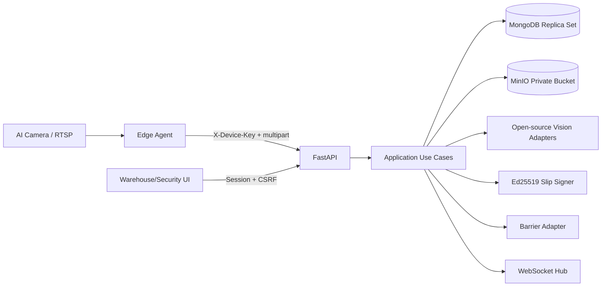

# Thiết kế mức cao

## 1. Thành phần



## 2. Luồng cổng vào (Gate In)

Edge gửi hai ảnh và `event_id`. API lưu evidence trước; nếu storage lỗi thì fail-closed. ALPR/face chạy song song trong bounded executor. Plate matcher resolve exact/fuzzy, face matcher chọn similarity tốt nhất, sau đó kiểm authorization. Use case ghi Gate Log trước khi phát command. `BarrierService` dùng command ID `open:{gate_id}:{event_id}`; chỉ ACK mới trả `permit_granted=true`.

## 3. Dock kho và phiếu xuất kho

Start dock yêu cầu Gate In PASSED của đúng cặp trong validity order. Mỗi capture ghi ảnh mã hóa cùng detection và cargo state timeline. `ANOMALY` chuyển review; chỉ operator finalize `LOADED` mới đưa order sang READY. Slip signer phát hành claims:

```json
{
  "order_id": "ORDER-001",
  "vehicle_id": "uuid",
  "driver_id": "uuid",
  "slip_version": 1,
  "jti": "random",
  "iat": 0,
  "exp": 0,
  "kid": "gate-ed25519-v1"
}
```

Token, JTI chỉ lưu dạng HMAC hash trong order. QR/HTML/PDF được mã hóa trước khi lưu MinIO.

## 4. Luồng cổng ra (Gate Out)

1. Lưu ba evidence: face, plate, slip.
2. Đọc QR bằng PyZbar/OpenCV; OCR chỉ là hint.
3. Xác minh Ed25519, `kid`, issuer/audience và `exp`.
4. So claims với order `SLIP_ISSUED`, version/JTI/token hash.
5. So live face trực tiếp với assigned driver; plate với assigned vehicle.
6. Transaction claim `exit_event_id` và tạo Gate Log PASSED.
7. Phát command barrier. Nếu ACK, atomic update order `COMPLETED`; nếu timeout, release claim và giữ order.

## 5. Cảnh báo thời gian thực

Alert được persist với sequence từ counter trước khi fan-out. WebSocket envelope gồm `event_id`, `sequence`, `event_type`, `severity`, `occurred_at`, `data`. Client reconnect gọi `/api/v1/security/alerts?after_sequence=N`, dedupe rồi đăng ký WebSocket lại.

## 6. Bảo mật

- Embedding và evidence: AES-256-GCM với AAD theo driver/object key.
- Password: Argon2; session/device/slip reference: HMAC-SHA256.
- Session cookie: HttpOnly, SameSite Strict, Secure khi HTTPS; mutation kiểm CSRF.
- Device key: scope nhỏ nhất; không dùng cookie operator trên edge.
- MinIO private; API không cấp URL public và không trả embedding.
- Secret production nằm ngoài image/Git; Ed25519 public key có thể phân phối cho verifier.

## 7. Chế độ lỗi

| Lỗi | Hành vi |
|---|---|
| AI không tải/chạy | FAILED + alert, barrier đóng |
| MinIO lỗi | workflow từ chối trước quyết định mở |
| QR hỏng/giả/hết hạn | CRITICAL alert, order giữ nguyên |
| Barrier không ACK | Gate Log barrier FAILED, order không complete |
| Retry/reconnect | event/command idempotency trả kết quả cũ |
| MongoDB không sẵn sàng | API not-ready; không fail-open |
