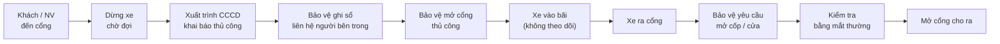
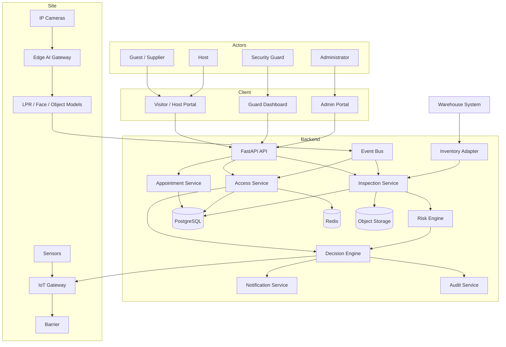
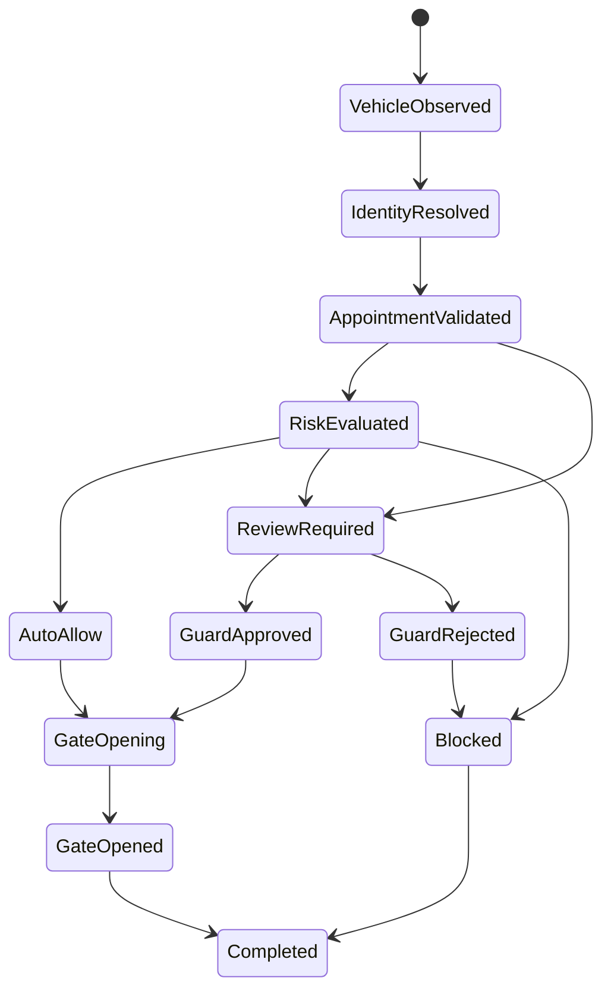
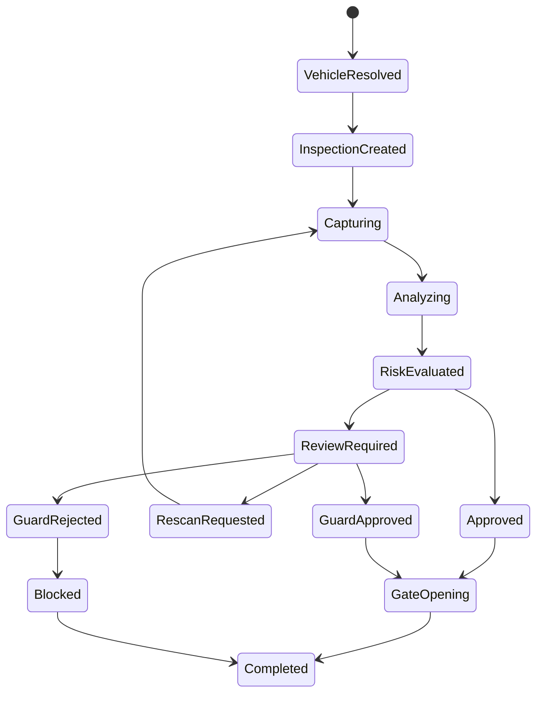
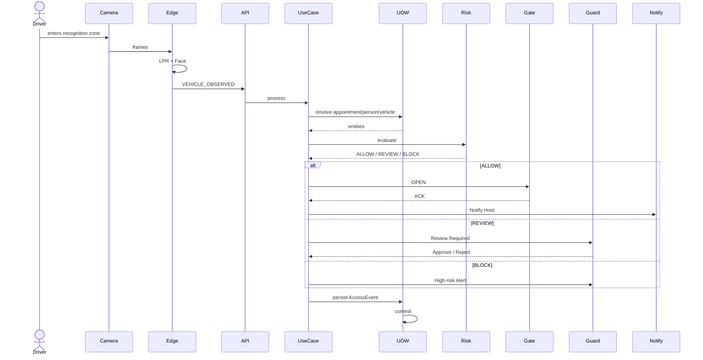
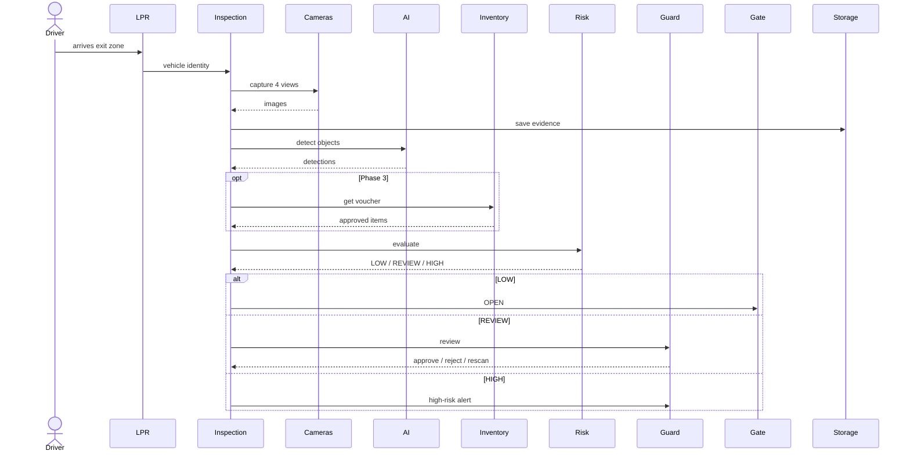
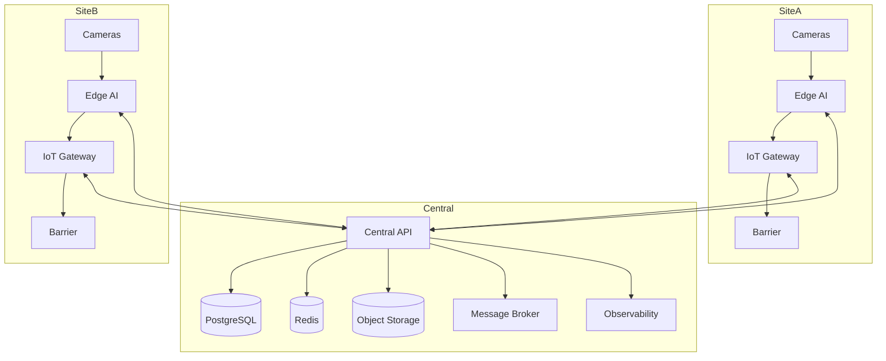

# Smart Gate & Vehicle Security Platform — Business System & High Level Design

> **Project:** AI-Powered Vehicle Gate Control and Inventory Management System  
> **Client:** Tổng Công ty Điện lực  
> **Status:** DRAFT / PROPOSED — chờ Official Requirement bằng văn bản (`OQ-01`)  
> **Architecture:** Edge AI + Event-driven Backend + Decision/Risk Engine + Human-in-the-loop

> ⚠️ **Đọc `requirements-traceability.md` trước tài liệu này.**
> Tài liệu HLD chỉ mô tả *giải pháp kỹ thuật*. Việc hạng mục nào đã được khách hàng
> xác nhận (`CONFIRMED`), hạng mục nào mới chỉ là đề xuất của team (`PROPOSED`),
> và hạng mục nào team tự thêm (`DESIGN-ADDED`) được quản lý tập trung tại RTM.
> **Hiện chỉ có 2/6 module là `CONFIRMED`** (Nhận diện AI, Điều khiển Cổng).

---

# PART A — BUSINESS SYSTEM

## 1. Problem Statement

### 1.1 Quy trình AS-IS (hiện tại)



Pain points được xác định trong BRD §1:

| # | Pain point | Hệ quả |
|---|---|---|
| 1 | Khách phải dừng lại, xuất trình CCCD, khai báo người cần gặp | Tốn thời gian check-in, ùn ứ giao thông tại cổng |
| 2 | Bảo vệ kiểm tra cốp xe bằng mắt thường / bằng tay | Không đảm bảo độ chính xác, dễ sai sót |
| 3 | Nhân viên hoặc nhà cung cấp có thể "tuồn" tài sản, thiết bị ra ngoài | Thất thoát tài sản có giá trị (vật tư, thiết bị điện) |
| 4 | Không có dữ liệu truy vết thống nhất người – xe – lịch hẹn – quyết định – bằng chứng | Khi xảy ra mất mát, không quy trách nhiệm được |
| 5 | Việc phát hiện bất thường phụ thuộc hoàn toàn kinh nghiệm cá nhân của bảo vệ | Chất lượng kiểm soát không ổn định giữa các ca trực |

### 1.2 Quy trình TO-BE (đề xuất)

Chi tiết xem `diagrams.md §3`. Tóm tắt nguyên tắc:

> **AI nhận diện → Business Rule kiểm tra → Risk Engine đánh giá → Decision Engine quyết định → Guard can thiệp khi cần.**

AI là hệ thống **hỗ trợ** quyết định, không phải nguồn quyết định an ninh duy nhất.
Đây là ràng buộc nghiệp vụ bắt buộc, xuất phát từ rủi ro `R-01` và `R-05` — xem RTM §8.

---

## 2. Business Goals & Success Metrics

### 2.1 Business KPIs

| Goal | Metric | Proposed Target |
|---|---|---:|
| Giảm thời gian check-in | Thời gian từ lúc xe vào vùng nhận diện đến quyết định | ≤ 10s |
| Giảm thao tác thủ công | Tỷ lệ lượt hợp lệ không cần nhập lại thông tin | ≥ 80% |
| Tăng khả năng truy vết | Lượt ra/vào có đầy đủ event + evidence + decision | 100% |
| Tăng hiệu quả bảo vệ | Cảnh báo có evidence để review | 100% |
| Sẵn sàng nhân rộng | Multi-site / Multi-gate configuration | Có |

> Các KPI trên là mục tiêu đề xuất và phải được khách hàng xác nhận trước khi trở thành Acceptance Criteria.

### 2.2 Technical KPIs

| Goal | Metric | PoC Target |
|---|---|---:|
| License Plate Recognition | Accuracy trong điều kiện PoC | ≥ 95% |
| Face Verification | Accuracy trong điều kiện PoC | ≥ 95% |
| Access Decision latency | P95 | ≤ 3s |
| Auditability | Decision/Gate Command có Audit | 100% |
| Asset Detection | Precision / Recall | TBD sau Dataset Benchmark |

### 2.3 KPI → Architecture Mapping

```text
KPI                            Architecture Decision
────────────────────────────────────────────────────────────
LPR / Face real-time      →   Edge AI
Decision P95 ≤ 3s         →   Local inference + async event
100% audit                →   AccessEvent + Audit + Evidence
AI uncertain              →   Human Review
Asset control             →   Inspection Session + Risk Engine
Multi-site rollout        →   Site/Gate/Lane configuration
```

---

## 3. Stakeholders

Nguồn: BRD §2. Cột **Origin** chỉ rõ vai trò nào có trong BRD, vai trò nào do team bổ sung.

| Actor | Responsibility | Origin |
|---|---|---|
| Client Sponsor — Cán bộ/Trưởng phòng Thông tin | Chủ đầu tư phía Điện lực, duyệt scope và nghiệm thu | BRD |
| Guest / Supplier | Đăng ký lịch, người và xe qua Portal | BRD |
| Employee | Nhân viên nội bộ đi xe máy/ô tô/bán tải, được nhận diện và kiểm soát hàng mang ra | BRD |
| Host | Nhân viên bên trong có lịch hẹn, nhận thông báo khi khách tới cổng | BRD |
| Guard | Nhận cảnh báo, giám sát camera, hỗ trợ mở cổng khi hệ thống không tự mở | BRD |
| Warehouse System | Cung cấp Export Voucher (Phase 2) | BRD |
| Security Supervisor | Quản lý policy, alert và audit | `DA-08` |
| System Admin | Quản lý user/site/gate/camera/device | `DA-06` |
| Edge AI | LPR, Face, Object Detection (system actor) | BRD (BR-02) |
| Gate Controller | Điều khiển Barrier (system actor) | BRD (BR-03) |

> `Security Supervisor` và `System Admin` **không có trong BRD**. Team bổ sung vì cần
> tách quyền cấu hình policy khỏi Guard trực ca. Cần khách duyệt — xem RTM §4.

---

## 4. Scope

> **Phase numbering tuân theo BRD §4.** BRD chỉ định nghĩa 2 phase thương mại:
> Phase 1 (scope chính) và Phase 2 (Đối chiếu Xuất kho).
> Bên trong Phase 1 team chia thành **Stage 1A / 1B** để giao hàng tăng dần —
> đây là phân rã kỹ thuật, **không phải** phase hợp đồng.

### Phase 1 — Smart Gate + Vehicle Security

#### Stage 1A — Entry Automation (`FR01`–`FR04`)

| Hạng mục | FR | Status |
|---|---|---|
| Visitor / Supplier Registration Portal | FR01 | `PROPOSED` |
| Vehicle Registration | FR01 | `PROPOSED` |
| Appointment | FR01 | `PROPOSED` |
| Host Approval | — | `DESIGN-ADDED` (`DA-01`) |
| License Plate Recognition | FR02 | **`CONFIRMED`** |
| Face Verification | FR02 | **`CONFIRMED`** |
| Access Decision + Gate Control | FR03 | **`CONFIRMED`** |
| Guard Dashboard + Manual Open | FR03 | **`CONFIRMED`** |
| Host Notification | FR04 | `PROPOSED` |
| Access Event | — | `DESIGN-ADDED` (`DA-02`) |
| Audit & Evidence | — | `DESIGN-ADDED` (`DA-02`, `DA-03`) |

#### Stage 1B — Exit Inspection (`FR05`)

| Hạng mục | FR | Status |
|---|---|---|
| Exit Inspection Zone | FR05 | `PROPOSED` |
| Four-camera capture (trước, sau, 2 bên/cốp) | FR05 | `PROPOSED` |
| Object Detection / Classification | FR05 | `PROPOSED` |
| Security Alert | FR05 | `PROPOSED` |
| Risk Scoring | — | `DESIGN-ADDED` (`DA-04`) |
| Guard Review + Rescan | — | `DESIGN-ADDED` (`DA-07`) |
| Evidence Package | — | `DESIGN-ADDED` (`DA-03`) |

> ⚠️ Stage 1B chịu rủi ro kỹ thuật cao nhất (`R-01`): nhận diện vật thể bị che khuất
> phụ thuộc mạnh vào ánh sáng và chất lượng camera. **Không cam kết con số accuracy**
> trước khi hoàn thành Dataset Benchmark — xem `ADR-005`.

### Phase 2 — Inventory Intelligence (`FR06`)

- Export Voucher integration (Warehouse System).
- Approved Asset List.
- Asset Type Matching.
- Quantity Matching **chỉ khi được kiểm chứng khả thi về mặt kỹ thuật**.
- Match / Mismatch Decision.

Điều kiện tiên quyết để khởi động Phase 2 — xem §18 PoC 3.

### Chưa phân bổ Phase — cần khách hàng chốt

| Hạng mục | BR | Vấn đề |
|---|---|---|
| Vehicle Tracking trong bãi đỗ | BR-05 | BRD §4 và TO-BE §6 bước 5 đều nêu, **nhưng BRD §5 không có FR tương ứng**. Đã đề xuất `FR07`, chờ trả lời `OQ-05` |

> Đây là gap của BRD, không phải của thiết kế. **Không đưa BR-05 vào estimate**
> cho đến khi `OQ-05` được trả lời (mức độ tracking: vị trí đỗ cuối vs toàn hành trình,
> có cần Vehicle Re-ID hay không — chênh lệch chi phí kỹ thuật rất lớn).

### Out of Scope — BRD §9

> **Toàn bộ phần cứng do khách hàng (Tổng Công ty Điện lực) tự đầu tư/cung cấp:**
> Camera IP · Server / máy chủ AI · Thiết bị IoT điều khiển barrier.

Ràng buộc kiến trúc bắt buộc phát sinh từ điều này:

1. Không hard-code vendor camera → bắt buộc `CameraGateway` port + adapter.
2. Không hard-code giao thức barrier → bắt buộc `GateControllerGateway` port (HTTP / MQTT / Modbus).
3. Team phải bàn giao **Hardware Specification** bằng văn bản (độ phân giải, FPS, góc đặt,
   yêu cầu ánh sáng vùng Inspection Zone) như điều kiện tiên quyết trong phụ lục hợp đồng.
   Nếu phần cứng khách mua không đạt chuẩn, team không chịu trách nhiệm về độ chính xác AI (`R-06`).

### Future / Potential Scope — BRD §9

- Tích hợp sâu đối chiếu Phiếu xuất kho (mở rộng Phase 2).
- **Đóng gói SaaS / License** để nhân rộng cho các chi nhánh điện lực khác hoặc bán ra ngoài.
- HR / SSO integration.
- Multi-site deployment · Central SOC dashboard · Parking analytics · Vehicle Re-identification.

---

## 5. Guardrails & Business Rules

1. AI không trực tiếp mở cổng.
2. `LOW` risk có thể auto-open nếu policy cho phép.
3. `MEDIUM` risk phải chuyển `HUMAN_REVIEW`.
4. `HIGH` risk phải giữ cổng đóng và tạo alert.
5. Low confidence không được coi là mismatch chắc chắn.
6. Blacklist được xử lý theo security policy.
7. Manual Override bắt buộc có operator + reason + audit.
8. Mọi Access Decision phải liên kết `AccessEvent`.
9. Mọi Inspection Session phải liên kết Access Event.
10. Raw video/image retention phải cấu hình.
11. Phase 2 AI chỉ phát hiện/phân loại vật thể, không kết luận "trộm".
12. Phase 3 mới thực hiện Voucher Matching.
13. AI/Camera failure phải degrade về Manual Inspection.
14. Central Backend failure không được dẫn tới fail-open.

---

# PART B — HIGH LEVEL DESIGN

## 6. Overall Architecture



---

## 7. AI vs Code vs Human

```text
┌───────────────────────────────────────────────────────┐
│ AI VISION                                            │
│ - Vehicle Detection                                  │
│ - License Plate Recognition                          │
│ - Face Detection / Verification                      │
│ - Object Detection / Classification                  │
├───────────────────────────────────────────────────────┤
│ BUSINESS CODE                                        │
│ - Appointment Validation                             │
│ - Whitelist / Blacklist                              │
│ - Risk Score                                         │
│ - Decision Rules                                     │
│ - Voucher Matching                                   │
│ - Audit / Idempotency                                │
├───────────────────────────────────────────────────────┤
│ HUMAN                                                │
│ - Low-confidence Review                              │
│ - Suspicious Asset Review                            │
│ - Approve / Reject / Rescan                          │
│ - Manual Override                                    │
└───────────────────────────────────────────────────────┘
```

---

## 8. AI & Device Integration

### 8.1 AI Capabilities

| Capability | Input | Output |
|---|---|---|
| Vehicle Detection | RTSP Frame | Vehicle Bounding Box |
| LPR | Plate Crop | Plate + Confidence |
| Face Verification | Face Crop | Candidate + Similarity |
| Object Detection | Inspection Images | Object + Bounding Box |
| Object Tracking | Consecutive Frames | Track ID |
| Vehicle Re-ID | Multi-camera | Future |

### 8.2 Port Contracts

```python
from typing import Protocol

class LicensePlateRecognitionGateway(Protocol):
    async def recognize(self, image_ref: str) -> "PlateRecognitionResult": ...

class FaceVerificationGateway(Protocol):
    async def verify(
        self,
        image_ref: str,
        candidate_person_id: str,
    ) -> "FaceVerificationResult": ...

class ObjectDetectionGateway(Protocol):
    async def detect(self, image_refs: list[str]) -> list["DetectedObject"]: ...

class GateControllerGateway(Protocol):
    async def open_gate(
        self,
        gate_id: str,
        command_id: str,
    ) -> "GateCommandResult": ...

class InventoryGateway(Protocol):
    async def get_export_voucher(
        self,
        voucher_code: str,
    ) -> "ExportVoucherDTO | None": ...
```

### 8.3 AI Event Contract

```json
{
  "event_id": "evt_01J...",
  "event_type": "VEHICLE_OBSERVED",
  "site_id": "EVN-HQ",
  "gate_id": "GATE-01",
  "lane_id": "IN-01",
  "camera_id": "CAM-IN-LPR-01",
  "occurred_at": "2026-08-17T10:30:00+07:00",
  "vehicle": {
    "plate": "51A-123.45",
    "plate_normalized": "51A12345",
    "confidence": 0.974
  },
  "person": {
    "face_candidate_id": "person_1021",
    "similarity": 0.941
  },
  "evidence_refs": [
    "evidence://2026/08/17/evt_01J/front.jpg"
  ],
  "model_versions": {
    "lpr": "lpr-v1.0.0",
    "face": "face-v1.0.0"
  }
}
```

### 8.4 Cache Strategy

| Data | Suggested TTL |
|---|---:|
| Active Appointment | 1–5 min |
| Vehicle Whitelist | 5–15 min |
| Blacklist | Short TTL + explicit invalidation |
| Device Configuration | 5 min |
| Idempotency Key | 24h |
| Latest Gate Status | Seconds |

### 8.5 Fallback Chain

```text
LPR:
Edge LPR → alternate frame → Guard Review

Face:
Face Verify → low confidence → Guard Review

Central Backend:
Unavailable → Site Manual Safe Mode

Inventory:
Unavailable → no auto-clear → Manual Review

Object Detection:
Unavailable → Manual Inspection
```

### 8.6 Notification Matrix — BRD §8

| Sự kiện | Người nhận | Kênh | FR | Priority |
|---|---|---|---|---|
| Phương tiện **chưa đăng ký** tới cổng | Guard | Guard Dashboard + Alert | FR03 | High |
| Nghi vấn **mang hàng hóa ra ngoài** (tuồn hàng) | Guard | Guard Dashboard + Alert kèm Evidence | FR05 | High |
| Khách **đã check-in qua cổng** | Host | Push Notification (App) | FR04 | Medium |
| Gate command **thất bại / timeout** | Guard | Guard Dashboard | — | `DESIGN-ADDED` |
| Voucher **mismatch** | Guard, Security Supervisor | Alert kèm Evidence | FR06 | Low (Phase 2) |

> Cảnh báo gửi cho Guard **bắt buộc kèm Evidence** (`DA-03`). Cảnh báo không có bằng chứng
> thì bảo vệ không thể xử lý và không có giá trị pháp lý khi truy trách nhiệm.

### 8.7 Integration Matrix — BRD §8

| Hệ thống ngoài | Chiều dữ liệu | Port | Phase | Status |
|---|---|---|---|---|
| Camera IP | Inbound (RTSP stream) | `CameraGateway` | 1 | `CONFIRMED` — phần cứng do khách cấp |
| Thiết bị IoT đóng/mở cổng | Outbound (command) | `GateControllerGateway` | 1 | `CONFIRMED` — phần cứng do khách cấp |
| Hệ thống Quản lý kho Điện lực | Inbound (Export Voucher) | `InventoryGateway` | 2 | `PROPOSED` — chưa có API contract |
| Hệ thống Nhân sự (HR) | Inbound (hồ sơ nhân viên) | `HRGateway` | Future | Future Scope |
| Push Notification Provider | Outbound | `NotificationGateway` | 1 | `PROPOSED` |

> ⚠️ **Chưa có API contract của hệ thống kho.** Đây là điều kiện tiên quyết bắt buộc
> để khởi động Phase 2 — xem §18 PoC 3.

---

## 9. Core Data Model

```text
Site
Gate
Lane
CameraDevice
GateDevice

User
Vehicle
Appointment
AppointmentApproval

AccessEvent
AIDetection
AccessDecision
GateCommand

InspectionSession
DetectedObject
SecurityAlert
GuardReview

Asset
ExportVoucher
ExportVoucherItem

Evidence
Notification
AuditLog
```

### 9.1 Mapping tới Data Requirements của BRD §7

| Entity trong BRD | Entity trong thiết kế | Ghi chú |
|---|---|---|
| Users (Khách, Nhà cung cấp, Nhân viên) | `User` | Lưu Tên, Ảnh khuôn mặt, CCCD. Phân loại qua `user_type` thay vì tách bảng |
| Vehicles (Xe tải, bán tải, ô tô con) | `Vehicle` | Lưu Biển số, Loại xe |
| Appointments | `Appointment` + `AppointmentApproval` | Tách approval để phục vụ `DA-01` (Host Approval) |
| Assets / Equipments | `Asset` | Hình dáng, nhãn mác (thùng điện, vật tư) |
| ExportVoucher | `ExportVoucher` + `ExportVoucherItem` | Tách item để đối chiếu theo từng dòng vật tư |

### 9.2 Cardinality — theo BRD §7

```text
User        1 ──── * Vehicle          (1 người đăng ký nhiều xe)
Appointment * ──── 1 User             (visitor)
Appointment * ──── 1 Vehicle
Appointment * ──── 1 User             (host)
Vehicle     1 ──── 0..1 ExportVoucher (khi rời công ty có chở hàng)
AccessEvent * ──── 0..1 Appointment   (xe không hẹn trước vẫn tạo AccessEvent)
AccessEvent 1 ──── 0..1 InspectionSession
```

> Lưu ý ràng buộc `AccessEvent * ──── 0..1 Appointment`: hệ thống **phải** ghi nhận được
> cả phương tiện **chưa đăng ký** (BRD §8 yêu cầu cảnh báo bảo vệ khi có xe chưa đăng ký).
> Không được thiết kế `appointment_id` là NOT NULL.

### Access Event Example

```json
{
  "access_event_id": "acc_20260817_000123",
  "direction": "ENTRY",
  "vehicle_id": "veh_001",
  "person_id": "person_001",
  "appointment_id": "apt_001",
  "observed_plate": "51A12345",
  "plate_confidence": 0.974,
  "face_similarity": 0.941,
  "risk_score": 12,
  "decision": "ALLOW",
  "decision_reason": [
    "APPOINTMENT_APPROVED",
    "TIME_WINDOW_VALID",
    "PLATE_MATCH",
    "FACE_MATCH"
  ]
}
```

---

## 10. Entry State Machine



---

## 11. Exit Inspection State Machine



---

## 12. Decision & Risk Engine

### Inputs

```text
Identity
├── Plate Match
├── Face Match
└── Confidence

Appointment
├── Approved
├── Time Window
├── Vehicle Linked
└── Host

Security
├── Person Blacklist
├── Vehicle Blacklist
└── Previous Alerts

Inspection
├── Object Detection
├── Confidence
├── Voucher
└── Match Result
```

### Initial Risk Configuration

| Condition | Risk |
|---|---:|
| Appointment Valid | -20 |
| Plate Match | -20 |
| Face Match | -20 |
| Unknown Vehicle | +30 |
| Face Low Confidence | +25 |
| Appointment Expired | +40 |
| Blacklisted Entity | +100 |
| Suspicious Object | +40 |
| No Voucher | +30 |
| Voucher Mismatch | +60 |

```text
0–29   LOW     → ALLOW
30–59  MEDIUM  → REVIEW
60+    HIGH    → BLOCK / REVIEW
```

Các score phải cấu hình và hiệu chỉnh trong PoC.

---

## 13. Entry Sequence



---

## 14. Exit Inspection Sequence



---

## 15. Evidence Architecture

```text
AI Event
   │
   ├── Metadata → PostgreSQL
   │
   └── Snapshot / Clip → Object Storage
                         │
                         └── EvidenceRef stored in DB
```

Evidence metadata:

```text
object_key
hash
camera_id
captured_at
retention_class
encryption_metadata
access_classification
```

---

## 16. Multi-site Deployment



---

## 17. NFR Summary

| Aspect | Proposed Design |
|---|---|
| Latency | P95 Decision ≤ 3s |
| Availability | Central ≥ 99.5%, manual fallback |
| Safety | Fail-safe, not fail-open |
| Scalability | Stateless API + Event-driven |
| Security | TLS, RBAC, Least Privilege |
| Privacy | Biometric retention + deletion policy |
| Auditability | 100% Decision/Override/Gate Command audited |
| Idempotency | Event ID + Command ID |
| Observability | Logs + Metrics + Traces |
| Model Governance | Model Version + Threshold Version |

---

## 18. PoC Strategy

### PoC 1 — Entry Automation

- LPR.
- Face Verification.
- Appointment Match.
- Decision.
- Barrier command.
- Guard review.
- Audit.

### PoC 2 — Exit Inspection

- Inspection Zone.
- 4-camera capture.
- Object detection.
- Evidence.
- Risk.
- Guard review.
- Rescan.

### PoC 3 — Inventory

Thực hiện sau khi có:

- Inventory API contract.
- Asset taxonomy.
- Dataset.
- Matching criteria.

---

## 19. Delivery Milestones

> Dùng ký hiệu **M0–M6** để tránh nhầm lẫn với **Phase 1 / Phase 2** của BRD (§4).
> `Phase` = phase thương mại theo BRD. `M` = mốc giao hàng kỹ thuật.

| Milestone | Scope | Thuộc Phase (BRD) | Điều kiện tiên quyết |
|---|---|---|---|
| M0 | Discovery + Site Survey + Hardware Specification | — | `OQ-01`, `OQ-03` |
| M1 | Entry PoC (LPR + Face + Decision + Barrier) | Phase 1 / Stage 1A | M0, `OQ-02` |
| M2 | Smart Gate MVP (Portal + Appointment + Notification + Audit) | Phase 1 / Stage 1A | M1 |
| M3 | Security Inspection PoC (4-camera + Object Detection) | Phase 1 / Stage 1B | M2, `OQ-03`, `OQ-04` |
| M4 | Security Production (Alert + Evidence + Guard Review) | Phase 1 / Stage 1B | M3 + Dataset Benchmark đạt ngưỡng |
| M5 | Inventory Integration (Export Voucher Matching) | Phase 2 | M4 + Inventory API contract |
| M6 | Multi-site Rollout / SaaS packaging | Future Scope | M5 + quyết định thương mại |

> **M0 là bắt buộc và không được bỏ qua.** Toàn bộ scope hiện tại đang dựa trên mong muốn
> trao đổi miệng (`R-04`). Không bố trí full team trước khi M0 hoàn thành và hợp đồng được ký (`R-03`).

---

## 20. Architecture Decision Records

### ADR-001 — Edge-first Computer Vision

**Status:** `PROPOSED` — phụ thuộc `OQ-02`.

Video được xử lý tại Edge để giảm latency, bandwidth và rủi ro privacy.

> ⚠️ Khách hàng **chưa quyết định** giữa Local AI model (bảo mật dữ liệu, đầu tư ban đầu cao)
> và Third-party AI API (chi phí duy trì cao) — BRD §10. ADR này giả định hướng Local/Edge.
> Nếu khách chọn Third-party API, phải revisit: `VisionSettings`, chi phí vận hành,
> ràng buộc privacy dữ liệu sinh trắc học (`OQ-07`), và mô hình license SaaS ở M6.
> Thiết kế hiện tại giảm thiểu rủi ro bằng cách đặt toàn bộ AI sau các Gateway port,
> nên việc đổi hướng ảnh hưởng Infrastructure layer, không ảnh hưởng Domain.

### ADR-002 — AI Result != Access Decision

**Status:** `ACCEPTED`.

AI chỉ trả observation/confidence; Decision Engine xử lý business decision.
Ràng buộc này bảo vệ dự án khỏi `R-05` (kỳ vọng "AI tự phát hiện trộm").

### ADR-003 — AccessEvent là core aggregate

**Status:** `ACCEPTED`.

Mọi AI event, decision, gate command, evidence và alert được liên kết về AccessEvent.
Đây là cơ sở kỹ thuật cho yêu cầu truy vết trách nhiệm (`DA-02`) — pain point #4 tại §1.1.

### ADR-004 — Human-in-the-loop

**Status:** `ACCEPTED` — phụ thuộc giả định `A-05`.

Uncertain/high-risk flow luôn có Guard Review.

> Giả định `A-05`: bảo vệ vẫn trực tại cổng để xử lý các trường hợp `REVIEW`.
> Nếu khách kỳ vọng vận hành **không người trực**, toàn bộ luồng này phải thiết kế lại.
> Cần xác nhận trong buổi họp kế tiếp cùng `OQ-06` (ai có quyền override khi cảnh báo nhầm).

### ADR-005 — Asset Recognition sau Dataset Benchmark

**Status:** `ACCEPTED` — biện pháp giảm thiểu trực tiếp cho `R-01`, `R-02`.

Không commit exact asset recognition trước khi khảo sát camera và dataset.

> Cụ thể: **không đưa con số accuracy của FR05 vào hợp đồng** trước khi có kết quả M3.
> Đề xuất kỹ thuật giảm rủi ro: yêu cầu bung cốp trong **Inspection Zone có kiểm soát ánh sáng**,
> thay vì cố gắng "soi xuyên kính" — bài toán sau vượt xa năng lực thực tế của công nghệ hiện tại.

### ADR-006 — Hardware là Out of Scope, tích hợp qua Adapter

**Status:** `ACCEPTED` — hệ quả trực tiếp của BRD §9.

Toàn bộ camera, server và thiết bị IoT do khách hàng cung cấp (`A-01`). Do đó hệ thống
không được phụ thuộc vendor cụ thể: mọi thiết bị tích hợp qua `CameraGateway` /
`GateControllerGateway` port. Đổi lại, team phải phát hành Hardware Specification
làm điều kiện tiên quyết hợp đồng (`R-06`).

---

## 21. Open Questions, Assumptions & Risks

Các mục này được quản lý tập trung tại **`requirements-traceability.md`** để tránh
phân tán thông tin. Tóm tắt các mục **blocking**:

| ID | Nội dung | Ảnh hưởng |
|---|---|---|
| `OQ-01` | Chưa có Official Requirement bằng văn bản | **Blocking toàn dự án** — scope chưa freeze được |
| `OQ-02` | Local AI model hay Third-party API? | Quyết định `ADR-001`, chi phí hạ tầng, mô hình SaaS |
| `OQ-03` | Thông số camera hiện có? | Không có ⇒ không cam kết được accuracy `FR05` |
| `OQ-04` | Khách có cung cấp dataset mẫu không? | Không có ⇒ `FR05`/`FR06` không khả thi đúng hạn |
| `R-01` | Nhận diện vật thể bị che khuất — độ chính xác không chắc chắn | Rủi ro kỹ thuật **cao nhất** của dự án |
| `R-03` | Thủ tục Nhà nước 2–3 tháng, rủi ro dòng tiền | Nguyên tắc *"có tiền mới làm"* |
| `R-04` | 4/6 module đang `PROPOSED` | Scope creep |

---

# Summary

```text
CAMERA / SENSOR
      │
      ▼
   EDGE AI
      │
      ├── LPR
      ├── FACE
      └── OBJECT
      │
      ▼
 AI EVENT
      │
      ▼
 APPLICATION
      │
      ▼
 DOMAIN POLICY
      │
      ▼
 DECISION ENGINE
   ┌──┼─────────┐
   ▼  ▼         ▼
ALLOW REVIEW   BLOCK
   │    │         │
   ▼    ▼         ▼
GATE  GUARD     ALERT
      │
      ▼
AUDIT + EVIDENCE
```

Hệ thống nên được định vị là **AI-assisted Smart Gate & Vehicle Security Platform**, không phải “AI tự phát hiện trộm”.

---

## Trạng thái tài liệu

| Hạng mục | Tình trạng |
|---|---|
| Nguồn yêu cầu | BRD v0.1 — `DRAFT / PROPOSED` |
| Module đã được khách xác nhận | 2/6 (Nhận diện AI, Điều khiển Cổng) |
| Open Questions còn mở | 7 (`OQ-01` … `OQ-07`) — trong đó `OQ-01` là blocking |
| Rủi ro mức Cao | 5 (`R-01` … `R-05`) |
| Điều kiện để freeze scope | `OQ-01` được trả lời bằng văn bản |

> Tài liệu này **chưa đủ điều kiện dùng làm cơ sở estimate hợp đồng**.
> Chi tiết truy vết yêu cầu, trạng thái từng hạng mục, câu hỏi mở, giả định và rủi ro:
> xem `requirements-traceability.md`.
