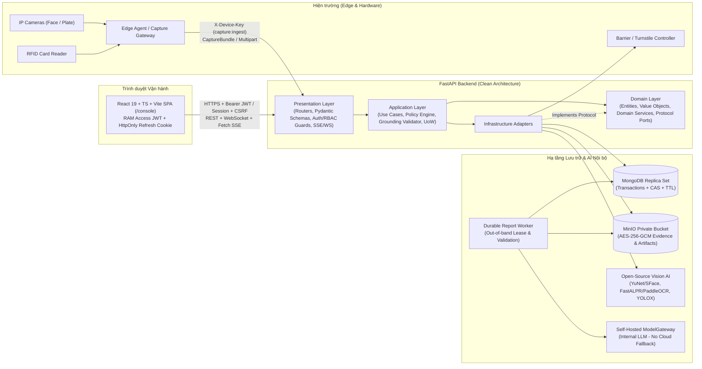
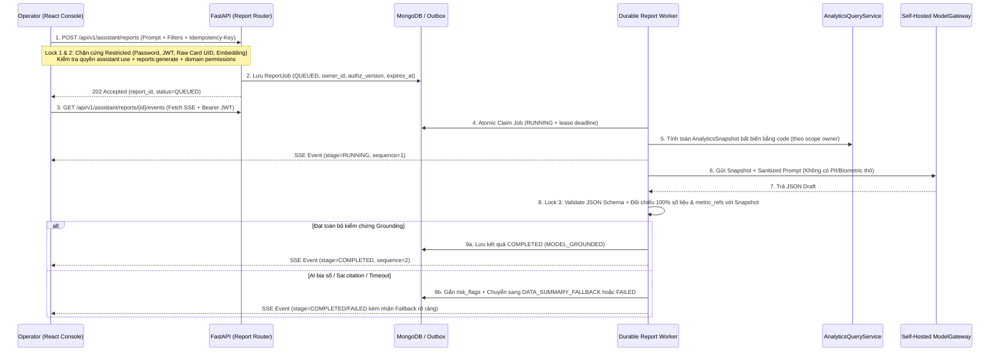

# Thiết kế Hệ thống Mức cao (High-Level Design — HLD) — EV Smart Gate

| Thuộc tính | Giá trị |
| --- | --- |
| **Mã tài liệu** | `EVSG-HLD-AI-2026-V2` |
| **Phiên bản** | `2.0` — Đồng bộ Kiến trúc Clean Architecture, React SPA Migration & Safe Flow 4 Lớp Khóa |
| **Ngày cập nhật** | `21/10/2026` (`Asia/Bangkok`) |
| **Tài liệu liên kết** | [BRD chuẩn AI](BRD.md) · [Kiến trúc Frontend](frontend-architecture.md) · [Hợp đồng M0](contracts/migration-v1.md) · [ERD](data-model-erd.md) · [RTM](requirements-traceability.md) |

---

## 1. Kiến trúc Tổng thể (Clean Architecture & Trust Boundaries)

Hệ thống tuân thủ nghiêm ngặt quy tắc phụ thuộc một chiều: **`Presentation -> Application -> Domain <- Infrastructure`**. Mọi tác nhân AI (`Vision AI Adapters` và `Self-Hosted ModelGateway`) đều nằm ở tầng `Infrastructure` dưới dạng các adapter thực thi `Protocol` của `Domain`, **tuyệt đối không đứng trực tiếp giữa Client/Edge và Database hoặc Thiết bị vật lý (`Barrier`)**.

---

## 2. Luồng Nghiệp vụ Cốt lõi & Cơ chế Kiểm soát AI

### 2.1. Luồng Cổng Phương tiện Đa yếu tố (`Vehicle Gate In / Gate Out` — 3 Nhóm xe: `motorcycle`, `car`, `truck`)
> [!IMPORTANT]
> **Tách biệt Core Access và Module Kho**: Luồng Cổng Ra (`EXIT`) cốt lõi của bãi xe sử dụng cùng cơ chế xác minh 3 yếu tố (`Thẻ RFID + Khuôn mặt 1:1 + Biển số & Ủy quyền Tài xế–Xe`) như Cổng Vào (`ENTRY`), **không** bắt buộc phải có `WarehouseExitOrder` hay `QR Exit Slip`. Luồng đối chiếu `QR Exit Slip` chỉ kích hoạt khi cổng được cấu hình thuộc phân hệ xuất kho mở rộng.

1. **Thu nhận & Kiểm tra Độ tin cậy (`Lock 1 — Capture Trust & Sanitizer`)**:
   - `Edge Agent` gửi gói thu nhận (`CaptureBundle` tại `/api/v2/capture-bundles` hoặc multipart tương thích tại `/api/v1/gates/{entry,exit}`) kèm `event_id` duy nhất.
   - Server kiểm tra `X-Device-Key` có đúng scope thiết bị/làn, kiểm tra định dạng/kích thước ảnh (`<= 10 MiB`), cấu hình `calibration`, `ROI`, `freshness` và `max_clock_skew`. Nếu thiếu cấu hình hoặc lệch chuẩn → trả `CAPTURE_CONFIG_REQUIRED` / `CAPTURE_UNTRUSTED` (**fail-closed**).
2. **Lưu Bằng chứng Mã hóa Trước khi Quyết định (`Lock 2 — Data Boundary`)**:
   - Mã hóa `face_image` và `plate_image` bằng `AES-256-GCM` (với `AAD` gắn theo định danh sự kiện/bản ghi) rồi lưu vào `MinIO` private bucket. Nếu `MinIO` lỗi → dừng ngay và từ chối mở cổng (**fail-closed**).
   - `card_uid` thô chỉ dùng để băm/tra cứu chủ thẻ trong RAM, không ghi vào log văn bản và chỉ trả về `card_uid_masked` trên UI.
3. **Quan sát AI Song song (`AI Observation — Bounded Executor`)**:
   - `Face Verification Adapter` (`YuNet/SFace`) phát hiện khuôn mặt người điều khiển trong vùng `ROI`, kiểm tra `liveness` và tính `face_similarity` `1:1` với embedding của chủ thẻ `card_uid`. (Nếu có nhiều khuôn mặt tranh chấp không phân biệt được người lái → trả cờ `AMBIGUOUS_DRIVER_FACE`).
   - `ALPR Adapter` (`FastALPR/PaddleOCR`) đọc biển số, chuẩn hóa `plate_normalized` và tìm phương tiện theo thứ tự:
     - Ưu tiên khớp chính xác (`EXACT`).
     - Chỉ chấp nhận khớp mờ (`FUZZY`) khi cùng độ dài, cùng 2 ký tự mã tỉnh đầu, `Levenshtein <= 1`, `RapidFuzz >= 90` và **chỉ có duy nhất 1 ứng viên đạt điểm cao nhất** (nếu hòa điểm → từ chối `AMBIGUOUS_PLATE_CANDIDATE`).
4. **Đánh giá Chính sách (`Lock 3 — Policy Engine`)**:
   - Kiểm tra đồng thời: Thẻ `EmployeeCard` đang `ACTIVE` + Hồ sơ `Driver` đang `ACTIVE` + `face_similarity >= 0.75` + `liveness` đạt + Phương tiện `ACTIVE` thuộc danh mục hợp lệ (`motorcycle`, `car`, `truck`; ánh xạ `sedan -> car`, chặn mở tự động với `unknown`) + Bản ghi `DriverVehicleAuthorization` đang `ACTIVE` trong khoảng `[valid_from, valid_until)`.
5. **Ghi Nhật ký, Phát Lệnh Barrier Idempotent & Đối soát ACK (`Lock 4 — Execution & Fallback Gate`)**:
   - Ghi `GateLog` trước khi phát lệnh phần cứng.
   - Nếu đạt 100% điều kiện: `BarrierService` phát lệnh với `command_id = "open:{gate_id}:{event_id}"`.
   - **Chỉ khi `Barrier Controller` trả về `ACK` thành công**, hệ thống mới cập nhật `barrier_status = OPENED` và cho phép UI hiển thị `Đã mở barrier (OPENED)`.
   - Nếu không đạt hoặc lỗi AI/thiết bị: giữ barrier đóng, ghi `GateLog` trạng thái `FAILED` (hoặc `OUTCOME_UNKNOWN` khi timeout ACK), sinh `SecurityAlert` có số thứ tự `sequence` bền vững và đẩy qua WebSocket. Khi timeout, client tra cứu lại qua `GET /api/v2/access-events/{event_id}` thay vì tự tạo `event_id` mới.

---

### 2.2. Luồng Cổng Nhân viên Đi bộ (`Pedestrian Access` — 4 Yếu tố)
1. Sử dụng hợp đồng và đường dẫn riêng (`/api/v1/employees`, `/api/v1/pedestrian-grants`, `/api/v1/person-access-logs`), **tuyệt đối không dùng biển số giả hoặc phương tiện giả**.
2. Kiểm tra 4 yếu tố bắt buộc:
   - Thẻ `EmployeeCard` ở trạng thái `ACTIVE`.
   - Bản ghi `EmployeeRegistry` ở trạng thái `ACTIVE` (tham chiếu `person_id` tới hồ sơ sinh trắc học đã enrollment, không nhân bản `face_embedding`).
   - Khuôn mặt trực tiếp khớp `1:1` với chủ thẻ (`face_similarity >= 0.75` và đạt `liveness`).
   - Quyền đi bộ vật lý (`PedestrianAccessGrant`) đang `ACTIVE` cho đúng `access_point_id`, `direction` (`ENTRY`/`EXIT`) và khoảng hiệu lực `[valid_from, valid_until)` (được kiểm tra lại ngay trước bước phát lệnh mở cửa để chống race condition thu hồi quyền).

---

### 2.3. Luồng Thống kê Hoạt động (`Operational Analytics`) & Trợ lý AI Báo cáo Nhanh (`Self-Hosted AI Assistant`)

- **Nguyên tắc chống ảo giác số liệu**: Mọi phép cộng, tỷ lệ `PASSED/(PASSED+FAILED)` (mẫu số `0 -> null`), phân rã theo lý do từ chối và độ phủ (`coverage`) đều do `AnalyticsQueryService` tính bằng code trên toàn tập dữ liệu được phép (không bao giờ lấy `items.length` của trang danh sách làm tổng).
- **Bảo vệ vòng đời & Quyền sở hữu (`AI-08`)**: Chỉ `owner_id` (còn giữ đủ quyền domain tại thời điểm truy cập) mới được đọc chi tiết, nhận SSE, hủy hoặc tải báo cáo; `ADMIN` không mặc nhiên đọc trộm báo cáo của người khác nếu không có policy kiểm toán riêng. Khi báo cáo quá hạn `expires_at`, hệ thống trả `410 Gone` và worker dọn dẹp (`purge`) toàn bộ prompt, snapshot và artifact.

---

### 2.4. Luồng Quản trị Cấu hình Thiết bị & Nhận diện (`Device & Vision Settings` — `FE-G08`)
- Quản trị 6 nhóm cấu hình tại `/settings`: `cameras`, `models`, `barriers`, `readers`, `access-points` (cổng & làn), và `history` (nhật ký kiểm toán cấu hình).
- **Tách biệt 3 trạng thái cấu hình**:
  1. `Local Draft (Bản nháp trong RAM trình duyệt)`: Chỉnh sửa và kiểm tra schema điều kiện theo loại thiết bị (ví dụ: làn `PEDESTRIAN` tự động cấm `plate_camera_ref` / `alpr_model_ref`), không lưu `localStorage`.
  2. `Saved Config (desired_version)`: Lưu cấu hình mới lên MongoDB với `expected_version` và `reason`, trạng thái chuyển sang `PENDING_APPLY` (chưa tác động thiết bị đang chạy).
  3. `Applied Config (applied_version)`: Thực thi bất đồng bộ qua `POST .../apply` trả về `operation_id`; nếu mất kết nối hoặc timeout khi apply, UI giữ trạng thái `OUTCOME_UNKNOWN` và đối soát qua `GET /api/v1/admin/device-settings/operations/{operation_id}`.
- **Giới hạn an toàn**: Các thao tác `validate`, `connectivity-test` và `apply` tuyệt đối không chứa lệnh mở barrier (`OPEN`) và không trả về RTSP password, webhook secret hay private key trong Read DTO.

---

### 2.5. Luồng Module Kho Mở rộng (`Warehouse Dock & Signed Exit Slip` — Extension)
- Khởi tạo kiểm tra dock (`DockInspection`) yêu cầu đơn hàng đang `PENDING` và có lượt `Gate In PASSED` hợp lệ của đúng cặp Tài xế – Xe.
- Mỗi lần chụp tại dock lưu ảnh mã hóa `AES-256-GCM` cùng lịch sử quan sát của `Cargo Vision Adapter` (`EMPTY`, `PARTIAL`, `FULL`, `ANOMALY`).
- Khi phát hiện `ANOMALY`, đơn hàng bị giữ lại để review; chỉ khi nhân viên `WAREHOUSE` xác nhận `finalize LOADED` mới chuyển đơn sang `READY_FOR_EXIT`.
- Phiếu xuất kho (`Exit Slip`) được ký bằng `Compact JWS Ed25519` (`order_id`, `vehicle_id`, `driver_id`, `slip_version`, `jti`, `iat`, `exp`, `kid`), lưu băm `HMAC-SHA256` trong DB và lưu bản QR/HTML/PDF mã hóa trong MinIO. Cấp lại phiếu (`reissue`) tăng `slip_version + 1` và làm mất hiệu lực các mã cũ.

---

## 3. Xác thực, Phân quyền RBAC & Cảnh báo Thời gian thực

### 3.1. Xác thực Operator (`Auth v1 Baseline` -> `Auth v2 Target`)
- **Chế độ mục tiêu (`Auth v2`)**:
  - `Access JWT` lưu duy nhất trong RAM trình duyệt (`TTL = 300s`, thuật toán `EdDSA` với cặp khóa operator độc lập với khóa ký phiếu kho).
  - `Refresh Token` opaque (`>= 256-bit`) lưu trong cookie `evsg_refresh` (`HttpOnly`, `Secure`, `SameSite=Strict`, `Path=/api/v2/auth`) kết hợp cookie `evsg_auth_csrf` và kiểm tra header `Origin` + `X-CSRF-Token`.
  - **Xoay vòng & Chống dùng lại (`Atomic Rotation & Reuse Detection`)**: Sử dụng single-flight trong tab và `Web Lock` đa tab. Khi xoay vòng, token vừa dùng trong cửa sổ ân hạn `5 giây` trả `409 REFRESH_IN_PROGRESS` (để tab song song chờ và thử lại tối đa 1 lần); nếu dùng lại token cũ ngoài cửa sổ `5 giây` → trả `401 REFRESH_REUSE_DETECTED` và thu hồi toàn bộ `token_family` trên mọi worker.
- **Tương thích ngược có kiểm soát**: Trong thời gian chờ Backend bàn giao `FE-G01`, Frontend sử dụng adapter `Session v1` tường minh (`/api/v1/auth/login`, `/me`, `/logout`), không tự động fallback mù khi JWT lỗi.

### 3.2. Phân quyền RBAC Động & Kiểm toán Bất biến (`G2`)
- Mỗi `User` có duy nhất 1 `role_id` đang hoạt động; quyền thực tế được tính từ `Permission Catalog` do backend sở hữu.
- Mọi thao tác tạo/gán hoặc sửa tài khoản `ADMIN` yêu cầu quyền chuyên biệt (`users:assign-admin`, `users:manage-admin`) và kiểm tra bất biến **`last-admin`** trong cùng một giao dịch MongoDB (`MongoUnitOfWork`) kèm ghi `admin_audit_logs` đã redact dữ liệu nhạy cảm.
- Khi đổi quyền của role, khóa tài khoản hoặc đặt lại mật khẩu, hệ thống tăng `authz_version` / `session_version` để vô hiệu hóa tức thời quyền cũ trên mọi request HTTP, kết nối WebSocket, luồng SSE và bộ nhớ đệm `TanStack Query`.

### 3.3. Cảnh báo Thời gian thực & Đồng bộ Chuỗi (`WebSocket + REST Delta Resync`)
- Mỗi cảnh báo hoặc cập nhật trạng thái cảnh báo được ghi vào bảng outbox/delta với số thứ tự `sequence` tăng nguyên tử trước khi đẩy qua `WebSocket Hub`.
- Trên `WS v2` (`/ws/v2/security/alerts`), kết nối được thiết lập bằng `ws_ticket` dùng một lần (`TTL = 30s`).
- Khi mất kết nối và nối lại, trình duyệt giữ buffer tối đa `1.000` sự kiện, gọi `GET /api/v2/security/alerts?after_sequence=N` theo từng trang để bắt kịp `watermark` và khử trùng lặp theo `sequence`. Nếu con trỏ cũ đã bị xóa theo chính sách lưu trữ (`retention`), server trả `410 ALERT_HISTORY_GAP` để UI khởi tạo lại từ đầu và hiển thị rõ cảnh báo `coverage = partial` (không báo giả là đã đồng bộ đầy đủ toàn bộ lịch sử).

---

## 4. Bảng Chế độ Lỗi & Hành vi An toàn (`Fail-Closed Failure Matrix`)

| Tình huống lỗi / Sự cố | Hành vi bắt buộc của Backend | Hành vi bắt buộc của Frontend (`React Console`) |
| :--- | :--- | :--- |
| **1. Mô hình Vision AI lỗi / Không tải được / Timeout** | Ghi `GateLog` `FAILED`, tạo `SecurityAlert`, **không** phát lệnh mở barrier (**fail-closed**). | Hiển thị trạng thái xác minh thất bại kèm mã lý do; không hiển thị trạng thái mở cổng. |
| **2. MinIO không lưu được ảnh bằng chứng** | Hủy luồng xác minh ngay trước bước cấp phép, trả `503`, **không** mở barrier. | Hiển thị lỗi hạ tầng lưu trữ bằng chứng; giữ nguyên trạng thái cổng đóng. |
| **3. MongoDB Replica Set mất kết nối / Không sẵn sàng** | `/health/ready` trả `503`; mọi kiểm tra quyền/phiên và xác minh cổng đều từ chối (**fail-closed**). | Banner hệ thống báo mất kết nối cơ sở dữ liệu; chặn các thao tác thay đổi dữ liệu. |
| **4. Barrier không trả `ACK` / Timeout mạng** | Ghi trạng thái `TIMEOUT_UNKNOWN` / `BARRIER_ACK_TIMEOUT`; không đánh dấu đơn kho `COMPLETED`. | Hiển thị `OutcomeUnknownState` (*"Chưa rõ kết quả chấp hành thiết bị"*), cung cấp nút đối soát theo cùng `event_id`, **cấm tự tạo `event_id` mới để gửi lại lệnh mở cổng**. |
| **5. `ModelGateway` của AI Assistant lỗi / Timeout** | Không gọi Cloud AI bên thứ ba; chuyển kết quả sang `DATA_SUMMARY_FALLBACK` (từ số thật) hoặc `FAILED`. | Hiển thị thông báo trung tính và bản tóm tắt số liệu dự phòng có nhãn rõ ràng; `DashboardPage` vẫn hoạt động bình thường. |
| **6. Đầu ra AI Assistant sai số liệu / Sai Schema / Chứa XSS** | Bước `VALIDATING` chặn xuất bản kết quả AI lỗi, gắn cờ `risk_flags` và ghi audit log. | Chỉ render văn bản thuần đã escape; không bao giờ thực thi HTML/script từ AI hoặc dữ liệu cảnh báo. |
| **7. Tràn bộ đệm WebSocket (`> 1.000 events`) hoặc mất lịch sử (`410`)** | Đóng kết nối với mã `4409` hoặc trả `410 ALERT_HISTORY_GAP` kèm `oldest_sequence` và `watermark`. | Không âm thầm làm rơi sự kiện; thực hiện resync qua REST và hiển thị banner cảnh báo độ phủ `partial`. |
| **8. Xung đột phiên bản (`409 VERSION_CONFLICT`) khi sửa User/Role/Config** | Từ chối ghi đè khi `expected_version` không khớp bản hiện hành trên DB. | Giữ nguyên dữ liệu người dùng đang nhập trên form modal, thông báo xung đột phiên bản và cho phép tải lại bản mới nhất. |
